# Exploring the head direction circuit in *Danionella cerebrum*

Manon's project overview, and a reanalysis (Nov 2026)

---

## Path integration

Note:
- A desert ant leaves its nest on a winding foraging path, then heads straight home
- To do that it must keep track of its heading (θ) and distance at every step, and sum them: path integration
- This needs an internal compass: a signal for heading that is maintained by the brain itself

---

## How does a brain keep an internal sense of direction, even in the dark?

---

  <figure style="margin:0; width:400px;">
    
    <!-- <figcaption style="font-size:0.5em; margin-top:8px;">Place cells: hippocampus, rat</figcaption> -->
    Paper: The hippocampus as a spatial map. Preliminary evidence from unit activity in the freely-moving rat | O'Keefe & Dostrovsky, *Brain Research*, 1971
  </figure>
  <figure style="margin:0; width:400px;">
    
    <!-- <figcaption style="font-size:0.5em; margin-top:8px;">Head direction cells: postsubiculum, rat</figcaption> -->
    Paper: Head-direction cells recorded from the postsubiculum in freely moving rats. | Taube, Muller & Ranck, *J. Neurosci.*, 1990
  </figure>

<!-- Footnote: Left: place field adapted from Jeffery et al. (2015, *Front. Psychol.*), CC BY 4.0. Right: Taube et al. (1990), Fig. 3C -->

Note:
- Left: rat's path in a square arena (black), spikes of one CA1 cell (red) cluster in one place = place field
- Right: one postsubiculum cell, firing rate vs head direction: ~100 Hz near 270°, silent elsewhere (~90° wide)
- Place cells fire when the animal is at one location in the environment
- Head direction cells fire when the head points in one direction, wherever the animal is
- HD tuning persists in darkness: the signal is maintained internally, not just read from vision

---

## The ring attractor

  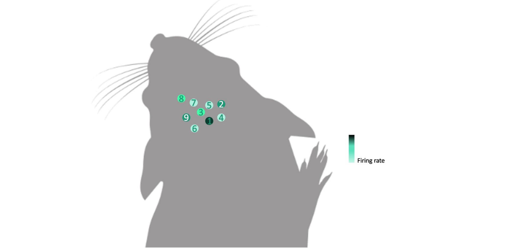
  
  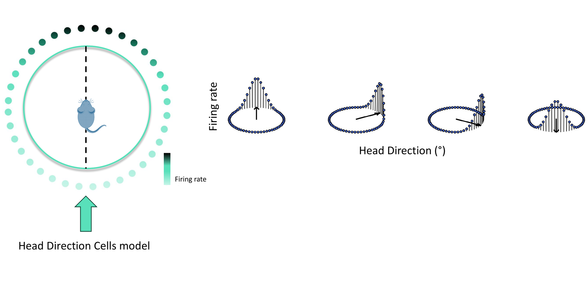
  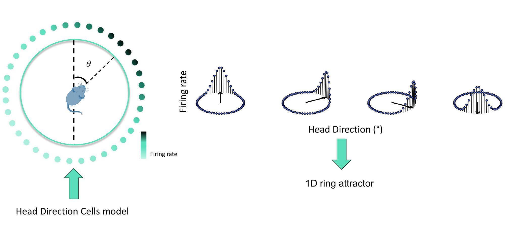
  

  Paper: A model of the neural basis of the rat's sense of direction | Skaggs, Knierim, Kudrimoti & McNaughton, *NeurIPS*, 1995
  Paper: Representation of spatial orientation by the intrinsic dynamics of the head-direction cell ensemble: a theory | Zhang, *J. Neurosci.*, 1996

Note:
- Step 1: head direction cells in the rat brain; each one fires most when the head points in its preferred direction
- Step 2: in the brain they are not ordered by preferred direction (anatomy is scrambled)
- Step 3: arrange them on a ring by preferred direction: as the animal turns, the activity bump moves around the ring. Tuning curves: firing rate vs head direction
- Step 4: this is a 1D ring attractor; bump position = heading θ
- Step 5: local excitation and global inhibition stabilise a single bump. With no input it persists (memory); angular velocity input pushes it around (path integration)
- HD cells were found in rats, bats and *Drosophila*
---

<video data-autoplay loop muted data-src="figures/intro/seelig2015_video6.mp4" style="max-height:440px; width:auto; display:block; margin:10px auto;"></video>

Paper: Neural dynamics for landmark orientation and angular path integration | Seelig & Jayaraman, *Nature*, 2015

Note:
- Head-fixed *Drosophila* walking on a ball in darkness, 2-photon GCaMP6f imaging of E-PG neurons in the ellipsoid body
- A single bump of activity travels around the ellipsoid body
- Accumulated bump position (red) follows accumulated ball rotation (blue): angular path integration without visual cues
- Playback at 2× speed

---

  
  

    Paper: Neural dynamics and architecture of the heading direction circuit in zebrafish | Petrucco et al., *Nature Neuroscience*, 2023
    <ul style="font-size:0.7em;">
      <li>Topographic heading code in the anterior hindbrain</li>
      <li>The bump rotates with directional swims</li>
      <li>Reciprocal inhibition in the IPN stabilises the ring</li>
    </ul>
  

Note:
- Figure top: r1π neurons (GABAergic, anterior hindbrain) projected on the first two rotated PCs form a ring; colour = angle on the ring. Same colours on the anatomy: a topographic map across both hemispheres
- Figure bottom: activity of ~100 neurons sorted by ring angle over 1000 s; the bright bump moves across the population, and the network phase (green) follows it
- Bump is otherwise stable for many seconds between swims
- EM: these neurons arborize in the interpeduncular nucleus (IPN), with reciprocal inhibition
- First vertebrate heading circuit whose connectivity is known
- Same architecture principles as the fly central complex

---

  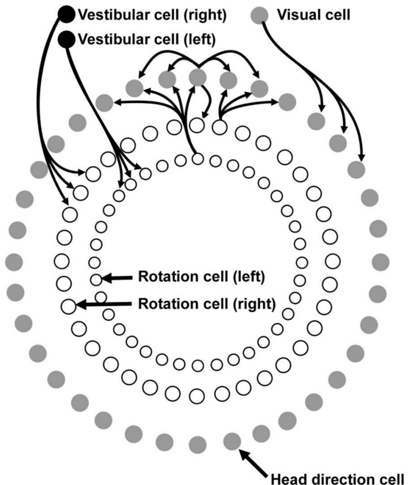
  

    <ul style="font-size:0.7em;">
      <li>Inputs: vestibular, visual, proprioceptive, auditory, olfactory…</li>
    </ul>
    <ul class="fragment" style="font-size:0.7em; margin-top:24px;">
      <li>How are these cues integrated?</li>
      <li>How does the circuit mature?</li>
    </ul>
  

Footnote: Schematic after Skaggs et al. (1995)

Note:
- Outer ring (grey): head direction cells. Inner rings: rotation cells (left/right), driven by vestibular cells, shift the bump. Visual cells anchor the ring to landmarks
- The zebrafish circuit was found in 7–9 dpf larvae; nothing is known about how it matures
- Zebrafish become opaque and too big for whole-brain imaging after ~2 weeks, so we need another animal

---

## *Danionella cerebrum*: a new animal model

  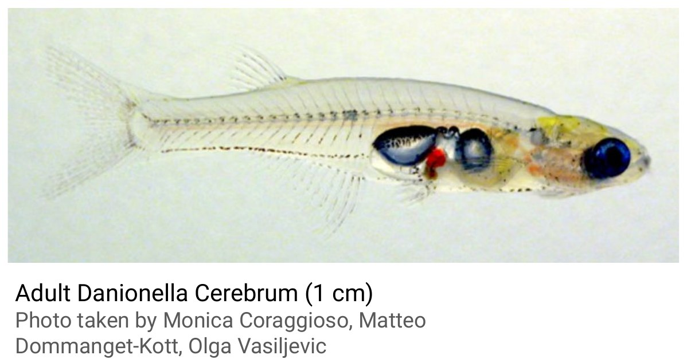
  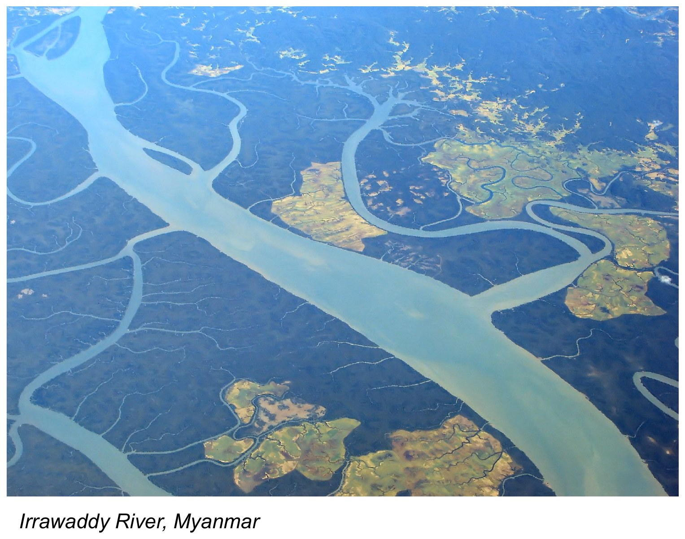

Note:
- Adult *Danionella cerebrum*, about 1 cm long
- Lives in the Irrawaddy river basin, Myanmar
- Stays small and transparent as an adult

---

  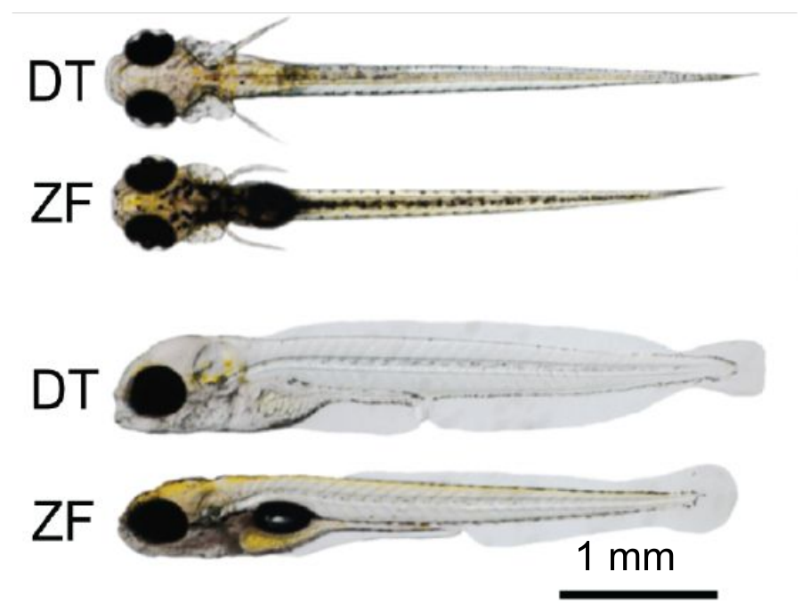
  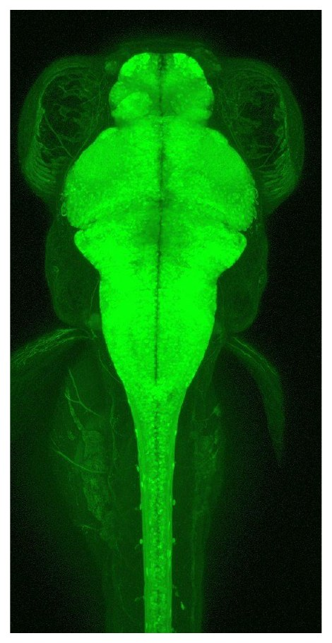
  

  <ul style="width:46%; font-size:0.62em;">
    <li>Smallest vertebrate brain</li>
    <li>Transparent, close to zebrafish</li>
    <li>Pan-neuronal GCaMP6s</li>
  </ul>
  Paper: Transparent *Danionella translucida* as a genetically tractable vertebrate brain model | Schulze et al., *Nature Methods*, 2018

Note:
- Left: *Danionella* (DT) vs zebrafish (ZF) larvae, dorsal and lateral views: zebrafish is already pigmented, *Danionella* is clear
- Middle: whole-brain GCaMP expression in *Danionella*. Right: adult zebrafish, for comparison
- (DT label: the lab strain was formerly classified as *D. translucida*)
- Manon's slide also credits the larva image to Gokul R. (2022), *Evolutionary divergence of locomotion in two related vertebrate species*: check which one is the source

---

## Light-sheet microscopy and virtual reality

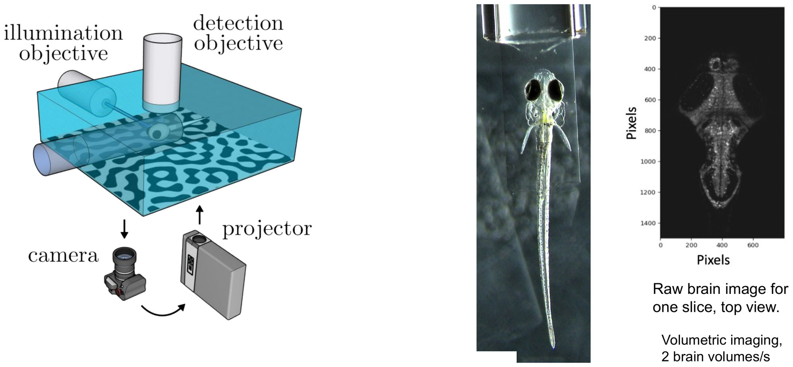

Footnote: Setup from Leonardo Demarchi's PhD: *Visuomotor control in Danionella cerebrum*

Note:
- Whole-brain light-sheet imaging, 2 brain volumes per second
- Landmark patterns are projected below the fish; tail tracked by a camera
- Middle: head embedded in agarose in a capillary, tail free. Right: raw image of one slice, top view

---

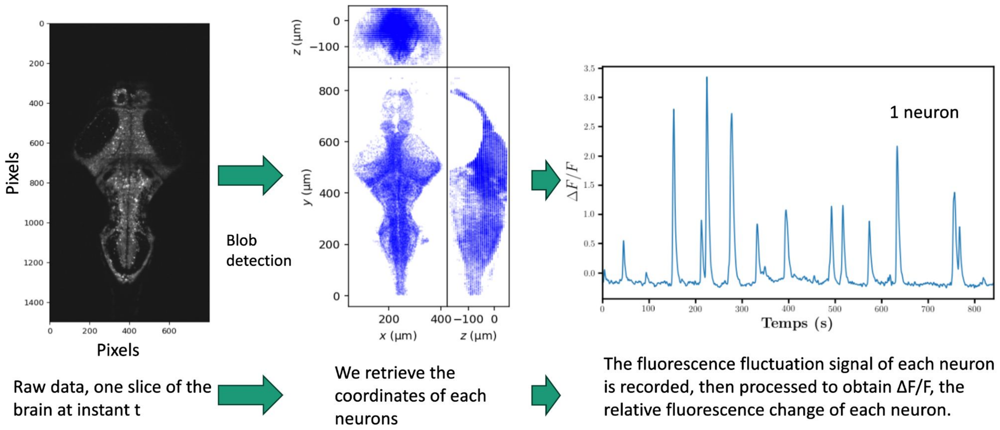

Note:
- Raw data: one slice of the brain at instant t
- Blob detection gives the coordinates of each neuron (~10⁴ per fish)
- The fluorescence of each neuron is extracted and converted to ΔF/F

---

## Screening for head direction cells

Visual landmarks anchor the HD system

Note:
- In a new environment, the HD system anchors itself to surrounding cues; vision is a major source. As you move, cues shift and act as landmarks
- Idea: instead of turning the fish, turn the world
- We project a pattern with landmarks and rotate it to simulate a rotating environment

---

## Rotate the world, not the fish

  
  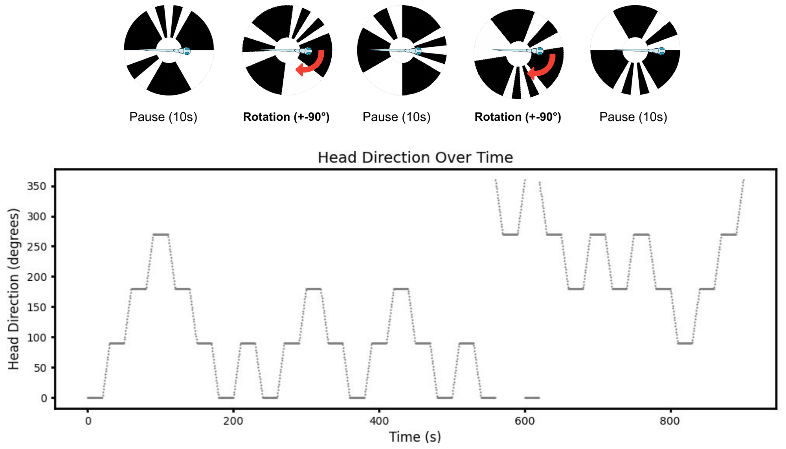
  

Open loop · ±90° rotations · 10 s pauses

Note:
- Open loop: the fish's movements do not change the projected pattern
- Fictive heading = orientation of the pattern (grey trace)
- For each angle, build a regressor: 1 when the fish "faces" that angle (black, here 90°), 0 otherwise. Correlate each neuron with each regressor

---

## Single neurons are tuned to fictive heading

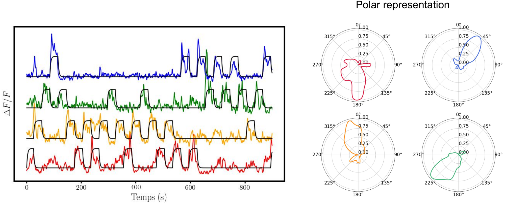

Note:
- Left: the best-correlated neuron for 0°, 90°, 180° and 270°, each with its regressor (black)
- Right: polar tuning curves of the same neurons: a single preferred direction each, like rodent HD cells
- But in open loop the eyes see the same scene: a purely visual neuron could do this too

---

## Decoding heading from the population

  

    
1. Tuning curves

    
  

  

    
2. Preferred directions

    $$\theta_{\mathrm{pref},n} = \arg \left(\sum_t r_n(t) e^{i\theta_t}\right)$$
    
why not $\arg \left( \sum_\theta \bar{r}_n(\theta) e^{i\theta}  \right)$ ?

  

Note:
- $r_n(t)$: activity (ΔF/F) of neuron $n$; $\theta_t$: imposed heading at time $t$
- The preferred direction is the circular mean of the heading, weighted by activity

---

  
3. Population vector

  $$\vec v(t) = \sum_n r_n(t)\, e^{i\theta_{\mathrm{pref},n}}$$

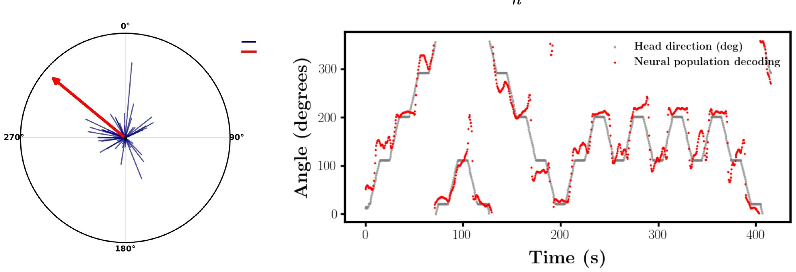

Note:
- Left: each neuron votes for its preferred direction, weighted by its current activity (blue); the sum is the population vector (red)
- Right: decoded heading (red) vs imposed heading (grey): the population tracks the fictive heading

---

## Experiment: landmark rotations, then darkness

  
  

Note:
- Protocol: alternating black/white flashes first, then ±45° rotations with 20 s pauses, then darkness (no landmarks)
- The flashes identify purely luminance-driven visual neurons, which are removed
- Training part (purple): preferred directions are estimated. Test part (blue): prediction on held-out data. Dashed green line: prediction start
- Then: what happens to the decoded heading in the dark period (grey)?

---

Note:
- y axis: mean absolute circular error on the test part. Blue: real data; orange: shuffle (mean ± s.d.)
- Chance level is ~90°; real data is ~20–40°
- Error far below shuffle in every fish (N = 6)
- Also found with simpler protocols (N = 15)

---

## What happens in the dark?

  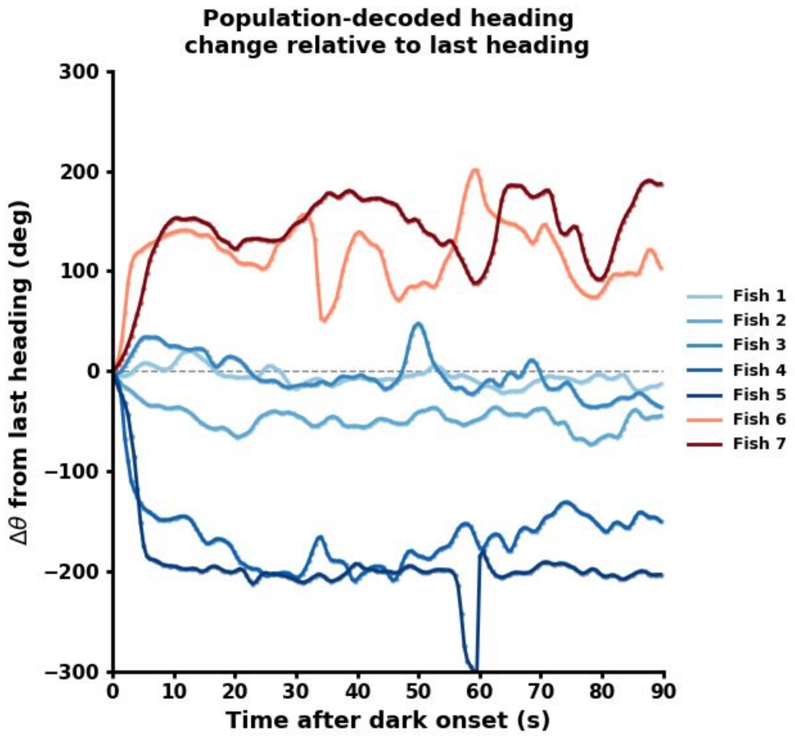
  

    <ul style="font-size:0.62em;">
      <li>Expected: bump holds the last heading, slow drift</li>
    </ul>
    <ul class="fragment" style="font-size:0.62em;">
      <li>Observed: stable, or a 180–200° jump</li>
    </ul>
    <ul class="fragment" style="font-size:0.62em;">
      <li>Jumps follow the last rotation (+90°, −90°)</li>
    </ul>
  

Note:
- y axis: decoded heading after dark onset, relative to the last imposed heading; one line per fish (N = 7)
- If these were purely visual neurons, the decoded heading would be meaningless in the dark
- Drift in the dark is also seen for rodent HD cells
- Preliminary: only 7 fish
- Reanalysis: a fixed angle in the dark is expected from any population vector when its neurons go quiet (see "A fixed angle in the dark is a decoder artifact")

---

Hypothesis: self-motion moves the bump

Note:
- Same plot over 250 s
- Long stable plateaus, separated by sudden steps

---

  
  <ul style="width:40%; font-size:0.62em;">
    <li>Active in the dark</li>
    <li>Stable heading for minutes</li>
    <li>Steps with tail movements?</li>
  </ul>

Note:
- Three fish: tail turning strength (grey) and decoded heading (colour), after dark onset
- Several steps in the decoded heading coincide with tail bouts: a hint of angular path integration
- Needs to be quantified

---

## Remapping

  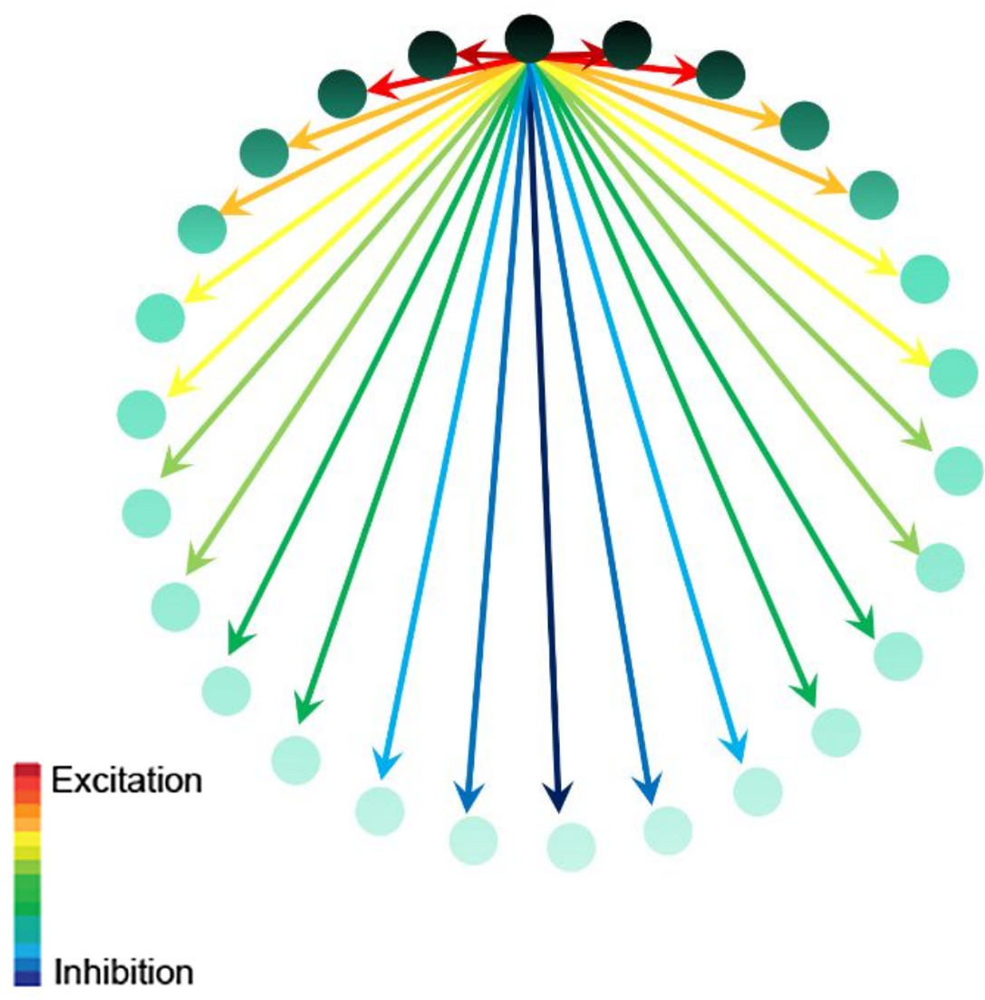
  <ul style="width:50%; font-size:0.65em;">
    <li>Same cells in a new environment?</li>
    <li>Do all preferred directions shift together?</li>
  </ul>

Note:
- In a ring attractor, a new environment rotates the whole ring: every preferred direction shifts by the same angle
- Purely visual neurons have no reason to shift together
- Angles of a pattern are arbitrary: what matters is whether the population keeps its relative organisation

---

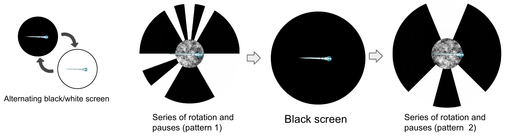

  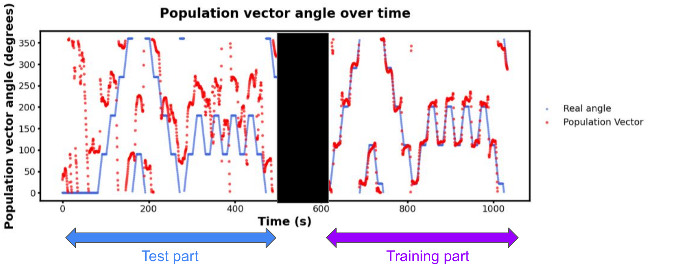
  

Note:
- Protocol: flashes, rotations with pattern 1, black screen, rotations with pattern 2
- Training on pattern 2 (right). Tested on pattern 1 (left), the decoder fails
- Shifting the test part by a single angle, −78°, realigns it (green)

---

## Do all cells shift together?

  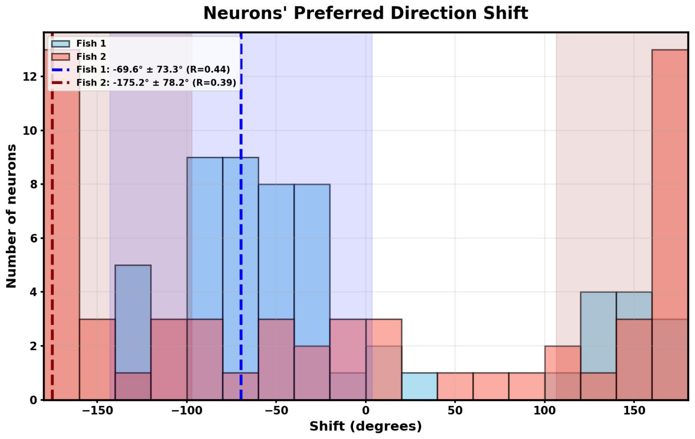
  <ul style="width:38%; font-size:0.62em;">
    <li>Expected: one common shift</li>
    <li>Fish 1: −69.6° per neuron vs −78° for the population</li>
    <li>~50 cells in both environments (N = 3)</li>
  </ul>

Note:
- Histogram of the preferred-direction shift between pattern 1 and pattern 2. Fish 1: −69.6° ± 73.3° (R = 0.44); fish 2: −175.2° ± 78.2° (R = 0.39). Fish 2's peak sits at ±180° and wraps around
- Most neurons shift by the same amount in 2 of 3 fish
- Outliers explain the large standard deviation; this criterion could be used to remove neurons that are not part of the circuit

---

## Where are these neurons?

  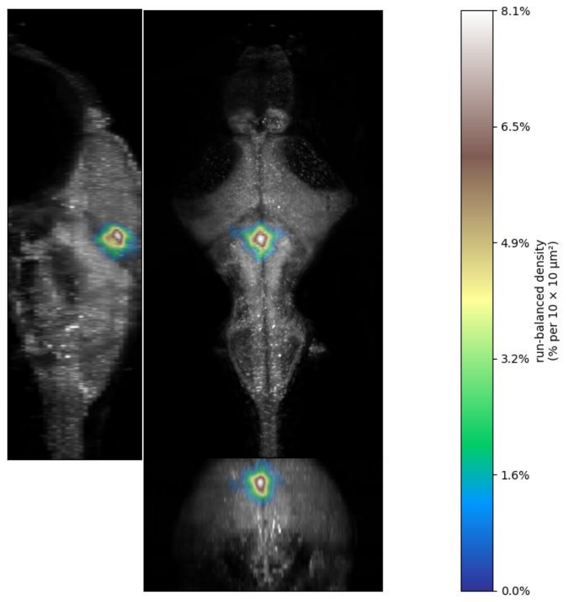
  <ul style="width:46%; font-size:0.65em;">
    <li>~50 neurons per fish, in the cerebellum (N ≈ 21)</li>
    <li>More dorsal than in zebrafish</li>
    <li class="fragment">Inhibitory or excitatory?</li>
  </ul>

Note:
- Density map of angle-correlated neurons across fish, registered to a common brain
- Zebrafish r1π neurons are GABAergic, in ventral rhombomere 1 (Petrucco 2023)
- The zebrafish HD cells are inhibitory: are ours?

---

## Excitatory or inhibitory? A gad1b line

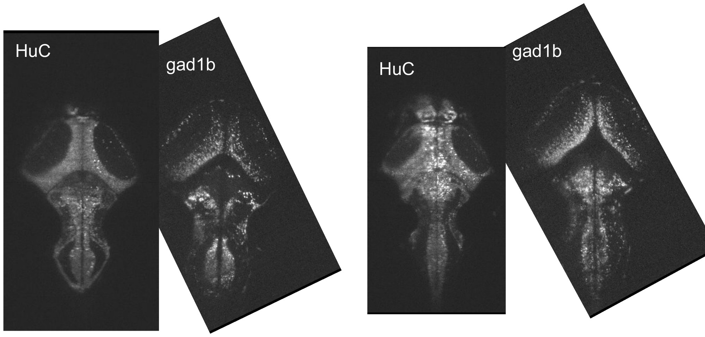

Note:
- HuC (elavl3): all neurons. gad1b: GABAergic (inhibitory) neurons, the line analogous to the one used for the zebrafish HD study
- Next: image the gad1b line with the same protocol

---

<!-- .slide: data-background-color="#000000" -->

# Reanalysis

Whole-brain spikes, cross-validated decoders, RBMs · Oct–Nov 2026

---

## Four runs, reanalysed from the spikes

| Run | Neurons | Protocol |
|---|---|---|
| 2024-06-13 run_23 | 33,716 | closed loop, flow, no landmark |
| 2024-06-13 run_24 | 33,529 | closed loop, flow, landmarks |
| 2025-05-28 run_03 | 55,760 | flashes, open-loop rotations, then dark |
| 2026-10-09 run_04 | 42,781 | flashes, open-loop rotations, 2 dark blocks with light after |
<!-- .element: style="font-size:0.5em;" -->

<ul style="font-size:0.6em;">
  <li>ΔF/F → spikes (blind sparse deconvolution)</li>
  <li>Swim bouts dominate: tail vigour correlates with 42–63% of neurons → regressed out</li>
</ul>

Note:
- Data from Manon, ΔF/F from Leonardo's pipeline; BSD as in LightsheetPreprocessing. Kernel is slow (H2B-GCaMP): rise 1.2–1.5 s, decay 3.7–5.3 s. Neurons active in ~4–6% of volumes
- Up to half the brain fires in one volume during a bout. In closed loop the heading only changes when the fish swims, so any bout neuron can look heading-tuned
- Every heading analysis uses the "controlled" activity: tail vigour, turning, global activity and flow regressed out
- run_04 is Manon's newest run, designed for the darkness question: the hidden scene keeps rotating while the screen is off (4 × 45° in block 1, 4 × 67.5° in block 2)

---

## Decoders must be cross-validated

| Median error | run_23 | run_24 | run_03 (lit) |
|---|---|---|---|
| Population vector, neurons chosen on all data | 25° | 41° | 18° |
| Population vector, cross-validated | 62° | 83° | 51° |
| Balanced population vector (Manon's selection) | 75° | **60°** | 28° |
| Bayesian, full noise covariance | 84° | 74° | **8°** |
| Chance (time-shifted heading) | ~90° | ~90° | ~90° |
<!-- .element: style="font-size:0.5em;" -->

<ul style="font-size:0.6em;">
  <li>Choosing ~50 of 10⁴ neurons on the decoded data flatters the decoder</li>
  <li>Open loop (run_03): heading read almost perfectly · closed loop: weak</li>
</ul>

Note:
- 5 contiguous folds: each block decoded with neurons, preferred angles and settings fitted on the other four only. Chance: score against the heading shifted in time (200 shifts)
- First row = my first estimate, same trap as Manon's notebook: neurons picked, tuned and decoded on the same volumes
- Balanced PV (Manon's idea, kept): 2-harmonic tuning, same number of neurons per 45° sector → even coverage. Cuts run_03 from 51° to 28°, makes run_24 significant (p = 0.005)
- Bayesian: tuning curves of 300 neurons + full noise covariance, so shared fluctuations are not read as heading
- Closed loop: the fish holds a few headings for minutes, so each test block holds headings barely seen in training. These runs cannot separate decoders
- Also: Manon's shuffle test averages tuning with the unshifted heading, so all shuffles are identical and the test cannot reject anything

---

## Heading, or what the fish sees?

| run_03, Bayesian decoder | Median error |
|---|---|
| Scene still between rotations | 4° |
| Scene rotating | 10° |
| Plain white / black flashes | 84° |
| Dark | 99° |
<!-- .element: style="font-size:0.55em;" -->

<ul style="font-size:0.6em;">
  <li>Information only while the textured scene is on screen</li>
  <li>Heading = scene orientation in these protocols</li>
</ul>

Note:
- Open loop: the program rotates the scene; between rotations it sits at one of four orientations. Telling four images apart is easy for a visual system
- A neuron tuned to "the bright sector is on my left" is indistinguishable from a heading neuron while the scene is visible. Only flashes and darkness separate the two
- The 300 neurons used lie in the rostral half; one dense cluster at the lateral edge (x ≈ 440, y ≈ 350 µm) all prefers ~120°: visual neurons, or projector light leaking at the tissue edge? To check on the raw images

---

## Tuning has the symmetry of the landmark image

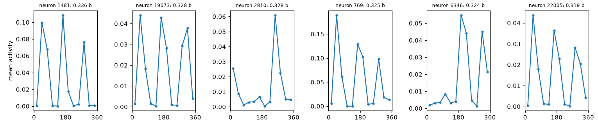

| Run | Landmark image | Neurons' dominant harmonic |
|---|---|---|
| run_24 | 3 openings, 120° apart | 3rd (72%) |
| run_03 | 2 opposite sectors | 2nd (55%) |
<!-- .element: style="font-size:0.5em;" -->

Note:
- Top: tuning curves (mean activity vs heading, 0–360°) of the 6 most informative neurons in run_24, by mutual information
- MI per neuron: 4 activity levels × 12 angle bins, bias-corrected with 200 time-shifted angles, gamma-fitted null, Benjamini–Hochberg 5%. Informative neurons: 1.9% (run_23), 0.4% (run_24), 2.0% (run_03), 14% (run_04); best 0.2–0.6 bits
- A heading cell has one preferred direction. These fire once per bright opening of the image: visual
- run_04 (same image, 7× larger, over a noise texture, only partly visible): 1st harmonic dominates (48%)

---

## The dark, with light afterwards (run_04)

<ul style="font-size:0.55em;">
  <li>Dark: decoder sits near 0°: not the last angle, not the hidden rotation, not the tail turns</li>
  <li>Light back: 20–60 s to lock on again</li>
</ul>

Note:
- Black: scene orientation, which keeps turning while hidden. Red: Bayesian decoder (smooth-heading prior). Blue: balanced PV. Green: cumulative tail turning. Grey: dark
- Each dark block is left out with 120 s of light on each side; decoders trained on the remaining lit volumes only
- Light, before: 9° / 5°. Dark vs last angle seen: 6° (block 1, by chance) / 174° (block 2). Dark vs hidden rotation: 94° / 62°
- Changes of the decoded angle vs fish turning (2.5 s bins): r = −0.22, p = 0.27
- Slow return is long for a purely visual response: adaptation to the dark? The balanced PV, which has no prior, is slow too

---

## A fixed angle in the dark is a decoder artifact

  $$\vec v(t) = \sum_n r_n(t)\, e^{i\theta_{\mathrm{pref},n}}$$

<ul style="font-size:0.6em;">
  <li>Uneven preferred directions: $\sum_n e^{i\theta_{\mathrm{pref},n}}$ points to 36° (resultant 0.29)</li>
  <li>In the dark all selected neurons get quieter (z: +0.06 → −0.18)</li>
  <li>A shared drop alone points to −144° · decoded: −133°</li>
</ul>

A stable angle in the dark is not evidence of memory

Note:
- run_03, 772–1032 s: last lit heading 90°, nothing rotates afterwards. Every decoder trained on the lit part lands between −108° and −150°, roughly opposite
- The shared part of the dark-block vector is 1.5× larger than everything else
- The Bayesian decoder models shared fluctuations and still lands at −130 to −150°, fully confident: its tuning curves are visual responses, read in neurons that have lost their input
- Manon's notebook shows the same drop of her selected neurons in the dark: the plateaus on the "What happens in the dark?" slides are likely this artifact

---

## RBM hidden units in the dark (run_04)

  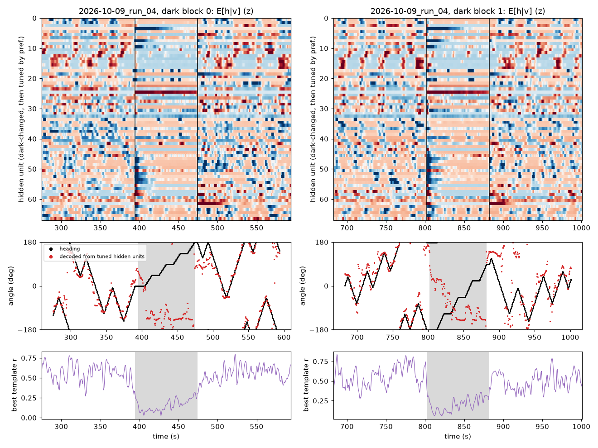
  <ul style="width:36%; font-size:0.55em;">
    <li>RBM, 100 hidden units, fits well (L4 = 0.26)</li>
    <li>43 units carry the angle</li>
    <li>Dark: 45 units change level, same in both blocks</li>
    <li>Tuned units match no lit heading: r 0.55 → 0.1–0.25</li>
  </ul>

Note:
- Babel recipe: binary neurons, 100 hidden units, L1 0.02, 200k updates. run_04 fits better than any model so far, Babel included (Babel spontaneous 04-15 Run01: 0.68). run_24: 0.89, run_03: 0.98, run_23 blew up
- Top: z-scored E[h|v]; above the dashed line, the 45 units that change in the dark (19 up, 26 down); below, angle-tuned units sorted by preferred angle
- Middle: angle read from tuned units by template matching (templates per 30° from lit volumes, dark ± 130 s left out). Bottom: correlation with the best template
- In the dark the network enters one fixed state that is no heading; recovery after light-on takes 20–60 s, like the decoders

---

## Light-off neurons, next to the angle neurons

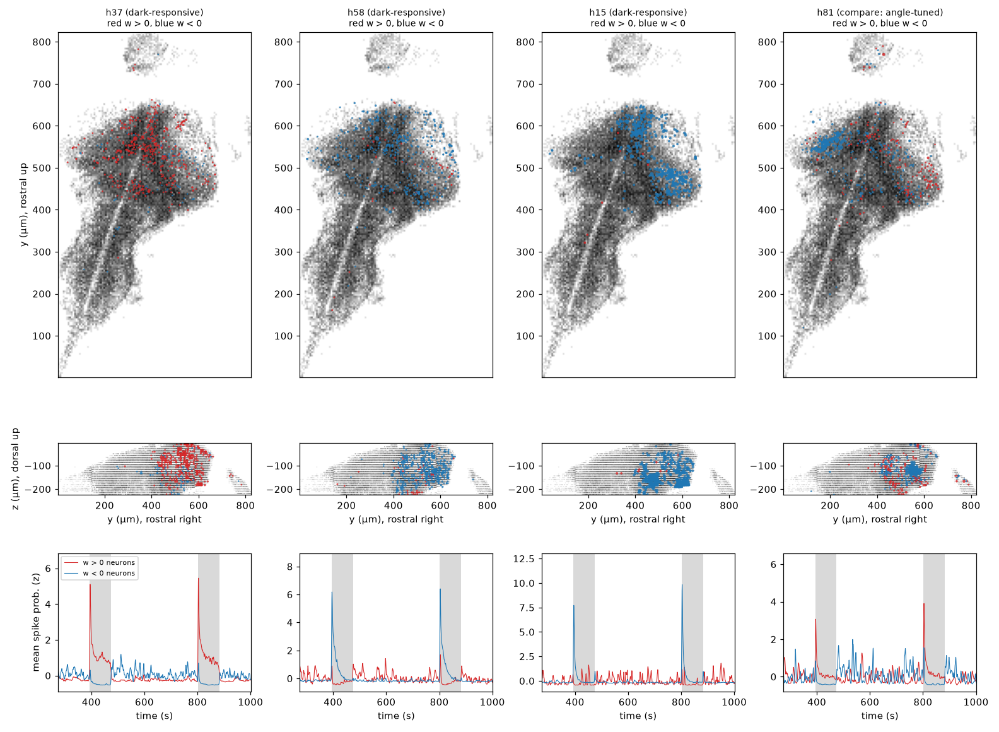

Note:
- Top: dorsal view (rostral up), 500 strongest-weight neurons of each unit (red w > 0, blue w < 0). Middle: side view. Bottom: their mean activity; grey = dark
- Unit 37: burst at light-off, then sustained firing for the whole block. Units 58 and 15: burst only, back to baseline in 10–40 s
- Light-off neurons (> 3 SD in the first 10 s of dark): 28% of rostral neurons; 67%, 80%, 97% of units 37, 58, 15's top neurons, vs 14% for angle-tuned unit 81
- All draw on the large paired rostral structure where the angle neurons are; each pair of units shares ≤ 36 of 500 top neurons
- Not registered to an atlas: which area, and whether one-sided, needs Manon's anatomy

---

## Summary and next steps

  

    <h3>So far</h3>
    <ul style="font-size:0.6em;">
      <li>Angle read from the brain: 4–10° in open loop, while the scene is visible</li>
      <li>Tuning follows the landmark image's symmetry: visual</li>
      <li>Dark: no memory, no hidden rotation, no integration of turns</li>
      <li>No ring in state space; light-off neurons nearby</li>
    </ul>
  

  

  

    <h3>Next</h3>
    <ul style="font-size:0.6em;">
      <li>Dark test on Manon's other dark runs (6 runs)</li>
      <li>Closed loop with a dark block: turns change the heading</li>
      <li>Rotate the landmark relative to the texture</li>
      <li>Register to a reference brain; development from 7 dpf</li>
    </ul>
  

Note:
- Manon's earlier summary (heading-tuned neurons in the cerebellum, heading held in the dark for minutes, coherent remapping) is revised by the reanalysis: the held angle in the dark is a population-vector artifact, and the tuned neurons look visual
- A head-direction network could still be too small or too weak to show in these analyses; the strongest test is a closed-loop run with a dark block
- Other dark runs: 2025-03-19 run_03, 2025-04-08 run_02, 2025-04-15 run_02, 2025-04-17 run_01, 2024-11-21 run_06, 2026-04-16 run_01
- Also: check the run_03 edge cluster on raw images (projector light?), why recovery after the dark takes 20–60 s, retry the run_23 RBM with parallel tempering
- Long-term question from Manon's project: when does the ring appear during development, and when do visual and self-motion inputs become aligned?

---

<!-- .slide: data-background-color="#000000" -->

# Supplementary

---

## Continuous rotation: a ring in state space

  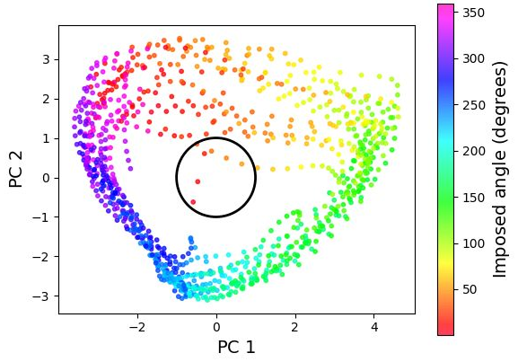
  

    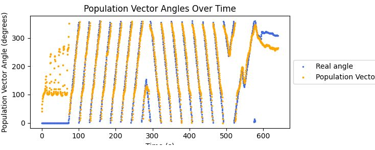
    <ul style="font-size:0.65em;">
      <li>Continuous rotation, open loop (N = 2)</li>
      <li>First two PCs trace a ring</li>
    </ul>
  

Note:
- From Manon's second-year TAC
- Same signature as the zebrafish r1π network (Petrucco 2023, Fig. 1): a 1D circular manifold

---

## gad1b line: first recordings

  
  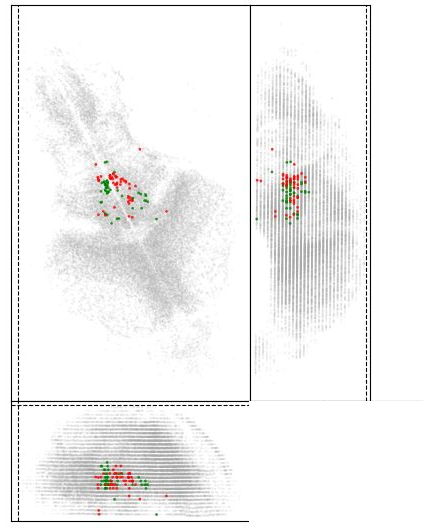

<ul style="font-size:0.65em;">
  <li>Strong ventral activity</li>
  <li>Left/right rotation neurons found</li>
  <li>No angle-correlated neurons yet (N = 2)</li>
</ul>

Note:
- From Manon's second-year TAC
- Right: neurons correlated with leftward (red) and rightward (green) rotations of the pattern

---

## Closed loop: getting the fish to steer

  <figure style="margin:0;">
    
    <figcaption style="font-size:0.45em; margin-top:6px;">Follows the target</figcaption>
  </figure>
  <figure style="margin:0;">
    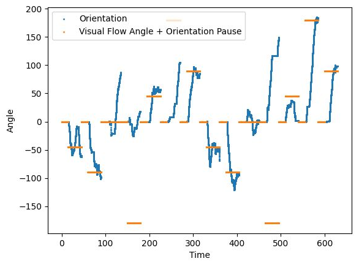
    <figcaption style="font-size:0.45em; margin-top:6px;">Short bursts</figcaption>
  </figure>

<ul style="font-size:0.65em;">
  <li>3 of 39 larvae follow the visual flow</li>
  <li>Suspect: lateral IR light. Next: behaviour-only rig</li>
</ul>

Note:
- From Manon's second-year TAC
- Blue: fish orientation in VR; orange: target orientation set by the visual flow
- ~50% of larvae swim continuously, but only 3/39 align with the visual flow

---

## No ring found without using the heading

  
  <ul style="width:32%; font-size:0.6em;">
    <li>PCA of the whole brain and of 41–48 tiles</li>
    <li>Does the phase of any PC pair follow the heading?</li>
    <li>Only run_23 passes (p = 0.005), and it is a blob with a slow trend, not a ring</li>
  </ul>

Note:
- Test from Petrucco et al. (2023): in a heading network two PCs trace a circle whose phase follows the heading. It does not use the heading to pick neurons, so it avoids the selection problem
- Controlled activity, clipped at ±3 SD; every pair of the first 6 PCs; free offset and direction; p-value corrected for the whole search
- run_24 p = 0.85, run_03 p = 0.80
- A heading network could still be too small to dominate the PCs of its tile
