# Exploring the head direction circuit in *Danionella cerebrum*

Manon's project overview, and a reanalysis (Nov 2026)

---

## To walk home, an ant must track its heading

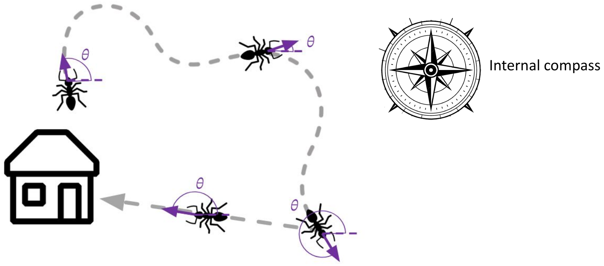

Note:
- The desert ant forages on a winding path, then walks straight back to the nest
- It sums its heading and distance at every step: path integration
- This needs an internal compass, a heading signal kept by the brain itself

---

## How does a brain keep an internal sense of direction, even in the dark?

Note:
- Ask aloud: how does a brain keep a sense of direction with no landmark in view?
- The rest of the first part: what is known in rodents, flies and zebrafish, then Manon's work in *Danionella*

---

## Some cells code position, others heading

  <figure style="margin:0; width:400px;">
    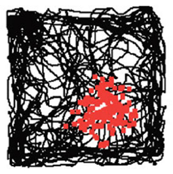
    Paper: The hippocampus as a spatial map. Preliminary evidence from unit activity in the freely-moving rat | O'Keefe & Dostrovsky, *Brain Research*, 1971
  </figure>
  <figure style="margin:0; width:400px;">
    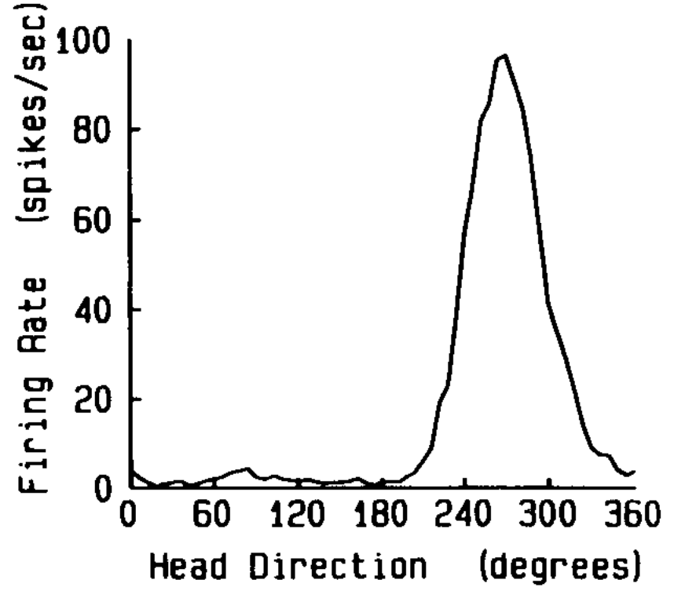
    Paper: Head-direction cells recorded from the postsubiculum in freely moving rats. | Taube, Muller & Ranck, *J. Neurosci.*, 1990
  </figure>

Note:
- Left: rat's path in a square arena (black); spikes of one CA1 cell (red) cluster in one place
- Right: one postsubiculum cell fires ~100 Hz near 270°, and is silent elsewhere
- It fires for that heading wherever the rat is, and keeps doing so in darkness

---

## Sorted by preferred direction, they form a ring

  
  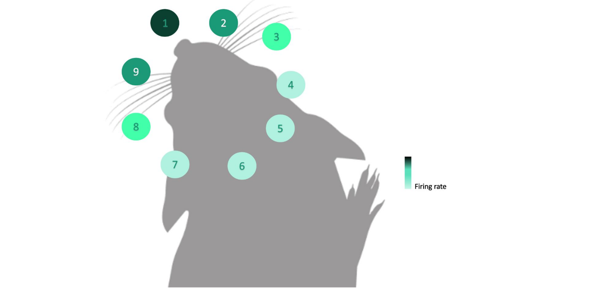
  
  
  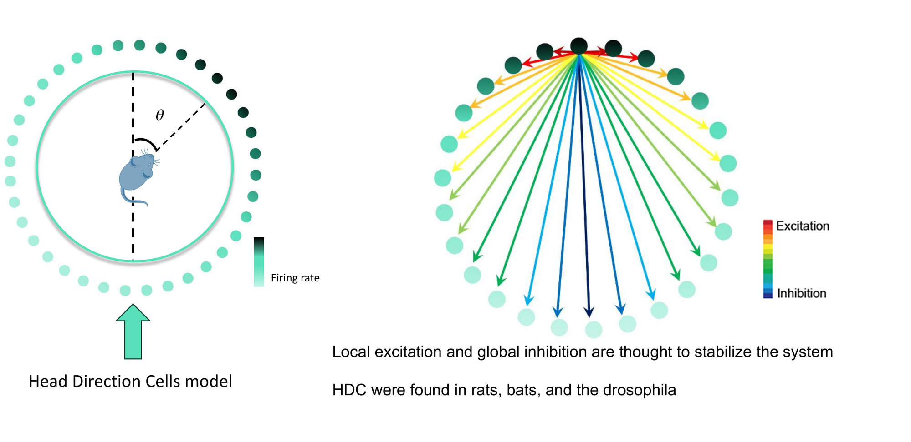

  Paper: A model of the neural basis of the rat's sense of direction | Skaggs, Knierim, Kudrimoti & McNaughton, *NeurIPS*, 1995
  Paper: Representation of spatial orientation by the intrinsic dynamics of the head-direction cell ensemble: a theory | Zhang, *J. Neurosci.*, 1996

Note:
- Each cell fires most at its **preferred direction**; in the brain the cells are not ordered by it
- Placed on a ring by preferred direction, activity is one bump that moves as the animal turns
- Local excitation and global inhibition hold the bump: it stays put with no input (memory) and moves with angular velocity input (path integration)
- Found in rats, bats and *Drosophila*

---

## In flies, one activity bump turns with the animal

<video data-autoplay loop muted data-src="figures/intro/seelig2015_video6.mp4" style="max-height:440px; width:auto; display:block; margin:10px auto;"></video>

Paper: Neural dynamics for landmark orientation and angular path integration | Seelig & Jayaraman, *Nature*, 2015

Note:
- Head-fixed fly walking on a ball in darkness; calcium imaging of E-PG neurons in the ellipsoid body
- Point at the bump going round the ellipsoid body
- Bump position (red) follows ball rotation (blue) with no visual cue; movie at 2× speed

---

## Zebrafish larvae have a heading ring too

  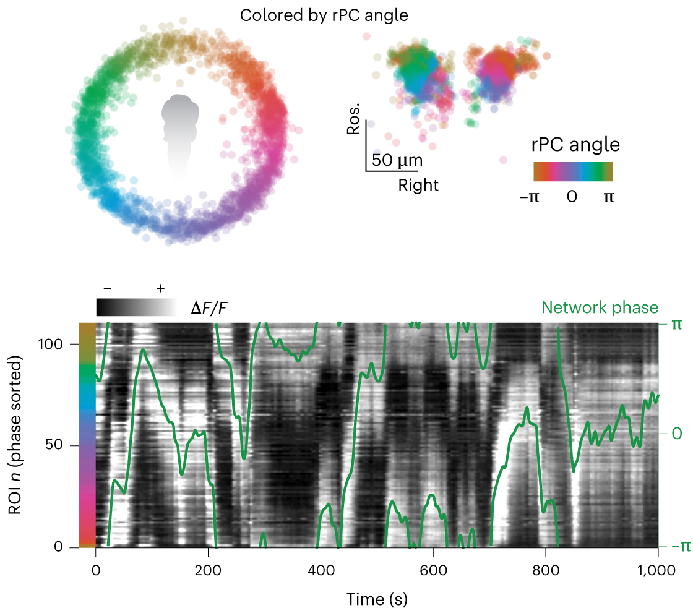
  

- Map of heading across both sides of the anterior hindbrain
- The bump turns with directional swims
- Mutual inhibition holds the ring

Paper: Neural dynamics and architecture of the heading direction circuit in zebrafish | Petrucco et al., *Nature Neuroscience*, 2023

  

Note:
- Top: GABAergic r1π neurons on the first two principal components form a ring; the same colours on the anatomy give a map
- Bottom: ~100 neurons sorted by ring angle over 1000 s; the bump moves, network phase (green) follows
- Electron microscopy: they project to the interpeduncular nucleus and inhibit each other
- First vertebrate heading circuit with known wiring; same principles as the fly

---

## Turns move the bump, landmarks anchor it

  
  

- Also auditory, olfactory and proprioceptive inputs

<ul class="fragment" style="margin-top:24px;">
  <li>How are these cues combined?</li>
  <li>How does the circuit mature?</li>
</ul>

  

Footnote: Schematic after Skaggs et al. (1995)

Note:
- Outer ring: head direction cells. Inner rings: rotation cells, driven by vestibular cells, shift the bump. Visual cells tie it to landmarks
- The zebrafish circuit was found at 7–9 days post-fertilisation; nothing is known about how it matures
- After ~2 weeks zebrafish are too opaque and too big for whole-brain imaging: we need another animal

---

## Adult *Danionella* stay small and transparent

  
  

Note:
- Adult *Danionella cerebrum*, about 1 cm long
- From the Irrawaddy river basin, Myanmar

---

## It has the smallest known vertebrate brain

  
  
  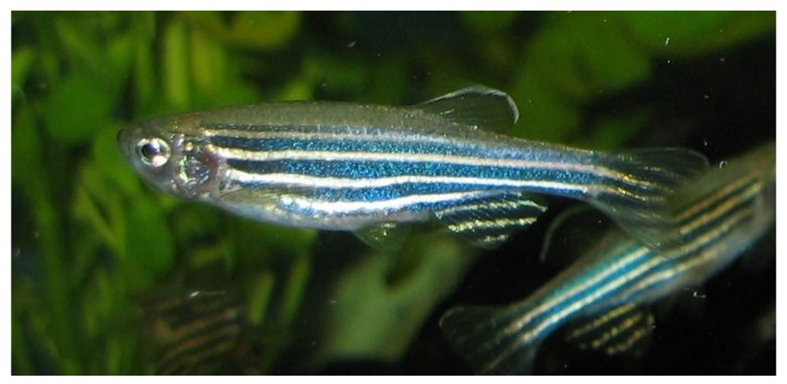

- Larva stays clear; zebrafish is already pigmented
- Calcium indicator GCaMP6s in all neurons

Paper: Transparent *Danionella translucida* as a genetically tractable vertebrate brain model | Schulze et al., *Nature Methods*, 2018

Note:
- Left: *Danionella* (DT) and zebrafish (ZF) larvae, top and side views
- Middle: GCaMP across the whole *Danionella* brain. Right: adult zebrafish for comparison
- DT: the lab strain was formerly classified as *D. translucida*

---

## We image the whole brain twice per second

Footnote: Setup from Leonardo Demarchi's PhD: *Visuomotor control in Danionella cerebrum*

Note:
- Light-sheet imaging of the whole brain
- A pattern is projected below the fish; a camera tracks the tail
- Head held in agarose in a capillary, tail free; right: one raw slice, top view

---

## We extract the activity of every neuron

Note:
- Raw data: one slice of the brain at time t
- Blob detection finds each neuron (~10⁴ per fish)
- Each neuron's fluorescence is converted to ΔF/F, its relative change

---

## Turning the scene mimics a turn of the head

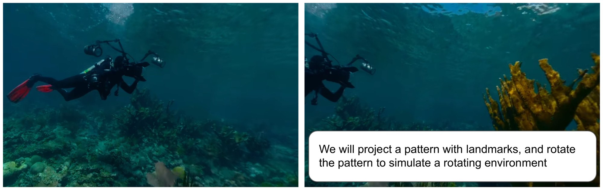

**Fictive heading**: the angle of the projected scene

Note:
- In a new place the heading system anchors to what it sees: when a diver turns, the landmarks shift
- The fish is fixed, so we turn the world instead: a projected pattern with landmarks

---

## The scene turns by ±90° and pauses for 10 s

  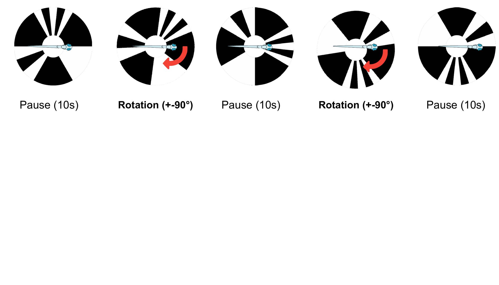
  
  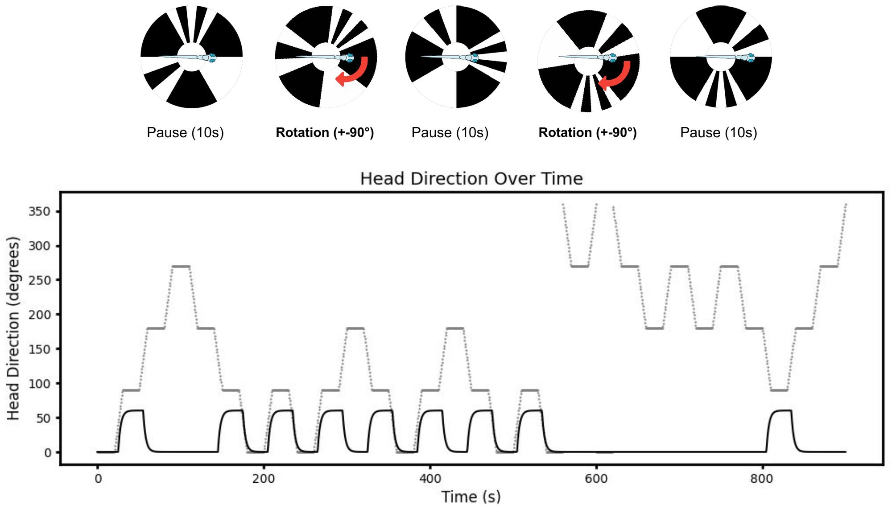

**Open loop**: the fish's swims do not move the scene

Note:
- Grey trace: fictive heading over time
- For each angle, a regressor is 1 when the scene sits at that angle (black, here 90°), 0 otherwise
- Each neuron is correlated with each regressor

---

## Single neurons fire most at one fictive heading

Note:
- Left: best-correlated neuron for 0°, 90°, 180° and 270°, with its regressor (black)
- Right: their polar tuning curves, one preferred direction each, like rodent cells
- But the eyes see the same image at each angle: a visual neuron would do this too

---

## A neuron's preferred direction is a mean heading

  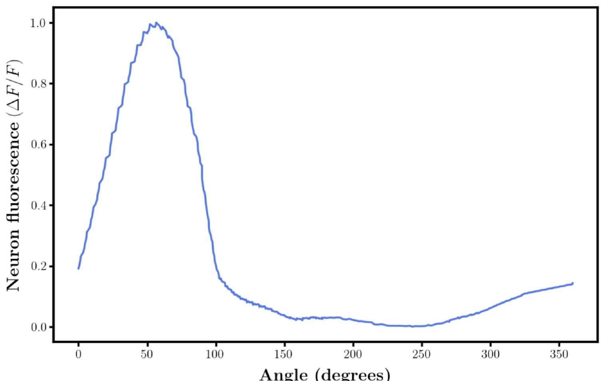
  

$$\varphi_n = \arg \sum_t r_n(t)\ e^{i\theta(t)}$$

- $\varphi_n$: preferred direction of neuron $n$
- $r_n(t)$: its activity at time $t$
- $\theta(t)$: fictive heading

  

Note:
- Left: one tuning curve, mean activity against heading
- Each time point votes for its heading, weighted by how active the neuron is
- Open point: headings the scene sits at longer weigh more; the tuning curve, $\arg \sum_\theta \bar r_n(\theta) e^{i\theta}$, would weigh every angle equally

---

## The population vector recovers the heading

$$\vec v(t) = \sum_n r_n(t)\ e^{i\varphi_n}$$

Note:
- $\vec v(t)$: the **population vector**; its angle is the decoded heading. $\varphi_n$, the preferred direction
- Left: each neuron votes for its preferred direction, weighted by its activity (blue); the sum is red
- Right: decoded heading (red) follows the fictive heading (grey)

---

## The decoder predicts heading on held-out data

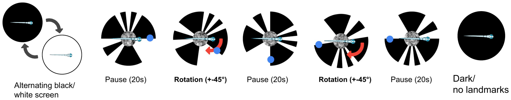

  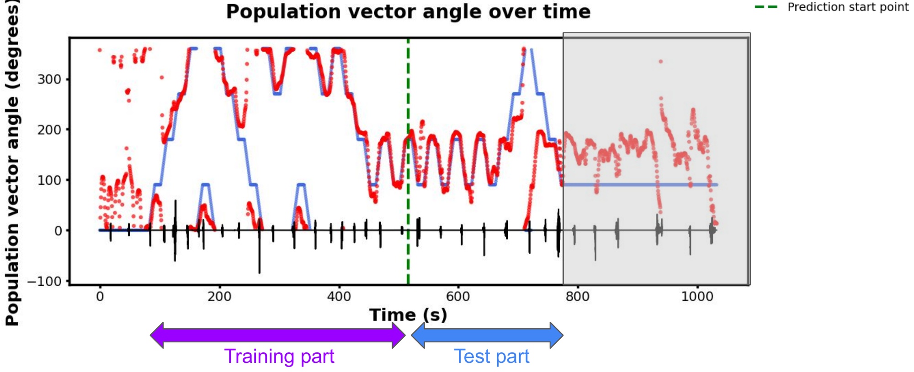
  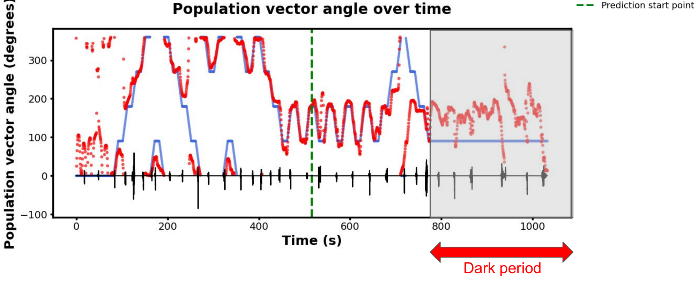

Note:
- Protocol: black/white flashes, ±45° rotations with 20 s pauses, then darkness
- Flashes find neurons driven by light level alone; they are removed
- Purple: preferred directions fitted. Blue: tested on held-out data, from the green line
- Keep the dark part (grey) for later

---

## In all six fish, the error is far below chance

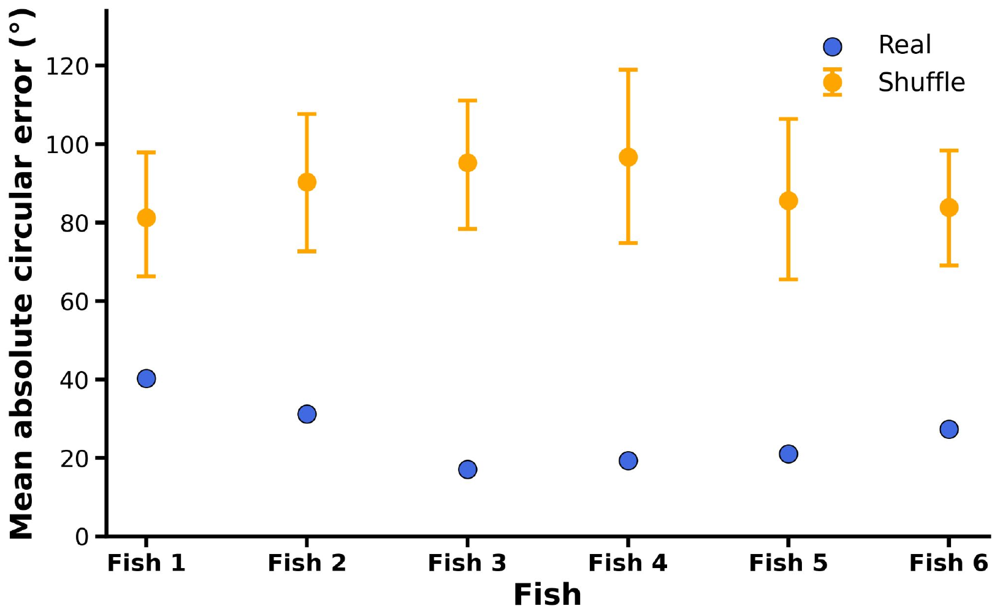

Note:
- Mean absolute circular error on the test part. Blue: data; orange: shuffle (mean ± s.d.)
- Chance ~90°, data 20–40°
- Also found with simpler protocols (N = 15)

--

## Under continuous rotation, activity traces a ring

  
  

    

- Continuous rotation, open loop (N = 2)

  

Note:
- Only if asked. From Manon's second-year TAC
- Same signature as the zebrafish r1π network (Petrucco 2023, Fig. 1): a circle in activity space

---

## In the dark, the heading holds or jumps by 180°

  
  

- Expected: slow drift from the last heading

<ul class="fragment">
  <li>Jumps follow the last rotation (+90°, −90°)</li>
</ul>

  

Note:
- Decoded heading after dark onset, relative to the last heading seen; one line per fish (N = 7)
- Stable, or a 180–200° jump. Visual neurons alone would give a meaningless angle here
- Rodent head direction cells also drift in the dark. Come back to this in the reanalysis

---

## Over 250 s, plateaus alternate with sudden steps

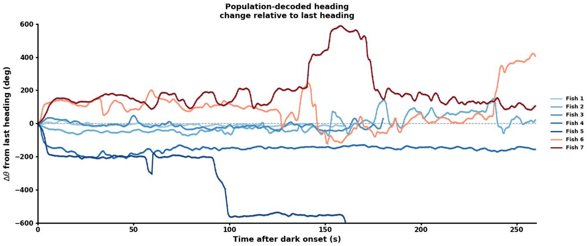

Note:
- Same fish over 250 s
- Hypothesis: the fish's own turns move the bump

---

## Some steps coincide with tail bouts

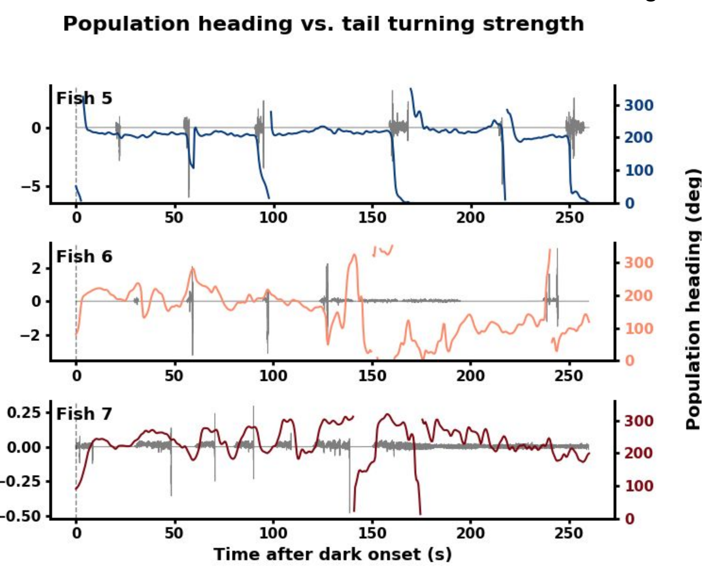

Note:
- Three fish after dark onset: tail turning strength (grey), decoded heading (colour)
- Several steps line up with tail bouts: a hint of path integration
- Not quantified yet

---

## A new scene should shift all preferred directions

  
  

- Visual neurons have no reason to shift together

  

Note:
- In a ring attractor, a new environment rotates the whole ring: every preferred direction shifts by the same angle
- The angles of a pattern are arbitrary; what matters is whether the population keeps its order

---

## One −78° shift realigns the decoder

  
  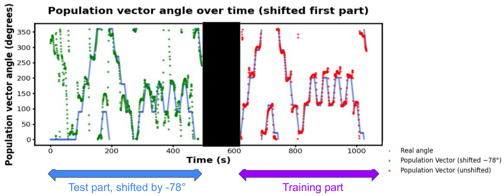

Note:
- Flashes, rotations with pattern 1, black screen, rotations with pattern 2
- Trained on pattern 2 (right); tested on pattern 1 (left) the decoder fails
- Shifting the decoded angle by −78° realigns it (green)

---

## In two of three fish, most neurons shift alike

  
  

- Fish 1: −69.6° per neuron, −78° for the population
- ~50 cells in both scenes (N = 3)

  

Note:
- Histogram of each neuron's shift in preferred direction between the two patterns
- Fish 1: −69.6° ± 73.3°; fish 2: −175.2° ± 78.2°, its peak at ±180° wraps around
- Outliers make the spread large; this could be used to remove neurons outside the circuit

---

## Tuned neurons cluster in the cerebellum

  
  

- ~50 per fish (N ≈ 21)
- More dorsal than in zebrafish

<ul class="fragment">
  <li>Inhibitory or excitatory?</li>
</ul>

  

Note:
- Density of angle-correlated neurons across fish, registered to a common brain
- Zebrafish r1π neurons are GABAergic, in ventral rhombomere 1 (Petrucco 2023): are ours inhibitory too?

---

## A gad1b line will show if they are inhibitory

Note:
- HuC: all neurons. gad1b: inhibitory (GABAergic) neurons, the line used in the zebrafish study
- Next: image the gad1b line with the same protocol

--

## gad1b recordings show no angle neurons yet

  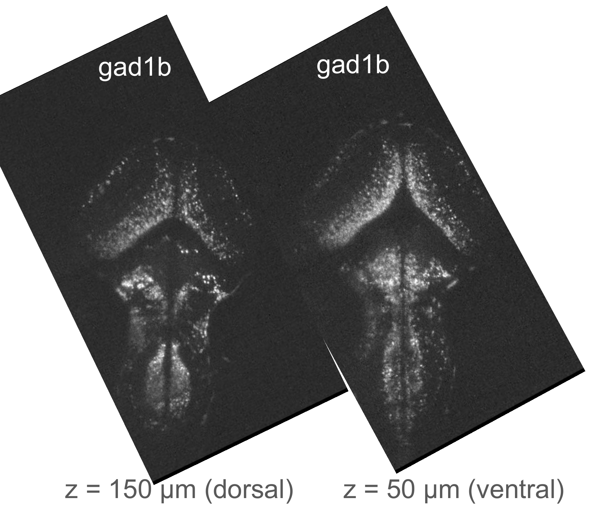
  

- Strong ventral activity; left and right rotation neurons found (N = 2)

Note:
- Only if asked. From Manon's second-year TAC
- Right: neurons correlated with leftward (red) and rightward (green) rotations of the pattern

---

<!-- .slide: data-background-color="#000000" -->

# Reanalysis

Whole-brain spikes, cross-validated decoders, RBMs · Oct–Nov 2026

---

## Do these recordings show a head direction network?

*Manon's results*

1. Single neurons are tuned to the fictive heading
2. The decoded heading is held in the dark for minutes
3. In a new environment, all tuned cells shift together

Re-tested here: 1 and 2. Remapping: not yet.

Note:
- Same data as Manon's slides plus her newest recording (Oct 2026), reanalysed Oct–Nov 2026
- A head direction network should be tuned to heading itself, not to the image, and hold its heading in the dark
- Short answer, given at the end: neither holds up yet

---

## We infer spikes and remove swim activity

- **Deconvolution**: we infer when each neuron spikes from its slow calcium signal
- During a swim bout up to half the brain fires at once
- So we first remove the activity explained by the tail, turning and the global level

Footnote: Four recordings, 33,000 to 56,000 neurons each

Note:
- Slow indicator: rise 1.2–1.5 s, decay 3.7–5.3 s; neurons active in ~4–6% of volumes
- Tail vigour correlates with 42–63% of neurons
- In closed loop heading only changes when the fish swims, so any swim neuron can look heading-tuned
- Every heading analysis below uses this cleaned activity

--

## The four recordings reanalysed

| Recording | Neurons | What the fish saw |
|---|---|---|
| 2024-06-13 run_23 | 33,716 | closed loop, no landmark |
| 2024-06-13 run_24 | 33,529 | closed loop, landmarks |
| 2025-05-28 run_03 | 55,760 | open loop, dark |
| 2026-10-09 run_04 | 42,781 | open loop, 2 dark blocks |

Note:
- Only if asked. All four have visual flow; run_03 and run_04 start with flashes
- run_04 is Manon's newest run, designed for the darkness question: the hidden scene keeps rotating while the screen is off
- ΔF/F from Leonardo's pipeline; blind sparse deconvolution as in LightsheetPreprocessing
- Regressed out: tail vigour, turning, global activity and flow

---

## Selecting on test data flatters the decoder

| Population vector, open loop | Median error |
|---|---|
| Neurons chosen on all the data | 18° |
| Neurons chosen on training data only | 51° |
| Chance | ~90° |

**Cross-validation**: we choose and fit on one part of the recording and test on another.

Note:
- Choosing ~50 of 10⁴ neurons on the decoded data flatters the decoder; my first estimate fell in the same trap as Manon's notebook
- 5 contiguous folds: each block decoded with neurons and preferred directions fitted on the other four
- Chance: score against the heading shifted in time (200 shifts)
- Manon's shuffle test averages tuning with the unshifted heading, so every shuffle is identical and the test cannot reject anything

---

## Heading decodes well in open loop only

| Recording | Best decoder, median error |
|---|---|
| Open loop: the program turns the scene | 8° |
| Closed loop, no landmark | 62° |
| Closed loop, landmarks | 60° |

Chance is about 90°.

Note:
- Open loop, 8°: a Bayesian decoder, tuning curves of 300 neurons plus their noise covariance, so shared fluctuations are not read as heading
- Closed loop: the fish holds a few headings for minutes, so each test block holds headings barely seen in training
- From here on, the open-loop recording is our main example

--

## Decoder errors in the three lit recordings

| Median error | No landmark | Landmarks | Open loop |
|---|---|---|---|
| Population vector, chosen on all data | 25° | 41° | 18° |
| Population vector, cross-validated | 62° | 83° | 51° |
| Balanced population vector | 75° | 60° | 28° |
| Bayesian, noise covariance | 84° | 74° | 8° |

Note:
- Only if asked. No landmark = run_23, landmarks = run_24 (closed loop), open loop = run_03; chance ~90° everywhere
- Balanced population vector (Manon's idea): 2-harmonic tuning, same number of neurons per 45° sector. Makes run_24 significant (p = 0.005)
- These closed-loop runs cannot tell decoders apart

---

## Heading is read only while the scene is on

| Open-loop recording | Median error |
|---|---|
| Scene still, between rotations | 4° |
| Scene rotating | 10° |
| Plain white or black flashes | 84° |
| Dark | 99° |

Note:
- Between rotations the scene sits at one of four angles; telling four images apart is easy for a visual system
- A neuron tuned to "the bright sector is on my left" looks exactly like a heading neuron while the scene is on
- Only flashes and darkness tell the two apart

--

## The decoder's neurons lie in the rostral half

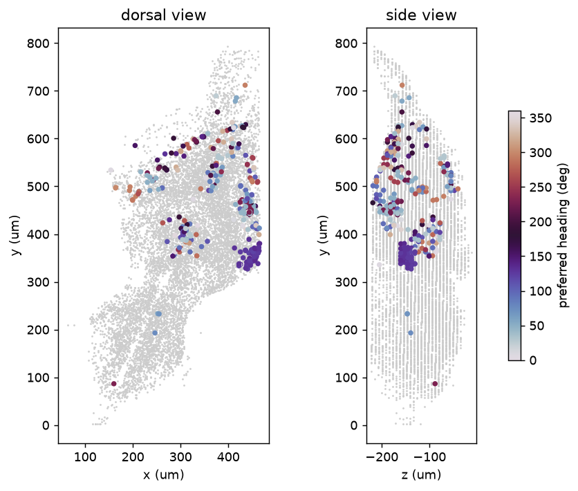

Note:
- Only if asked. The 300 neurons of the Bayesian decoder, coloured by preferred heading
- A dense cluster at the lateral edge (x ≈ 440, y ≈ 350 µm) all prefers ~120°
- Visual neurons, or projector light leaking at the tissue edge? To check on the raw images

---

## Tuning curves repeat with the image's symmetry

Landmark image with 3 openings, 120° apart: most tuned neurons fire 3 times per turn.

Note:
- Closed loop with landmarks: the 6 most informative neurons, mean activity against heading
- A heading cell has one peak; 3 peaks 120° apart is the 3rd harmonic, dominant in 72% of informative neurons
- Open loop, image with 2 opposite sectors: 2nd harmonic dominant in 55%
- Newest recording, a larger image only partly visible: 1st harmonic dominates (48%)

--

## How informative neurons were picked

- Mutual information between activity and heading
- Bias corrected with 200 time-shifted headings
- False discovery rate 5%

Note:
- Only if asked. 4 activity levels × 12 angle bins; gamma-fitted null, Benjamini–Hochberg
- Informative: 1.9% (run_23), 0.4% (run_24), 2.0% (run_03), 14% (run_04); best 0.2–0.6 bits

---

## So far, the tuned neurons look visual

- Heading is read only while the scene is visible
- Tuning curves have one peak per bright part of the image

Note:
- Claim 1, heading-tuned neurons, is better explained by visual responses
- A small heading network could still hide among them; darkness is the test
- Next: what happens in the dark?

--

## No ring is found without using the heading

  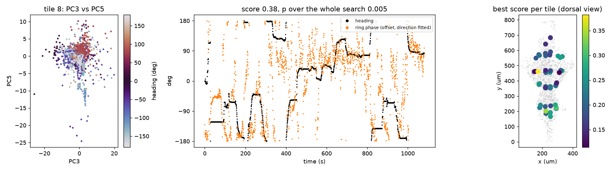
  

- A heading network makes two principal components trace a circle
- Only one recording passes, and it shows a blob

  

Note:
- Only if asked. Test from Petrucco et al. (2023); it does not use heading to pick neurons, so it avoids the selection problem
- PCA of the whole brain and of 41–48 tiles; every pair of the first 6 components; p-value corrected for the whole search
- run_23 passes (p = 0.005) with a blob and a slow trend; run_24 p = 0.85, run_03 p = 0.80
- A heading network could be too small to dominate the components of its tile

---

## In the dark, the hidden scene keeps turning

- Lit: the program turns the scene back and forth
- Dark, 80 s: screen off, the scene turns in hidden steps
- Light back on

A heading memory would hold the last angle, follow the hidden steps, or follow the turns.

Note:
- Manon's newest recording (Oct 2026), designed for this question: flashes, rotations, 2 dark blocks with light after
- Hidden rotation: 4 × 45° in block 1, 4 × 67.5° in block 2
- Decoders trained on lit volumes only, each dark block left out with 120 s of light on each side

---

## In the dark, the decoder follows none of them

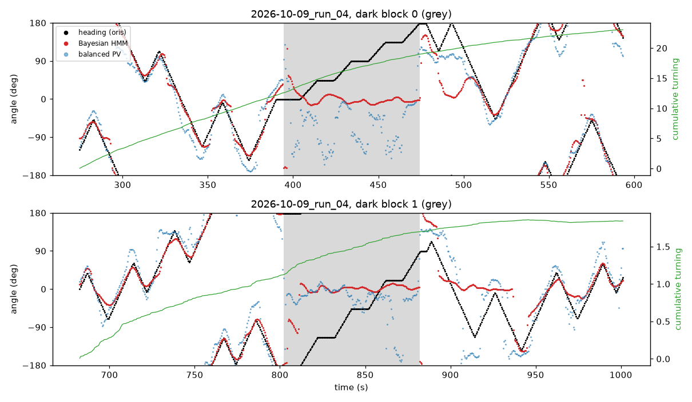

Note:
- Black: scene angle. Red: Bayesian decoder; blue: balanced population vector; green: cumulative tail turning. Grey: dark
- In light, 9° / 5° error. In the dark the angle sits near 0°: 174° from the last angle in block 2, 62–94° from the hidden rotation
- Not related to the fish's turns (r = −0.22, p = 0.27)
- After light-on, 20–60 s to lock on again, long for a visual response

---

## Quiet neurons push the vector to a fixed angle

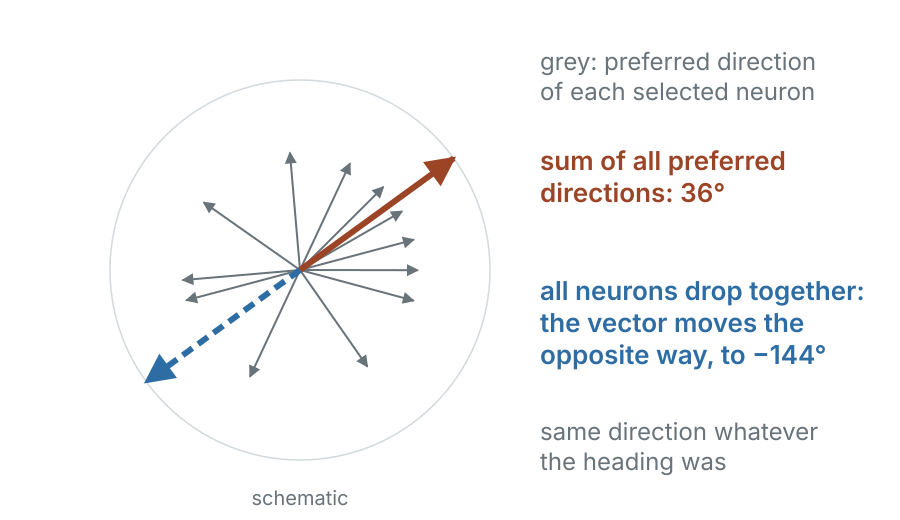

Note:
- The selected neurons' preferred directions are uneven: more of them point near 36°
- In the dark they all lose their visual input together; the vector loses most where most votes were, so it swings to the opposite side
- The same angle whatever the last heading. Arrows are made up; 36° is the open-loop value

---

## This predicts −144°; the decoders read −133°

$$\vec v(t) = \sum_n r_n(t)\ e^{i\varphi_n}$$

- $\vec v(t)$: population vector at time $t$
- $r_n(t)$: activity of neuron $n$
- $\varphi_n$: preferred direction of neuron $n$

If every $r_n$ drops by the same amount, $\vec v$ moves along $-\sum_n e^{i\varphi_n}$, here −144°.

Note:
- Open-loop recording: last lit heading 90°, then dark; nothing rotates afterwards
- Every decoder trained in the light lands between −108° and −150°
- Manon's selected neurons drop in the dark too: the plateaus on her dark slides are likely this artifact, not memory

--

## The Bayesian decoder falls for it too

- Selected neurons drop in the dark: z from +0.06 to −0.18
- The shared drop is 1.5× larger than everything else
- Bayesian decoder: −130 to −150°, fully confident

Note:
- Only if asked. Open-loop recording (run_03), 772–1032 s
- Uneven preferred directions: $\sum_n e^{i\varphi_n}$ points to 36°, resultant 0.29
- The Bayesian decoder models shared fluctuations, but its tuning curves are visual responses, read in neurons that lost their input

---

## The brain enters one fixed state in the dark

  
  

- A restricted Boltzmann machine (**RBM**) compresses 42,781 neurons into 100 groups that fire together
- Dark: 45 groups change level, the same way in both blocks

  

Note:
- Top: activity of each group (hidden unit). Above the dashed line the 45 that change in the dark (19 up, 26 down); below, 43 angle-tuned units by preferred angle
- Middle and bottom: angle read from tuned units by template matching; match 0.55 in light, 0.1–0.25 in the dark
- The dark state is no heading; recovery after light-on takes 20–60 s, as for the decoders

--

## How the RBM was trained

- Binary neurons, 100 hidden units
- L1 penalty 0.02, 200,000 updates
- Fit better than any earlier recording

Note:
- Only if asked. Babel recipe. L4 = 0.26 here; Babel spontaneous 04-15 Run01: 0.68; run_24: 0.89, run_03: 0.98; run_23 blew up
- Templates per 30° from lit volumes, dark ± 130 s left out

---

## Light-off neurons sit among the angle neurons

Note:
- Three groups that change in the dark (37, 58, 15), one angle-tuned group (81). Rows: top and side view of the 500 strongest-weight neurons, mean activity (grey = dark)
- 37: burst at light-off then sustained firing; 58 and 15: burst only, back to baseline in 10–40 s
- Light-off neurons (> 3 SD in the first 10 s of dark): 28% of rostral neurons; 67–97% of these groups' top neurons, 14% for group 81
- Not registered to an atlas: which area needs Manon's anatomy

---

## The decisive test is darkness during closed loop

- Closed loop with a dark block: the fish's own turns change its heading
- Rotate the landmark against the background texture
- Run the dark test on Manon's six other dark recordings
- Register to a reference brain; then development from 7 days

Note:
- A network too small or weak for these analyses is not excluded; closed loop in the dark is the strongest test
- Other dark runs: 2025-03-19 run_03, 2025-04-08 run_02, 2025-04-15 run_02, 2025-04-17 run_01, 2024-11-21 run_06, 2026-04-16 run_01
- Also: open-loop edge cluster on raw images, the slow recovery after the dark, run_23 RBM with parallel tempering
- Skip if short on time; the conclusions name the main test

--

## Only 3 of 39 larvae steer in closed loop

  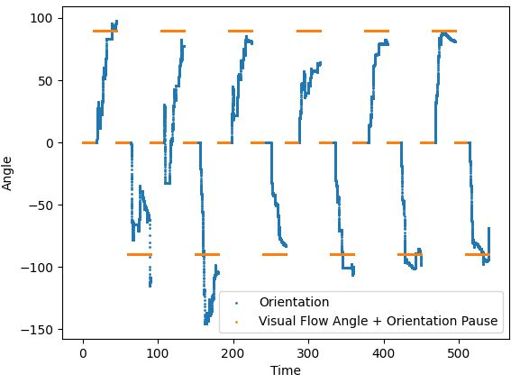
  

- Suspect: lateral infrared light. Next: behaviour-only rig

Note:
- Only if asked. From Manon's second-year TAC
- Blue: fish orientation in VR; orange: target set by the visual flow. Left follows the target, right swims in short bursts
- ~50% of larvae swim continuously, but only 3/39 follow the visual flow

---

## Conclusions

*No head direction network found yet*

- Heading is read only while the scene is visible
- Tuning follows the shape of the image
- In the dark, a fixed decoded angle comes from the decoder, not from memory
- Remapping: not re-tested yet

Note:
- Back to the opening question: in these recordings, nothing yet keeps a sense of direction in the dark
- Claims 1 and 2 are better explained by visual neurons and a decoder artifact
- A small or weak network is not excluded; next test: closed loop with darkness
