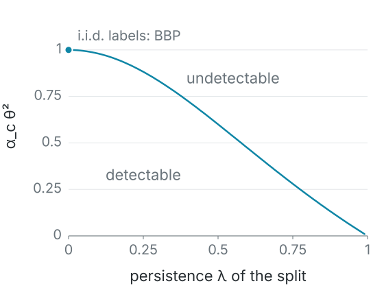

# What does a too-small HMM learn?

Literature review and first results

20/11/2026

Note:
- Side project that grew out of the HMM-RBM paper, started with Rémi on 23/10
- Main part: what the literature says, and where the gap is
- Then a plan, preliminary results, and Rémi's idea from last week

---

## Our HMM fits keep improving as we add states

HMM-RBM fits of whole-brain zebrafish activity, from $S = 2$ to $128$ hidden states: the likelihood on held-out data never levels off.

Note:
- HMM = hidden Markov model: a hidden state that jumps from step to step with fixed probabilities, and an observation drawn from a distribution that depends on the state
- From the paper: no elbow in held-out likelihood; prediction time grows like log S
- So the true number of states is unknown, maybe infinite

---

## So every model we fit is too small. What does it represent?

Data generated by an HMM with $K^\star$ states, fitted with $K < K^\star$ states: which true states end up together, and what decides?

Note:
- This is the question of the whole talk
- Synthetic check in the paper: generate with the 1024-state model, refit with S up to 128, the spectrum of time scales still looks right
- So the small model keeps something real. We want to know what

---

## Toy case: three true states, two fitted states

- **a** and **b** emit almost the same values
- a and c swap back and forth quickly; b stays put

Note:
- Horizontal axis: the observed value. Each bump: what one hidden state emits
- a and b: emission means delta apart. c is far away
- a <-> c at rate kappa, fast. b is slow: long stays
- We will come back to this example after each section

---

## Two states must merge: a with b, or a with c?

Note:
- Merge a and b (left): the merged emission is almost right, it costs about pi_b delta^2. But the merged state has short stays (from a) and long stays (from b)
- Merge a and c (right): the merged emission has two far bumps, expensive. But in time it is clean: the fast a <-> c switching happens inside one state and disappears
- A mixture model would only see the emissions and pick a+b. An HMM has to trade emissions against timing
- Question for the talk: which one wins, and when?

---

## We look at three bodies of work, then at four special cases

1. Clustering with too few clusters
2. Theory of HMMs fitted with the wrong model
3. Model reduction of HMMs, from control theory
4. Four limits we can solve, and Rémi's idea for the general case

Note:
- 1 to 3 are the literature review, most of the talk
- 4 is preliminary: derivations from the last three weeks, checked numerically but not re-derived by hand

---

# 1 · Clustering with too few clusters

---

## A mixture model is an HMM without memory

- **Mixture model**: each observation picks a hidden cluster at random, independently of the previous one
- HMM: the next hidden state depends on the current one
- In the toy case, a mixture sees three bumps and no timing

Note:
- So clustering with too few clusters is the memoryless version of our question
- It is much better understood. Start there, then ask what the memory changes

---

## Deterministic annealing: clusters split one at a time as temperature drops

Paper: Statistical mechanics and phase transitions in clustering | Rose, Gurewitz & Fox, *PRL*, 1990

Note:
- Rose and colleagues treat clustering as a physical system at temperature T. Each point is assigned to every centre with a Gibbs weight, exp(-distance / T)
- At high T every point belongs equally to every centre, so all centres sit at the mean of the data: one effective cluster, however many centres are allowed
- As T decreases, the clusters split one at a time, at critical temperatures
- Toy case: c is far, so the first split separates c from a+b. A fit with two clusters stops before a and b separate

---

## A cluster splits when the temperature falls below twice its largest variance

$$T_c = 2\lambda_{\max}$$

- $T_c$: temperature at which the cluster splits in two
- $\lambda_{\max}$: largest variance of the points in that cluster, along its principal axis

Paper: Deterministic annealing for clustering, compression, classification, regression, and related optimization problems | Rose, *Proc. IEEE*, 1998

Note:
- Read back: a cluster that is spread out along one direction splits early, along that direction
- Toy case: before the first split, the spread is dominated by the distance between c and the rest, so c splits off first
- They minimise a free energy F = D - T H: D the average distance to the centres, H the entropy of the soft assignments
- Caveat: a local stability argument, so a necessary condition. No proof that the low-T answer is the global optimum
- This is the picture we want for HMMs: what replaces the variance when the states have memory?

---

## With too few components, EM lands on a predictable biased fit

- Fit 2 Gaussians to data from 3 Gaussians, in one dimension
- They bound the **bias**: how far the fitted means sit from the true ones
- Which components merge is fixed in advance by the symmetric set-up

Paper: Theoretical guarantees for EM under misspecified Gaussian mixture models | Dwivedi, Ho, Khamaru, Wainwright & Jordan, *NeurIPS*, 2018

Note:
- Skip if short on time
- EM = expectation-maximisation, the standard fitting algorithm (Baum-Welch is EM for HMMs)
- Fitted model: half N(-theta, sigma^2) + half N(theta, sigma^2), sigma known
- Case 1, two close components with separation rho: bias at most rho |theta*| + c (rho |theta*| / sigma)^(1/4)
- Case 2, small middle component of weight omega: bias at most c omega^(1/8) |theta*|^(1/4) / sigma^(1/4)
- EM converges quickly to this biased fit; with n samples it gets within about sqrt(log(1/delta) / n)
- Their simulations: the true bias scales like rho^2 and omega, so the bounds are loose
- For us: they measure the cost of a merge, not which merge happens

---

## In high dimension, too little data can hide the clusters completely

- Below a critical number of samples per dimension, the fitted centres carry **no information** about the true ones
- Exact thresholds are known, but for the correct number of clusters
- A wrong number of clusters was treated only in 2025

Paper: Statistical mechanics of the maximum-likelihood density estimation | Barkai & Sompolinsky, *PRE*, 1994

Paper: Phase transitions and optimal algorithms in high-dimensional Gaussian mixture clustering | Lesieur, De Bacco, Banks, Krzakala, Moore & Zdeborová, 2016

Paper: The role of rank in mismatched low-rank symmetric matrix estimation | Niu et al., arXiv, 2025

Note:
- Skip if short on time
- Barkai & Sompolinsky call the first point "retarded learning"
- Lesieur et al.: threshold rho_c = K* / sqrt(alpha), and the transition becomes abrupt (first order) for K* > 4 + 2 sqrt(alpha)
- Niu et al.: wrong assumed rank, which plays the role of a wrong number of clusters
- All of this has independent labels: no dynamics
- Also: Pollard 1981 (consistency of k-means), Jin et al. 2016 (local maxima of the mixture likelihood), from memory, not re-read

---

## Recap: a too-small mixture merges the closest clusters

A mixture with too few clusters converges to a merge of the true clusters. Distance decides which, and the change can be abrupt. In the toy case: <b>a and b merge</b>.

Note:
- Everything so far ignores time. Now: what is known when the hidden states have memory

---

# 2 · HMMs fitted with the wrong model

---

## With infinite data, the fit goes to the best next-step predictor

$$\ell(\theta) = \mathbb{E}_{\star}\big[\log p_\theta(y_t \mid y_{t-1}, y_{t-2}, \dots)\big]$$

- $\ell(\theta)$: average log-probability of the next observation
- $p_\theta$: prediction of the fitted HMM with parameters $\theta$
- $\mathbb{E}_\star$: average over data from the true process

Paper: Asymptotic properties of the maximum likelihood estimation in misspecified hidden Markov models | Douc & Moulines, *Ann. Stat.*, 2012

Note:
- Read back: score the fitted model by how well it predicts each new observation from the whole past, averaged over the true data. The best fit maximises this score
- This is the same as being closest to the truth in KL divergence rate
- Douc & Moulines: maximum likelihood converges to the set of maximisers of l, even when the model is wrong. The data can be any stationary ergodic process. No central limit theorem
- Caveats: infinite data comes first, before any other limit. And the theory needs transition probabilities bounded away from zero, which a merged fit may violate
- Also Mevel & Finesso 2004
- For us: this defines the target. It does not say what the target looks like

---

## Other HMM results answer "how many states?", not "what do they mean?"

- Underestimating the number of states becomes exponentially unlikely with more data
- A computable stand-in for the distance between a process and an HMM
- In practice, a wrong emission model makes criteria pick too many states

Footnote: Gassiat & Boucheron (2003); Finesso, Grassi & Spreij (2006–08); Pohle, Langrock, van Beest & Schmidt (2017)

Note:
- Gassiat & Boucheron: order estimation. Tells you K < K* will be detected; silent on what the K-state fit means
- Finesso et al.: approximation of the KL rate, not the exact best fit
- Pohle et al.: applied paper, the practical side of our situation: extra states absorb a wrong emission model
- Also "Phase transition for parameter learning of HMMs" (PRE 2021): learning breaks down sharply as noise increases, but with the correct number of states
- Lehéricy 2018: non-asymptotic control for misspecified nonparametric HMMs

---

## Recap: we know the fit converges, not to what

With infinite data the fit converges to the best-predicting HMMs. Nobody has computed what they look like. In the toy case: <b>no answer</b> to a+b versus a+c.

Note:
- The closest thing to an answer comes from control theory

---

# 3 · Model reduction of HMMs

---

## Control theory shrinks an HMM by grouping its states

- Choose a grouping, average transitions and emissions inside each group
- Search for the grouping that loses the least

Paper: A recursive learning algorithm for model reduction of hidden Markov models | Deng, Mehta, Meyn & Vidyasagar, *CDC-ECC*, 2011

Note:
- Here the toy case is exactly their problem: compare grouping {a,b}{c} with {a,c}{b}
- Averages are weighted by how much time the chain spends in each state (stationary weights)
- Loss measured by the KL rate, the same quantity as on the Douc & Moulines slide
- Finite states and observations; maximum likelihood over groupings is consistent; a stochastic-approximation algorithm converges to a stationary point
- Also Vidyasagar 2010 (aggregation), Kotsalis & Shamma 2015 (balanced truncation, and a lower bound on the error of any smaller model; check which error measure)
- Closest work to ours. Not yet read in full

---

## But the best small HMM need not be a grouping at all

Merging a and b: stays in the merged state are either very short or very long.

Note:
- A Markov chain leaves a state with the same probability at every step, so stays have a geometric distribution: one typical length
- After the merge, short stays come from a and long stays from b. No single leaving probability fits both: the merged sequence is not a Markov chain
- Chains where merging keeps the Markov property are called lumpable; they are rare
- So the best 2-state HMM might do something else: give one state to "periods of fast switching", or split a state by how long it lasts
- Merging two clusters of a mixture gives a mixture. Merging two states of a Markov chain usually does not give a Markov chain. That is the difference with section 1

---

## And the quantity to maximise has no formula

The score $\ell$ involves the entropy rate of a hidden Markov process, which has no closed form. So we cannot just write down the best fit.

Note:
- l: average log-probability of the next observation given the whole past
- The predictor p(y_t | past) runs a filter over the hidden states, and its average over the data has no closed form
- This is probably why so few analytical results exist, and why limits where the formula simplifies are the way in
- Heuristic: two states are hard to tell apart when they emit alike now and predict alike for the future. A guide, not a theorem

---

## The gap: nobody says which states a too-small HMM merges

For data from a $K^\star$-state HMM, the best $K$-state HMM has not been described: whether it merges true states, which ones, how timing enters, and whether the answer changes abruptly.

Note:
- Searched: clustering with too few clusters, misspecified HMMs, order estimation, HMM model reduction, entropy-rate asymptotics, two-time-scale Markov chains, Markov-label mixtures, recent arXiv
- Independent check with Elicit: same conclusion. Also public AI-lab maths releases: nothing on this
- Not exhaustive, especially for 2025-2026 preprints. To re-check once there is a first result

---

# 4 · A plan, and first results

Derivations from the last three weeks, checked numerically, not yet re-derived by hand

Note:
- Done with Claude between 23/10 and 13/11; every statement checked numerically in the underfitted-hmm repo
- Treat the formulas as conjectures with numerical support

---

## In four limits the score simplifies enough to compute

Note:
- Horizontal: how long the hidden states last. Vertical: how much one observation tells you about its hidden state
- Strategy: solve in the corners, then connect them numerically
- From the 23/10 discussion with Rémi
- Our HMM-RBM fits sit in the top corner: one whole-brain frame says a lot
- Tools from the literature for each limit are in the supplementary slides

---

## When states switch fast, the fit is a mixture with a little memory

- Fast switching: the past says almost nothing about the next state
- First the fit is a mixture model, as in section 1
- Then a small memory correction: the true chain **seen through the fitted clusters**

Note:
- Set-up: T = 1 pi^T + epsilon R. Each row of the transition matrix is almost the stationary distribution
- Gain over the mixture: half the sum of squared canonical correlations of consecutive posteriors
- If the truth is near-fast too, T - 1 pi^T = W (T* - 1 pi*^T) V, with W, V the membership matrices: a soft lumping
- Soft lumping differs from hard lumping by 5-25% in the example when clusters overlap
- Checked against the exact filter on small examples. Formulas in supplementary
- Toy case: a+b merge, as for a mixture
- Open: near-tied mixture fits, multivariate emissions, finite data

---

## When states last long, the fit sorts whole stays by how they look

- Long stays: the filter locks onto one fitted state per true state
- Each true state goes **entirely** to the fitted state that resembles it most
- The fitted dynamics are the true ones, grouped: the control-theory recipe, now derived

Note:
- Set-up: T = I + epsilon Q, epsilon the switching rate
- Resembles most = smallest KL divergence between emission distributions. It is k-means on the true states, with KL as the distance
- Fitted emission = mixture of its true states' emissions
- Next order is epsilon log(1/epsilon): the cost of detecting each switch. Fitted Q = lumped generator, Q_ss' = N_ss' / pi*(C_s)
- So the grouping Deng et al. assumed comes out of the expansion here
- Validity condition on the tail of the wrong-state belief (kappa > 1/2); kappa <= 1/2 open. Order-epsilon constant relates to Peres & Quas
- Toy case: a and b merge, since emissions decide

--

## On a four-state test, the fit matches the grouped dynamics within 2.4%

Footnote: Truth: 4 states, 6 symbols. Fit: 2 states, Baum–Welch, 6 starts, switching rate 0.01

Note:
- Skip if short on time
- Curve: predicted loss when the grouped dynamics are scaled by c. No free parameter. Dots: Baum-Welch
- Maximum at c = 1: the grouped dynamics are the best
- The predicted grouping always wins; emissions = mixtures of grouped states within 0.01
- Score matches the expansion within 5%
- K = 3: two Baum-Welch optima 0.027 apart, equal to the gap between the two best groupings. The local optima of Baum-Welch are the local optima of the k-means on true states

---

## In high dimension, each frame is classified alone and transitions are counted

- One whole-brain frame names its state with near certainty
- So the emissions are a plain clustering of single frames
- The best transitions: decode each frame, **count** the jumps

Note:
- Why: the prior from the previous state moves the log-odds by order 1, one frame by order d
- l is about E[max_s log f_s(Y)] + sum N_ss' log T_ss', N = frequency of decoded jumps from s to s'
- First term order d: classification. Second term order 1: decoded sequence scored as an observed Markov chain
- Dynamics only break exact ties. Gain from the dynamics = mutual information of consecutive decoded states, at most log K
- Different from the slow limit: there whole stays were assigned, here single frames

--

## Our HMM-RBM fits are in this regime

Prediction: what the dynamics add equals the information between consecutive decoded states.

Note:
- 6 fish, S = 2 to 128. Points on the diagonal = prediction holds
- Filter certain (max posterior > 0.99) on 97-99.8% of training frames
- Within 0.01 nats for S = 4-16; error up to 0.03 to S = 16, 0.38 at S = 128, where T has near-zero entries
- Synthetic data from the 1024-state model: each fitted state is a group of true states on 97-99.5% of frames

--

## Counting decoded jumps beats Baum–Welch on held-out data

Footnote: Counted jumps on training frames, pseudocount 0.01. Held-out frames, mean over 6 fish

Note:
- A practical point for the paper. At S = 128: Baum-Welch -0.18, counted 1.62 nats/frame
- Likely cause: Baum-Welch pseudocount 1e-9, so a jump never seen in training costs about 20 nats
- The per-neuron predictive power in the paper barely changes; the likelihood does
- Pseudocount can be chosen by leave-one-out on the training counts

---

## With weak frames, timing can change which states merge

Persistent states make a split detectable with less data.

Footnote: Same form as Ghasemian et al. (2016, *PRX*) for dynamic networks

Note:
- Set-up: N = alpha d frames, separation 1/sqrt(d) per coordinate. One frame carries order-1 evidence, so emissions, timing and estimation noise compete on equal terms
- Curve: alpha_c theta^2 = (1 - lambda^2)/(1 + lambda^2), lambda = how persistent the hidden labels are. lambda = 0 gives the known BBP threshold for independent labels
- K = 2 < K* = 3: the best grouping seems to switch abruptly with alpha, near alpha = 0.75 in the AMP-EM example
- Hard phase for K* = 10, widened by persistence
- Replica-symmetric and numerical only. AMP with a forward-backward denoiser
- The only corner where the toy case could pick a+c

---

## Recap: so far, emissions decide what merges

In three of the four limits the fit groups the true states that look alike, as in clustering. Timing changes the grouping only when single frames are weak. In the toy case: <b>a and b merge</b>, unless frames are weak.

Note:
- Tentative answer to "looks alike or behaves alike": mostly looks alike
- Also gives Deng et al.'s grouping a justification in the slow limit
- All to be re-derived and written up

---

# 5 · Rémi's idea for the general case

13/11

---

## Average the likelihood instead of its logarithm

- The score averages $\log P(Y)$: no formula
- Averaging $P(Y)$ itself is a sum over paths we can do exactly
- Later, recover the log with the replica trick

Note:
- P(Y): probability the fitted HMM gives to the whole observed sequence Y
- E*[P(Y)] is the annealed average, E*[log P(Y)] the quenched one
- Start with S = 2 as an easier first step, but keep the general case in view
- Replica trick: compute E*[P(Y)^n], then n -> 0

---

## The averaged likelihood is a power of one matrix on pairs of states

$$\mathbb{E}_\star[P(Y)] = \langle 1 | \tau^{L-1} | \rho_0 \rangle, \qquad \tau_{(x,x^\star) \to (y,y^\star)} = T^\star_{x^\star y^\star}\ T_{xy}\ M_{x x^\star}$$

- $x, y$: fitted states; $x^\star, y^\star$: true states
- $T, T^\star$: fitted and true transition matrices
- $M_{x x^\star}$: overlap of the emissions of fitted state $x$ and true state $x^\star$
- $L$: sequence length

Note:
- M_{s s*} = sum_y f_s(y) f*_{s*}(y)
- Read back: run the fitted chain and the true chain side by side. Each step, both jump, and you gain the overlap of what they emit. Observations are summed out
- For long sequences only the largest eigenvalue of tau counts. So maximising the averaged likelihood = maximising the largest eigenvalue of tau (Perron-Frobenius, Rayleigh-Ritz for S = 2)
- Toy case: tau is a 2 x 3 = 6-state matrix

---

## Averaging the likelihood rewards rare true sequences; replicas remove them

- With $n = 1$, the fit can bend the true path towards states it emits well
- The price of such a rare path falls like $1/n$, so it vanishes as $n \to 0$
- $n = 1$ is computable but answers another question

Note:
- Skip if short on time
- n: number of replicas, the power of P(Y) being averaged
- Identity is exact also for n replicas: tau_n = (T tensor n tensor T*) D_{M_n}, checked against brute force
- Lambda(n) = log rho(tau_n) is convex, l = Lambda'(0+) <= Lambda(n)/n
- Lambda(1) is about l + half the variance: the annealed objective rewards parameters for which log P(Y) fluctuates
- Separated emissions, S = S*: the optimal T is deterministic, it cycles around the best cycle of T* (T = I if T* is diagonally dominant)
- A variational (Donsker-Varadhan) form gives an "annealed Baum-Welch" that increases rho monotonically
- l = Lambda'(0) needs regularity not checked; the n -> 0 continuation is the replica assumption
- Next: replica-symmetric ansatz at small n, S = 2

---

## Conclusions

- Clustering: a too-small model merges the clusters that look alike
- HMMs: the fit converges, but nobody has said to what
- Four limits: emissions decide the merge, timing only for weak frames
- HMM-RBM paper: count decoded jumps for the transitions

Note:
- Next: read in full Peres & Quas; Deng, Mehta & Meyn 2010; Kotsalis & Shamma 2015; Pouzo, Psaradakis & Sola 2025
- Re-derive the fast and slow expansions by hand
- Toy model (delta, kappa, epsilon): map numerically which merge wins between the corners
- Rémi's route: S = 2, then n -> 0
- Side result: spectral learning with rank K < K* has a closed form; compare with ML. May explain why small HMMs reproduce the spectrum (Hsu, Kakade & Zhang)
- Later: Rose-style stability of the one-state solution; conjecture that the first split involves the autocovariance, not only the variance
- Paper: counted T with a leave-one-out pseudocount

---

<!-- .slide: data-background-color="#000000" -->

---

# Supplementary

---

## Each limit has tools in the literature

| Limit | Tools |
|---|---|
| Fast switching | Pouzo, Psaradakis & Sola (2025); Yin & Zhang (2007) |
| Slow switching | Peres & Quas; Zhang, Yin & Moore (2007); Noé et al. (2013) |
| High dimension | Zuk, Domany, Kanter & Aizenman; Han & Marcus |
| Weak frames | Ghasemian et al. (2016); Karagulyan & Ndaoud; Kadry & Zhang (2025); Truong |

Note:
- Pouzo et al.: fitting an independent mixture to HMM data still recovers the emissions, the same-K version of the fast limit
- Peres & Quas: entropy rate of HMMs with rare transitions, exactly the I + epsilon Q form
- Noé et al.: hidden Markov state models in molecular dynamics, fast within groups, slow between
- Ghasemian et al.: detectability in dynamic networks, the graph analogue of the weak-frames limit
- Still to read in full: Peres & Quas; Pouzo et al.

---

## Fast limit: the memory gain is set by correlations of consecutive posteriors

$$\max_R \ell - \ell_{\text{mix}} = \tfrac12 \sum_i \rho_i^2$$

- $\ell_{\text{mix}}$: score of the best mixture model
- $R$: the small correction to the transition matrix, $T = \mathbf{1}\pi^\top + \varepsilon R$
- $\rho_i$: canonical correlations between cluster posteriors at consecutive times

Note:
- epsilon R* = Phi^-1 Gamma_1 Phi^-1 D_pi: covariance over curvature of the posteriors
- Near-fast truth: T - 1 pi^T = W (T* - 1 pi*^T) V

---

## Slow limit: the leading score is a clustering of true states in KL

$$\ell_0 = -\sum_k \pi^\star_k H(f^\star_k) - \sum_k \pi^\star_k \min_s D_{\mathrm{KL}}\big(f^\star_k \| f_s\big)$$

- $\pi^\star_k$: fraction of time in true state $k$
- $f^\star_k$, $f_s$: emission of true state $k$, of fitted state $s$
- $H$: entropy; $D_{\mathrm{KL}}$: KL divergence

Note:
- First term does not depend on the fit. Second: each true state pays the KL to its closest fitted state
- Lloyd's algorithm with KL as the distance

---

## High-dimension limit: classification plus a counted Markov chain

$$\ell \approx \mathbb{E}\Big[\max_s \log f_s(Y)\Big] + \sum_{s,s'} N_{ss'} \log T_{ss'}$$

- $f_s$: emission of fitted state $s$
- $N_{ss'}$: frequency of decoded jumps from $s$ to $s'$
- $T_{ss'}$: fitted transition probability

Note:
- N_ss' = P*(decoded state s at t-1, s' at t)
- Gain over the mixture = I(s_hat_{t-1}; s_hat_t) <= log K
- If the truth has long stays: decoded state = function of the true state, T = lumped T*

---

## Weak frames: persistence widens the hard phase

Note:
- K* = 10, rho = 8. Ratio of information-theoretic threshold to spinodal against the persistence eta of T*
- Replica-symmetric free entropy
