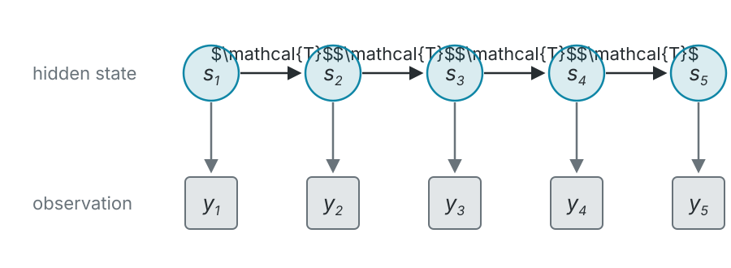
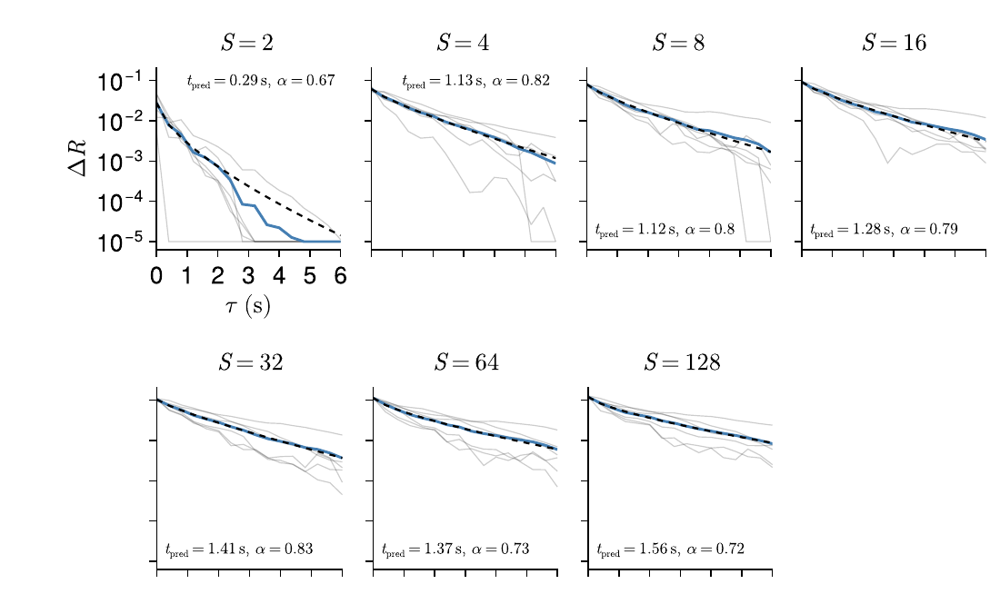
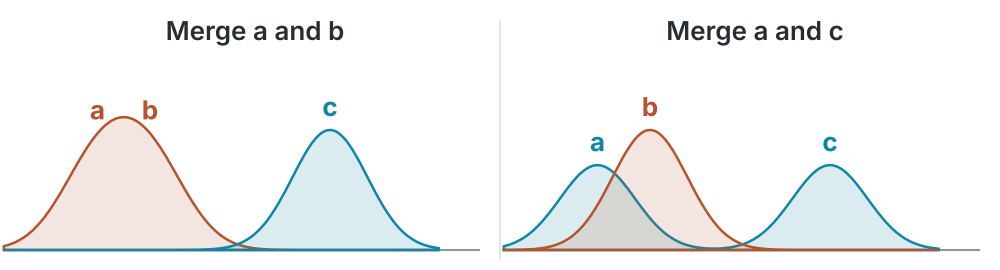
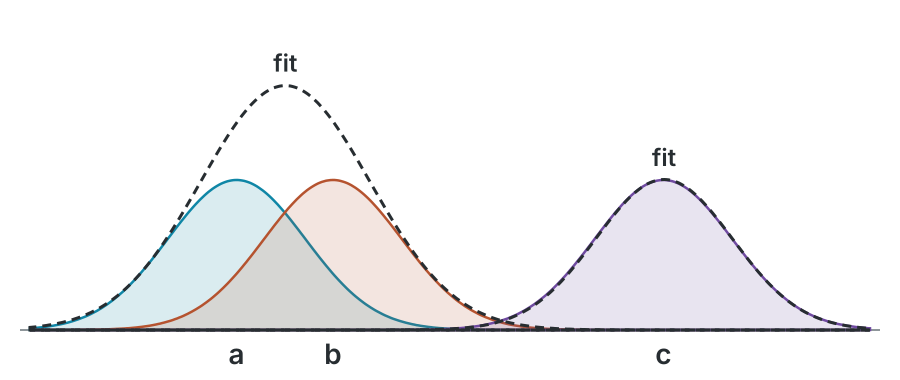
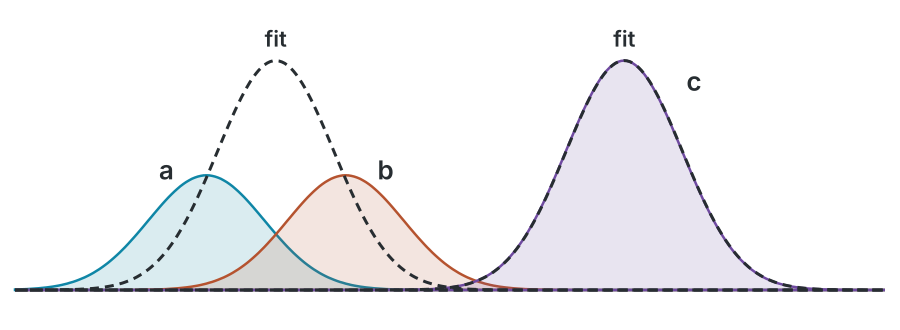

# What does a too-small HMM learn?

Guillaume Faye-Bédrin  
24/11/2026

---

## An HMM is a Markov chain seen through noise

$$\mathcal{T}_{ss'} = P(s_{t+1} = s' \mid s_t = s) \qquad\qquad f_s(y) = P(y_t = y \mid s_t = s)$$

Note:
- Two ingredients: how the state moves (𝒯, left), what each state emits (emission, right)
- We only see the observations
- The number of states is fixed before fitting: that is the topic

---

## We fit HMMs to whole-brain zebrafish activity

Note:
- Six larvae, about 45,000 neurons, one frame every 0.4 s
- An RBM compresses each frame into 100 hidden units; each HMM state is a point there
- Bottom: one state at a time, stays of a few seconds; from t, forecast with 𝒯

---

## Activity hops from one state region to the next

<video data-autoplay loop muted data-src="figures/hmm_states_movie.mp4" style="max-height:560px; width:auto; display:block; margin:6px auto;"></video>

Note:
- Fish F4, 16 states, 4× speed
- Watch the orange dot: it stays in a region, then jumps to a neighbour
- S=16 is arbitrary, what happens with other S?

---

## Our HMM fits keep improving as we add states

Note:
- Left: forecast horizon, grows like log S
- Right: how much of the frame the state explains, no plateau up to 128
- So every model we fit is too small
- R(\tau)

--

## Forecasts stay useful longer with more states

Note:
- Gain over the stationary forecast against horizon, one panel per S, log scale
- Dashed: the fit that gives t_pred, from 0.29 s at S = 2 to 1.56 s at S = 128

---

## Going from 8 to 16 states redraws the state map

→

Note:
- Each cell: the frames one state explains best
- From 8 to 16, cells split, and borders also move
- Ask aloud: data from K* states, fit with K < K*: which states merge, and why?

---

## A toy case with three hidden states

Note:
- Each bump: what one state emits
- a and b look alike; a and c switch fast; b stays long
- Bottom: one sample of the hidden sequence

---

## Which merge does a two-state fit choose, a+b or a+c?

Note:
- First row: the true sequence, as on the previous slide
- Middle row: a+b. Emissions almost right, but short and long stays mixed
- Bottom row: a+c. Emissions bad, but the fast switching disappears into one long stay
- A mixture picks a+b; an HMM must trade looks against timing

---

# 1 · Clustering with too few clusters, without dynamics

---

## A mixture model is an HMM without memory

$$P(y) = \sum_s \pi_s \, f_s(y)$$

Note:
- Start without memory: a mixture. Each step picks hidden cluster s with probability π_s, then draws y from its bump f_s
- Same as the HMM, minus the arrows. Bumps need not be Gaussian; here they are, all with the same width (the case Rose treats)
- Toy case: generate data from these three bumps, fit only two clusters. Which do we find?

---

## Clusters split one at a time as temperature drops

$$P(s = j \mid y) \propto e^{-\|y - \mu_j\|^2 / T}$$

Paper: Statistical mechanics and phase transitions in clustering | Rose, Gurewitz & Fox, *PRL*, 1990

Note:
- Rose: all clusters get the same assumed width; T = twice that variance. Not a training setting, a resolution knob
- High T: one cluster at the mean. Lower T: clusters split one at a time (next slide)
- Dotted line: the true width T* = 2σ*², where centres sit on the true means
- Read bottom-up: a and b merge first, c later. Without memory, distance decides

--

## The centres balance distance against randomness

$$P(s = j \mid y) = \frac{e^{-d(y, \mu_j)/T}}{Z_y}, \qquad Z_y = \sum_k e^{-d(y, \mu_k)/T}, \qquad d(y,\mu) = \|y - \mu\|^2$$
$$F = D - T H = -T \sum_y p(y) \log Z_y \qquad\Rightarrow\qquad \mu_j = \frac{\sum_y p(y)\, y \, P(s = j \mid y)}{\sum_y p(y)\, P(s = j \mid y)}$$
$$\text{cluster } j \text{ splits when } T < T_c = 2 \lambda_{\max}\big(\mathrm{Cov}[y \mid s = j]\big)$$

- $p(y)$: weight of point $y$ ($1/N$ for $N$ points); $\mu_j$: centre of cluster $j$; $D$, $H$: mean distance and entropy of the assignments
- Same as fitting a Gaussian mixture (equal weights, variance fixed at $\sigma^2 = T/2$): $F = -T \times$ log-likelihood + const
- $T \to 0$: k-means

Footnote: Rose, Gurewitz & Fox, *PRL* (1990); Rose, *Proc. IEEE* (1998)

Note:
- Averaged over the points with p(y), as in Rose 1998; a plain sum over points gives the same minimiser
- Why this posterior: Bayes for equal weights and width T/2; also the maximum-entropy assignment at fixed mean distance D (Rose), T the Lagrange multiplier
- Centres = weighted means; iterate at fixed T, then lower T slowly (annealing), perturbing centres to detect splits
- T_c from the second derivative of F: the single-centre solution becomes a saddle along the top principal axis
- Splits are continuous, not jumps: centres move apart fast (typically ∝ √(T_c − T)) and reach the true means at the true width T* = 2σ*². Below T* (towards k-means), overlapping clusters drift slightly apart. Jumps in special cases: equal isotropic clusters ("explosion"), high dimension (Lesieur et al.)
- Necessary condition only; annealing avoids bad local minima in practice, no global guarantee
- Mixture link: E-step = Gibbs assignment, M-step = centroid condition, log-likelihood = sum p(y) log Z_y + const. Annealing = shrink the assumed variance step by step. A normal mixture fit learns the variance, so no T and no collapse

---

## A cluster splits when the temperature falls below twice its largest variance

$$T_c = 2\lambda_{\max}\big(\mathrm{Cov}[y \mid s = j]\big)$$

- $T_c$: temperature at which cluster $j$ splits in two
- $\lambda_{\max}$: largest eigenvalue of the cluster's covariance, i.e. its variance along the principal axis

Paper: Deterministic annealing for clustering, compression, classification, regression, and related optimization problems | Rose, *Proc. IEEE*, 1998

Note:
- A spread-out cluster splits first, along its widest direction (the split is along that eigenvector)
- Cov is weighted by the posterior P(s = j | y): the points the cluster holds at that T
- Local condition only, no proof of the global optimum
- For HMMs: what replaces the variance?

---

## Without memory, a too-small model merges the closest clusters

A too-small model sees the data coarser, as at a higher T

Note:
- Toy fitted with two components (EM, learned widths): one bump on the a+b centre, wider, weight 2/3
- From the full model, raise T: the closest merge first, in the reverse order of the splits
- If asked (supplementary): EM reaches this merged fit fast (Dwivedi 2018); in high dimension, too little data hides the clusters
- Next: with memory, does timing change which clusters merge?

---

# 2 · HMMs with too few states

---

## With infinite data, the fit goes to the best next-step predictor

$$\ell(\theta) = \mathbb{E}_{\star}\big[\log p_\theta(y_t \mid y_{t-1}, y_{t-2}, \dots)\big]$$

Paper: Asymptotic properties of the maximum likelihood estimation in misspecified hidden Markov models | Douc & Moulines, *Ann. Stat.*, 2012

Note:
- ℓ, the score: average log-probability of the next observation y_t, predicted by the fitted HMM (parameters θ), averaged over true data (E⋆)
- Best fit = best predictor of the next observation, even with the wrong model; the rest of the talk computes or compares ℓ
- Toy case: the two-state fit is a+b or a+c, whichever has the larger ℓ

--

## The likelihood is a sum of next-step predictions

$$\frac{1}{L}\log p_\theta(y_1,\dots,y_L) = \frac{1}{L}\sum_{t=1}^{L} \log p_\theta(y_t \mid y_{1:t-1}) \;\xrightarrow[L\to\infty]{}\; \ell(\theta)$$

$$\ell(\theta) = -h_\star - \mathbb{E}_\star\Big[\mathrm{KL}\big(p_\star(y_t \mid \text{past}) \,\big\|\, p_\theta(y_t \mid \text{past})\big)\Big]$$

Note:
- Chain rule: the likelihood is a product of one-step predictions; L = sequence length
- Time average over one long sequence → average over the data (ergodic theorem)
- The filter forgets its start, so the finite past acts like the infinite past: that is the hard part of the proof
- h⋆ = entropy rate of the data, same for every θ → maximise ℓ = minimise the average KL

--

## Other results say how many states, not what they mean

- With more data, a too-small number of states is detected with exponentially high probability
- To find the best $K$-state HMM: $\ell$ has no formula, so they maximise a computable proxy
- With a wrong emission model, selection criteria pick too many states

Footnote: Gassiat & Boucheron (2003); Finesso, Grassi & Spreij (2010); Pohle, Langrock, van Beest & Schmidt (2017)

Note:
- Gassiat & Boucheron: you will notice that K is too small, and that is all
- Finesso et al.: same goal as ours, same obstacle (ℓ cannot be computed). They swap ℓ for a proxy (probabilities of short sequences): an algorithm, not a description of the fit
- Pohle et al.: in practice, extra states absorb a wrong emission model

---

## Control theory shrinks an HMM by grouping its states

- Choose a grouping, average transitions and emissions inside each group
- Keep the grouping that loses the least $\ell$

Paper: A recursive learning algorithm for model reduction of hidden Markov models | Deng, Mehta, Meyn & Vidyasagar, *CDC-ECC*, 2011

Note:
- Exactly our toy question: {a,b}{c} or {a,c}{b}
- Their loss is the KL rate of the previous slide, i.e. our score ℓ
- Closest work to ours; not read in full yet

---

## When is the best small HMM a grouping, and which grouping?

Note:
- Point at the brackets: stays in ab last 1 step (from a) or about 10 (from b)
- A Markov state has one typical stay length, so a grouped ab state is not exactly Markov
- So a fit with free parameters might beat every grouping. We want to know when the best small HMM is a grouping, and which one

---

## The score has no formula because each prediction needs the filter

$$p_\theta(y_t \mid \text{past}) = \sum_s P(s_t = s \mid \text{past})\; f_s(y_t)$$

- $P(s_t = s \mid \text{past})$: the filter, what the past says about the current state
- $f_s(y_t)$: emission of state $s$

Note:
- To predict, guess the current state from the whole past, then emit
- The filter is updated by Bayes at every step; its long-run statistics have no closed form (Blackwell, 1957)
- So ℓ has no formula: Finesso et al. replace it, we look for limits where it simplifies

---

## With memory, nobody says which states a too-small HMM merges

Note:
- We know what the fit maximises (ℓ) but cannot compute it
- Control theory compares groupings, but the best fit need not be one
- So on the toy: no answer to a+b or a+c. Next: limits where ℓ can be computed

---

# 3 · Four limits where the score can be computed

Note:
- First results, checked numerically
- Derived 23/10 to 13/11, checked numerically, not yet re-derived by hand: treat as conjectures

---

## We look for limits where the score becomes computable

Note:
- Top row, limits on the dynamics, ε → 0. Fast: every row of 𝒯 close to π. Slow: 𝒯 close to identity, Q the transition rates
- Bottom row, limits on one frame, of dimension d. Left: one frame names its state. Right: each coordinate weak, sequence length L grows with d
- Separate limits, not a map. Two worked out: fast mixing and high dimension. Slow and weak frames: next steps
- Zebrafish HMMs sit in d → ∞

---

## First limit: fast mixing

$$\begin{gathered}\mathcal{T} = \mathbf{1}\pi^\top + \varepsilon R, \qquad \sum_{s'} R_{ss'} = 0 \\[0.3em] \mathcal{T}^\star = \mathbf{1}\pi^{\star\top} + \varepsilon^\star R^\star\end{gathered}$$

Note:
- At ε=0 the HMM is a mixture model
- Second line: the truth is near the fast limit too, ε⋆ small. ε belongs to the fit and is free; the fit has small ε only because the data have little memory

---

## With fast mixing, the prediction is the mixture plus a small correction

$$\begin{aligned}
P(y_t \mid \text{past}) &= \sum_{r,s} \pi_{t-1}(r)\; \mathcal{T}_{rs}\; f_s(y_t) \\
&= \sum_s \pi_s\, f_s(y_t) \;+\; \varepsilon \sum_{r,s} \pi_{t-1}(r)\, R_{rs}\, f_s(y_t) \\
&= m(y_t) + O(\varepsilon) \\[0.3em]
\ell &= \mathbb{E}_\star\big[\log m(y_t)\big] + O(\varepsilon)
\end{aligned}$$

- $\pi_{t-1}(r) = P(s_{t-1} = r \mid \text{past})$: the filter, belief about the previous state
- $m(y) = \sum_s \pi_s f_s(y)$: the mixture density

Note:
- Line 1: guess the previous state from the past, step with 𝒯, emit
- Line 2, exact: put in 𝒯 = 1πᵀ + εR; the filter sums to 1, so the π part does not depend on the past. π_{t−1} is the exact filter, bounded, so no need to expand it here
- Line 3: the first sum is the mixture density m, the second is of size ε
- Line 4: take the log and average: the mixture score, plus a correction of order ε

---

## So at leading order, the fit is the mixture fit of section 1

Note:
- Maximising ℓ at leading order = maximising the mixture score: π and the emissions are those of the mixture fit
- Toy: a+b merge, as in section 1
- Memory cannot change this at leading order: it only adds a small term on top (next slides)

---

## With fast mixing, timing cannot change the merge

Note:
- The merge is fixed by the emissions (last slide). The fit still learns transitions: how the true chain moves between the merged groups
- Toy, merge a+b: ab stays with probability 0.70, c goes back to ab with 0.90. Baum–Welch on the toy gives 0.70 and 0.90
- The transitions move the emissions only at second order, so the merge stays a+b
- The toy as drawn is not in the fast regime (b stays long); the grouped transitions still match because the emissions barely overlap

--

$$\begin{aligned}
\mathcal{T} &= \mathbf{1}\pi^\top + \varepsilon\eta\,\big(I - \mathbf{1}\pi^\top\big) \\[0.3em]
\frac{P(y_t \mid \text{past})}{m(y_t)} &= 1 + \varepsilon \sum_{r,s} \pi_{t-1}(r)\, R_{rs}\, \frac{f_s(y_t)}{m(y_t)} \\
&= 1 + \varepsilon \sum_{r,s} \phi_r(y_{t-1})\, R_{rs}\, \frac{\phi_s(y_t)}{\pi_s} + o(\varepsilon) \\
&= 1 + \varepsilon\, u_t + o(\varepsilon) \\[0.3em]
u_t &= \eta\, \frac{\big(\phi_1(y_{t-1}) - \pi_1\big)\big(\phi_1(y_t) - \pi_1\big)}{\pi_1 \pi_2}
\end{aligned}$$

where $\phi_s(y) = \pi_s f_s(y) / m(y)$: probability of state $s$ judged from frame $y$ alone

Note:
- Line 1: two states, zero row sums and π stationary leave R one direction; εη is the lag-1 autocorrelation of the fitted state
- Line 2: line 2 of the first derivation, divided by the mixture m. Exact
- Line 3: at this order the filter only knows the last frame, π_{t−1} = φ(y_{t−1}); older frames drop out
- Line 4: R = η(I − 1πᵀ), Σ_r φ_r = 1, two states. The term is the product of consecutive fluctuations of φ₁ around π₁
- Toy, a+b fit: frames from a and from b both give φ_ab ≈ 1, so a's fast switching and b's long stays look the same; only ab ↔ c is visible

--

$$\begin{aligned}
\ell - \ell_{\text{mix}} &= \mathbb{E}_\star\big[\log(1 + \varepsilon u_t)\big] = \varepsilon\, \mathbb{E}_\star[u_t] - \tfrac{\varepsilon^2}{2}\, \mathbb{E}_\star[u_t^2] + O(\varepsilon^{\star 3}) \\
&= \kappa\varepsilon\eta\,\rho - \tfrac12 (\kappa\varepsilon\eta)^2 + O(\varepsilon^{\star 3}) \\[0.4em]
\varepsilon \hat\eta &= \frac{\rho}{\kappa}, \qquad \max_\eta\, \ell - \ell_{\text{mix}} = \frac{\rho^2}{2}
\end{aligned}$$

<ul>
<li>$u_t$: as on the last slide</li>
<li>$\ell_{\text{mix}} = \mathbb{E}_\star\big[\log m(y_t)\big]$</li>
<li>$\rho = \mathrm{Corr}_\star\big(\phi_1(y_{t-1}), \phi_1(y_t)\big)$</li>
<li>$\kappa = \mathrm{Var}_\star\big(\phi_1(y_t)\big) / (\pi_1\pi_2) \in [0, 1]$</li>
</ul>

Note:
- ρ: how much consecutive frames agree on the state. κ: how sharply one frame names the state (1 if emissions do not overlap)
- Line 1: log of the last slide's ratio, expanded. Line 2: mean of a product of fluctuations = covariance = ρ Var φ₁, hence κρ; mean of its square ≈ κ² (frames almost independent)
- Linear term: point εη in the direction of ρ. Quadratic term: sets how far
- Answer: εη̂ = ρ/κ, the correlation seen between consecutive frames, corrected for the blur (κ = 1 when emissions do not overlap). Gain ρ²/2
- Toy, a+b fit: after c comes ab more often than chance, so ρ < 0: the fit learns the alternation ab ↔ c

--

## In matrix form, memory trades a covariance reward against a curvature penalty

$$\ell - \ell_{\text{mix}} = \underbrace{\varepsilon \,\mathrm{tr}\big(R^\top \Gamma_1 D_\pi^{-1}\big)}_{\text{reward}} \;-\; \underbrace{\tfrac{\varepsilon^2}{2}\, \mathrm{tr}\big(R^\top \Phi R\, D_\pi^{-1} \Phi D_\pi^{-1}\big)}_{\text{penalty}} \;+\; O(\varepsilon^{\star 3})$$
$$\Longrightarrow\quad \varepsilon \hat R = \Phi^{-1}\, \Gamma_1\, \Phi^{-1} D_\pi$$

<ul>
<li>$\Gamma_1 = \mathrm{Cov}_\star\big(\phi(y_{t-1}), \phi(y_t)\big)$: covariance of consecutive state probabilities</li>
<li>$\Phi = \mathbb{E}_\star\big[\phi(y)\phi(y)^\top\big]$, $D_\pi = \mathrm{diag}(\pi)$</li>
<li>$\Gamma_1 = O(\varepsilon^\star)$: consecutive frames are weakly dependent</li>
</ul>

Note:
<!-- - All averages over the true data (⋆); φ, π, m belong to the fitted model. Expand log(1 + u) = u − u²/2, u the ε term of the last slide -->
- Mean of u: E⋆φ = π (π is at the mixture optimum) and the rows of R sum to 0, so only Γ₁ survives: a reward linear in R
- Mean of u²: frames almost independent, so it factorises into Φ: a penalty quadratic in R. Deeper history (the filter correction, lag 2) only enters at O(ε⋆³)
- Linear term alone has no maximum: the amount of memory is set by the balance. At the optimum ε = O(ε⋆), εR̂ = Φ⁻¹Γ₁Φ⁻¹D_π

--

## With K states, the fit learns how the true chain moves between merged groups

$$\begin{gathered}\hat{\mathcal{T}}_{ss'} = P_\star\big(s^\star_t \in C_{s'} \mid s^\star_{t-1} \in C_s\big) = \frac{\sum_{k \in C_s} \sum_{k' \in C_{s'}} \pi^\star_k\, \mathcal{T}^\star_{kk'}}{\sum_{k \in C_s} \pi^\star_k} \\[0.4em]
\max\, \ell - \ell_{\text{mix}} = \tfrac12 \sum_{i} \rho_i^2 + O(\varepsilon^{\star 3})\end{gathered}$$

<ul>
<li>$C_s$: the true states merged into fitted state $s$; $s^\star_t$: true state at time $t$</li>
<li>$\rho_i$: canonical correlations between $\phi(y_{t-1})$ and $\phi(y_t)$, the $\rho$ of two states</li>
</ul>

Note:
- From the last slide: no overlap gives Φ = D_π, so εR̂ = D_π⁻¹Γ₁ = grouped transition minus π. Gain: the trace is Σ ρᵢ² after whitening
- First line: watch the true chain, write down only the group, count the transitions. With overlap: 𝒯̂ − 1πᵀ = W(𝒯⋆ − 1π⋆ᵀ)V, W and V partial assignments
- Toy: P(ab → ab) = (0.25 × 0.20 + 0.50 × 0.95) / 0.75 = 0.70, the number on the main slide
- Checked against the exact filter: within 2–3% at ε⋆ = 0.05–0.1

---

## In high dimension, one frame names its state

$$\log \frac{f_s(y)}{f_{s'}(y)} = \sum_{i=1}^{d} \log \frac{f_{s,i}(y_i)}{f_{s',i}(y_i)} \qquad \text{mean} \propto d, \quad \text{spread} \propto \sqrt{d}$$

The past changes the odds between two states by at most a factor $1/t_{\min}$, with $t_{\min}$ the smallest transition probability

$$\Longrightarrow \quad P(s_{t-1} = s \mid \text{past}) \to \mathbf{1}\big[s = \hat s_{t-1}\big], \qquad \hat s_t = \arg\max_s f_s(y_t)$$

Note:
- A frame has d coordinates, independent given the state. Each one gives a small vote; if states differ by a fixed amount in many coordinates, the votes add up like d, the noise only like √d
- The prior from the past is bounded, so for large d the last frame decides alone: the belief is one-hot on its best state ŝ, the rest of the past drops out
- Hypothesis (A): the log-ratio becomes large. Fails if states differ in few coordinates, if coordinates are redundant, or if each difference shrinks like 1/√d (weak frames)
- Our fits: decoding each frame alone agrees with Viterbi on at least 98% of frames

--

$$\begin{aligned}
\hat\pi_{t-1}(s) &= \sum_r \pi_{t-2}(r)\, \mathcal{T}_{rs} \;\in\; [t_{\min}, 1] \\[0.3em]
\frac{\pi_{t-1}(s)}{\pi_{t-1}(\hat s)} &= \frac{\hat\pi_{t-1}(s)}{\hat\pi_{t-1}(\hat s)}\, \frac{f_s(y_{t-1})}{f_{\hat s}(y_{t-1})} \;\le\; \frac{1}{t_{\min}}\, e^{-|L_{\hat s s}(y_{t-1})|} \\[0.3em]
\big|\pi_{t-1}(s) - \mathbf{1}[s = \hat s]\big| &\le \frac{K - 1}{t_{\min}}\, \max_{s' \neq \hat s} e^{-|L_{\hat s s'}(y_{t-1})|} \;\longrightarrow\; 0
\end{aligned}$$

$\hat\pi_{t-1}$: belief before seeing $y_{t-1}$; $\ \pi_{t-1}$: after; $\ L_{s s'} = \log f_s / f_{s'}$; $\ \hat s = \hat s_{t-1}$

Note:
- Line 1: the prior on s is an average of the entries of column s of 𝒯, each between t_min and 1, whatever the past
- Line 2: Bayes; the normalisation cancels in the ratio. The likelihood ratio is below 1 because ŝ is the best state for y_{t−1}
- Line 3: each wrong state has tiny weight, and the right one misses at most their sum. (A) makes the bound vanish
- Only the last frame and the bound t_min enter: the rest of the past is gone

---

## The score splits into classifying frames and counting jumps

$$\ell = \mathbb{E}_\star\Big[\max_s \log f_s(y_t)\Big] + \sum_{s,s'} N_{ss'} \log \mathcal{T}_{ss'} + o(1)$$

- $N_{ss'} = P_\star\big(\hat s_{t-1} = s,\ \hat s_t = s'\big)$: frequency of decoded jumps from $s$ to $s'$

Note:
- First term: each frame scored by its best state alone, the classification likelihood, of order d
- Second term: the decoded sequence scored as an observed Markov chain, between log t_min and 0
- Only the second term depends on 𝒯; both depend on the emissions

---

## So the emissions cluster single frames, and the transitions count jumps

$$\mathcal{T}_{ss'} = P_\star\big(\hat s_t = s' \mid \hat s_{t-1} = s\big), \qquad \ell_{\text{HMM}} - \ell_{\text{mix}} = I\big(\hat s_{t-1}; \hat s_t\big) \leq \log K$$

- $I$: mutual information between consecutive decoded states; $K$: number of fitted states

Note:
- Emissions: the first term is of order d, the second at most log K, so the emissions are a static clustering of frames. Toy: a+b
- Transitions: decode every frame alone, count the jumps
- Dynamics only break exact ties between clusterings, choosing the most predictable decoded sequence

---

## Our zebrafish HMMs are in this regime

Prediction: what the dynamics add equals the information in the decoded jumps

Note:
- Decoded state = best RBM state for each frame alone; agrees with Viterbi on at least 98% of frames
- On the diagonal = prediction holds; 6 fish, S = 2 to 128
- Good up to S = 16, off at 128 where 𝒯 has near-zero entries

--

## Counting decoded jumps beats Baum–Welch on held-out data

Footnote: Counted jumps on training frames, pseudocount 0.01. Held-out frames, mean over 6 fish

Note:
- At S = 128: Baum–Welch −0.18, counting 1.62 nats per frame
- Cause: tiny pseudocount, so an unseen jump costs about 20 nats
- A practical fix for the paper

---

## With fast mixing or in high dimension, the merge depends only on the emissions

Note:
- Fast mixing: the mixture fit, a+b, with the true transitions between the merged groups
- High dimension: a clustering of frames, a+b; dynamics only break ties
- Slow mixing and weak frames: next. That is where timing could change the merge

---

## Next steps: slow mixing and weak frames

**Slow mixing**

$\mathcal{T} = I + \varepsilon Q$

The belief stays on one state for long stretches. The hard part is the cost of each switch

**Weak frames**

$L/d = \alpha$ fixed  
$d \to \infty$

One frame carries little evidence, so emissions and dynamics enter at the same order

Note:
- Slow: after a switch, the belief needs about log(1/ε) frames to follow, and occasionally much longer; those delays set the cost
- Weak frames: the filter has no closed form, and with as many frames as dimensions the fit can miss the states entirely (tools: AMP, replicas)
- On the toy, our simulations with strong enough timing give a+c, or no grouping at all. These two limits are where that should appear

---

# 4 · An attempt at the general case

Note:
- Idea from Rémi, 13/11

---

## Average the likelihood instead of its logarithm

$$\mathbb{E}_\star\big[\log P(Y)\big] = \lim_{n \to 0} \frac{\mathbb{E}_\star\big[P(Y)^n\big] - 1}{n}$$

- $Y$: a whole sequence of length $L$; $P(Y)$: its likelihood under the fitted HMM
- $L \times \ell$ is the left side; $n = 1$ on the right is a sum over paths we can do exactly

Note:
- ℓ averages log P(Y): no formula (filter)
- Averaging P(Y) itself is an exact sum over paths (next slide)
- Replica trick: compute for integer n, continue to n → 0. Start with 2 fitted states

---

## The averaged likelihood is a power of one matrix on pairs of states

$$\mathbb{E}_\star[P(Y)] = \langle \rho_0 | \tau^{L-1} | 1 \rangle, \qquad \tau_{(s,k) \to (s',k')} = \mathcal{T}_{ss'}\ \mathcal{T}^\star_{kk'}\ M_{s'k'}$$

- $s, s'$: fitted states; $k, k'$: true states; $\rho_0(s,k) = \pi_s \pi^\star_k M_{sk}$
- $\mathcal{T}, \mathcal{T}^\star$: fitted and true transition matrices
- $M_{sk}$: overlap of the emissions of fitted state $s$ and true state $k$

Note:
- Run the fitted and true chains side by side; each step, gain the overlap of what they emit
- Long sequences: only the top eigenvalue of τ counts
- Toy case: a 6-state matrix (2 fitted × 3 true)

--

$$\begin{aligned}
\mathbb{E}_\star[P(Y)] &= \int P_\star(Y)\, P(Y)\, dY \\
&= \sum_{s_{1:L}} \sum_{k_{1:L}} \pi_{s_1} \pi^\star_{k_1} \prod_{t=2}^{L} \mathcal{T}_{s_{t-1}s_t}\, \mathcal{T}^\star_{k_{t-1}k_t} \prod_{t=1}^{L} \int f_{s_t}(y)\, f^\star_{k_t}(y)\, dy \\
&= \sum_{(s,k)_{1:L}} \rho_0(s_1, k_1) \prod_{t=2}^{L} \tau_{(s_{t-1},k_{t-1}) \to (s_t,k_t)} = \langle \rho_0 | \tau^{L-1} | 1 \rangle
\end{aligned}$$

$M_{sk} = \int f_s(y)\, f^\star_k(y)\, dy$; $\ Y = y_{1:L}$; $\ P$ and $P_\star$ the fitted and true likelihoods

Note:
- Line 1: average over the true data
- Line 2: write both likelihoods as sums over hidden paths. Given the two paths, the frames are independent, so the integral over Y splits into one overlap per time step
- Line 3: group the two paths into one path of pairs (s, k): the weights multiply along it, which is a matrix power
- Exact for any L. Gaussian emissions: M is a Gaussian integral in closed form

---

## Averaging the likelihood rewards rare true sequences; replicas remove them

- With $n = 1$, the fit can bend the true path towards states it emits well
- The weight of such rare paths falls like $1/n$, so it vanishes as $n \to 0$

Note:
- Skip if short on time
- n = 1 is computable but answers another question: it rewards fits where log P(Y) fluctuates
- Next: replica-symmetric ansatz, small n, 2 states

---

## Conclusions

- Without memory, the closest clusters merge: a+b
- With memory, the fit maximises a score with no formula
- Fast mixing or high dimension: looks still decide, dynamics come second
- For our HMM-RBM fits: count decoded jumps

Note:
- Answer to "which states merge, and why?": mostly the ones that look alike
- Next: slow mixing and weak frames, where timing could win; read Peres & Quas, Deng et al., Kotsalis & Shamma
- Toy model: map which merge wins between the corners; averaged likelihood: 2 states, then n → 0

---

<!-- .slide: data-background-color="#000000" -->

---

# Supplementary

---

## Fitting two Gaussians to three, EM quickly lands on the merged pair

The model is symmetric: which pair merges is fixed in advance.

Paper: Theoretical guarantees for EM under misspecified Gaussian mixture models | Dwivedi, Ho, Khamaru, Wainwright & Jordan, *NeurIPS*, 2018

Note:
- Their case is our toy: a, b close (weight ¼ each), c far (½). Fit: ½N(−θ, σ²) + ½N(θ, σ²), σ known
- EM converges fast; the mean is almost exact (3.005 vs 3), the cost is the width
- They bound the cost of a merge; they cannot say which merge happens

---

## In high dimension, too little data can hide the clusters completely

- Below a critical number of samples per dimension, the fitted centres carry **no information** about the true ones
- Exact thresholds are known, but for the correct number of clusters
- A wrong number of clusters was treated only in 2025

Paper: Statistical mechanics of the maximum-likelihood density estimation | Barkai & Sompolinsky, *PRE*, 1994

Paper: Phase transitions and optimal algorithms in high-dimensional Gaussian mixture clustering | Lesieur, De Bacco, Banks, Krzakala, Moore & Zdeborová, 2016

Paper: The role of rank in mismatched low-rank symmetric matrix estimation | Niu et al., arXiv, 2025

Note:
- Too few samples per dimension: the centres learn nothing
- Wrong number of clusters only treated in 2025; no dynamics anywhere

---

## Each limit has tools in the literature

| Limit | Tools |
|---|---|
| Fast mixing | Pouzo, Psaradakis & Sola (2025); Yin & Zhang (2007) |
| Slow mixing | Peres & Quas; Zhang, Yin & Moore (2007); Noé et al. (2013) |
| High dimension | Zuk, Domany, Kanter & Aizenman; Han & Marcus |
| Weak frames | Ghasemian et al. (2016); Karagulyan & Ndaoud; Kadry & Zhang (2025); Truong |

Note:
- Pouzo et al.: an independent mixture fitted to HMM data still recovers the emissions
- Peres & Quas: entropy rate with rare transitions, our slow limit
