# What does a too-small HMM learn?

Guillaume Faye-Bédrin  
24/11/2026

---

## An HMM is a Markov chain seen through noise

$$\mathcal{T}_{ss'} = P(s_{t+1} = s' \mid s_t = s) \qquad\qquad f_s(y) = P(y_t = y \mid s_t = s)$$

Note:
- A hidden state moves with 𝒯 (left); each state emits a frame through f_s (right)
- We only see the frames, and we choose the number of states before fitting
- That number is the topic: what happens when it is too small?

---

## We fit HMMs to whole-brain zebrafish activity

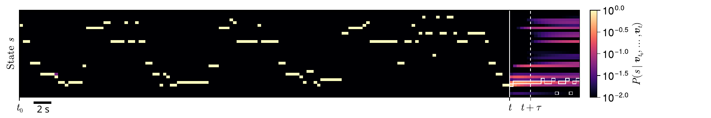

Note:
- Our data: six larvae, about 45,000 neurons, one frame every 0.4 s
- An RBM compresses each frame; each HMM state is one point in its hidden space
- Bottom: the decoded state, one at a time, with stays of a few seconds

---

## Activity hops from one state region to the next

<video data-autoplay loop muted data-src="figures/hmm_states_movie.mp4" style="max-height:560px; width:auto; display:block; margin:6px auto;"></video>

Note:
- Fish F4, 16 states, 4× speed. Point at the orange dot: it stays in a region, then hops to a neighbour
- But 16 is our choice. Next: what changes with the number of states

---

## Our HMM fits keep improving as we add states

Note:
- Left: how far ahead we can forecast; it grows like log S
- Right: how much of a frame the state explains; no plateau up to 128 states
- So every model we fit is too small for the data

--

## Forecasts stay useful longer with more states

Note:
- Only if asked. Gain over the stationary forecast against horizon, one panel per S
- Dashed: the fit that gives t_pred, from 0.29 s at S = 2 to 1.56 s at S = 128

---

## Going from 8 to 16 states redraws the state map

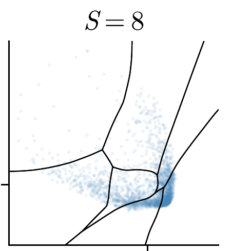
→
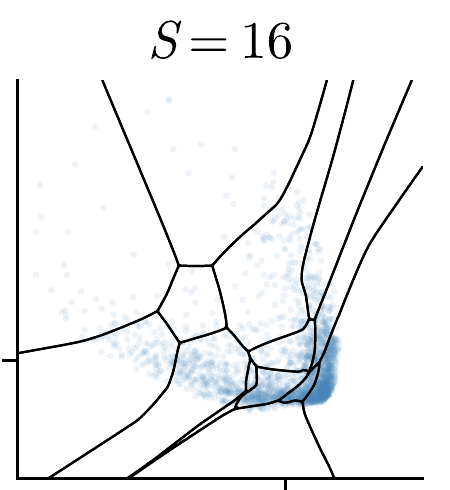

Note:
- Each cell: the frames one state explains best
- From 8 to 16 states, cells split, and borders also move
- Ask aloud: if the data have K⋆ states and we fit K < K⋆, which states merge, and why?

---

## A toy case with three hidden states

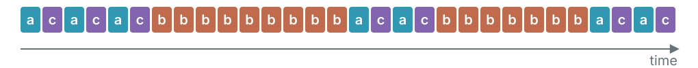

Note:
- To answer it, a toy with three hidden states. Each bump is what one state emits
- a and b look alike. a and c switch fast; b stays long
- Bottom: one sample of the hidden sequence

---

## Which merge does a two-state fit choose, a+b or a+c?

Note:
- Fit two states: two ways to merge. Middle row, a+b: emissions almost right, but short and long stays mixed
- Bottom row, a+c: emissions worse, but the fast switching becomes one long stay
- A fit must trade looks against timing. That is the question of the talk. We start without timing

---

# 1 · Clustering with too few clusters, without dynamics

Note:
- First, no dynamics at all: what does a too-small clustering do?

---

## A mixture model is an HMM without memory

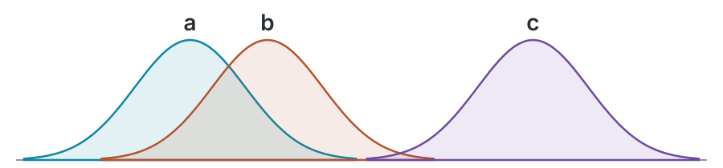

$$P(y) = \sum_s \pi_s \, f_s(y)$$

Note:
- Remove the arrows from the HMM: each frame picks cluster s with probability π_s, then draws from its bump f_s
- Here the bumps are Gaussians of equal width, the case where the answer is known (Rose)
- Toy: data from three bumps, fit two clusters

---

## Clusters split one at a time as temperature drops

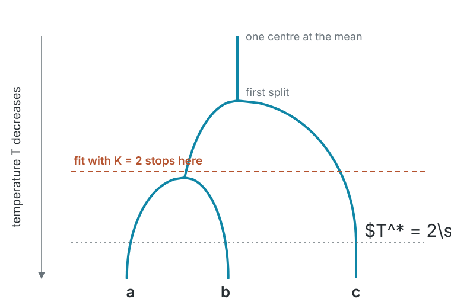

$$P(s = j \mid y) \propto e^{-\|y - \mu_j\|^2 / T}$$

Paper: Statistical mechanics and phase transitions in clustering | Rose, Gurewitz & Fox, *PRL*, 1990

Note:
- Rose's idea: give every cluster the same assumed width, T = twice its variance, and lower T slowly
- High T: one cluster at the mean. As T drops, clusters split one at a time
- Read the tree upwards, raising T: a and b merge first, c joins later. Dotted line: the true width

--

## The centres balance distance against randomness

$$P(s = j \mid y) = \frac{e^{-d(y, \mu_j)/T}}{Z_y}, \qquad Z_y = \sum_k e^{-d(y, \mu_k)/T}, \qquad d(y,\mu) = \|y - \mu\|^2$$
$$F = D - T H = -T \sum_y p(y) \log Z_y \qquad\Rightarrow\qquad \mu_j = \frac{\sum_y p(y)\, y \, P(s = j \mid y)}{\sum_y p(y)\, P(s = j \mid y)}$$
$$\text{cluster } j \text{ splits when } T < T_c = 2 \lambda_{\max}\big(\mathrm{Cov}[y \mid s = j]\big)$$

- $p(y)$: weight of point $y$ ($1/N$ for $N$ points); $\mu_j$: centre of cluster $j$; $D$, $H$: mean distance and entropy of the assignments
- Same as fitting a Gaussian mixture (equal weights, variance fixed at $\sigma^2 = T/2$): $F = -T \times$ log-likelihood + const
- $T \to 0$: k-means

Footnote: Rose, Gurewitz & Fox, *PRL* (1990); Rose, *Proc. IEEE* (1998)

Note:
- Only if asked. The posterior is Bayes with equal weights and width T/2; also the maximum-entropy assignment at fixed mean distance D
- Minimising F gives centres as weighted means. Iterate at fixed T, then lower T slowly
- T_c: the one-centre solution becomes a saddle along the top principal axis. Near T_c the split is continuous
- Same as a Gaussian mixture with variance fixed at T/2; T → 0 is k-means. Local condition only, no global guarantee

---

## A cluster splits when the temperature falls below twice its largest variance

$$T_c = 2\lambda_{\max}\big(\mathrm{Cov}[y \mid s = j]\big)$$

- $T_c$: temperature at which cluster $j$ splits in two
- $\lambda_{\max}$: largest eigenvalue of the cluster's covariance, i.e. its variance along the principal axis

Paper: Deterministic annealing for clustering, compression, classification, regression, and related optimization problems | Rose, *Proc. IEEE*, 1998

Note:
- The rule: a cluster splits when T falls below twice its largest variance, along that direction
- So the widest cluster splits first. The covariance uses the points the cluster holds at that T
- Keep in mind: with dynamics, what plays the role of this variance?

---

## Without memory, a too-small model merges the closest clusters

A too-small model sees the data coarser, as at a higher T

Note:
- Fit the toy with two clusters and free widths: one bump on a+b, wider, weight 2/3
- A too-small model sees the data as at a higher T: the closest clusters merge first
- Answer without memory: a+b. Next: does timing change that?

---

# 2 · HMMs with too few states

Note:
- Now the HMM itself. First: what does a fit to the wrong model converge to?

---

## With infinite data, the fit goes to the best next-step predictor

$$\ell(\theta) = \mathbb{E}_{\star}\big[\log p_\theta(y_t \mid y_{t-1}, y_{t-2}, \dots)\big]$$

Paper: Asymptotic properties of the maximum likelihood estimation in misspecified hidden Markov models | Douc & Moulines, *Ann. Stat.*, 2012

Note:
- ℓ is the score: the average log-probability of the next frame given the past, under the fitted HMM, over the true data
- Douc & Moulines: with enough data, the fit maximises ℓ, even when the model is wrong
- Toy: the two-state fit is a+b or a+c, whichever has the larger ℓ

--

## The likelihood is a sum of next-step predictions

$$\frac{1}{L}\log p_\theta(y_1,\dots,y_L) = \frac{1}{L}\sum_{t=1}^{L} \log p_\theta(y_t \mid y_{1:t-1}) \;\xrightarrow[L\to\infty]{}\; \ell(\theta)$$

$$\ell(\theta) = -h_\star - \mathbb{E}_\star\Big[\mathrm{KL}\big(p_\star(y_t \mid \text{past}) \,\big\|\, p_\theta(y_t \mid \text{past})\big)\Big]$$

Note:
- Only if asked. Chain rule: the likelihood is a product of one-step predictions; over a long sequence its average gives ℓ (ergodic theorem)
- Hard part of the proof: the filter forgets its start, so a finite past acts like the infinite past
- h⋆ is the same for every fit, so maximising ℓ = minimising the average KL to the true prediction

--

## Other results say how many states, not what they mean

- With more data, a too-small number of states is detected with exponentially high probability
- To find the best $K$-state HMM: $\ell$ has no formula, so they maximise a computable proxy
- With a wrong emission model, selection criteria pick too many states

Footnote: Gassiat & Boucheron (2003); Finesso, Grassi & Spreij (2010); Pohle, Langrock, van Beest & Schmidt (2017)

Note:
- Only if asked. Gassiat & Boucheron: you will detect that K is too small, nothing more
- Finesso et al.: same goal, same obstacle; they replace ℓ by a computable proxy, which gives an algorithm, not a description of the fit
- Pohle et al.: in practice, extra states absorb a wrong emission model

---

## Control theory shrinks an HMM by grouping its states

- Choose a grouping, average transitions and emissions inside each group
- Keep the grouping that loses the least $\ell$

Paper: A recursive learning algorithm for model reduction of hidden Markov models | Deng, Mehta, Meyn & Vidyasagar, *CDC-ECC*, 2011

Note:
- Model reduction asks our toy question directly: {a,b}{c} or {a,c}{b}?
- Average transitions and emissions in each group, keep the grouping that loses the least ℓ
- Closest work to ours (not read in full: don't claim details)

---

## When is the best small HMM a grouping, and which grouping?

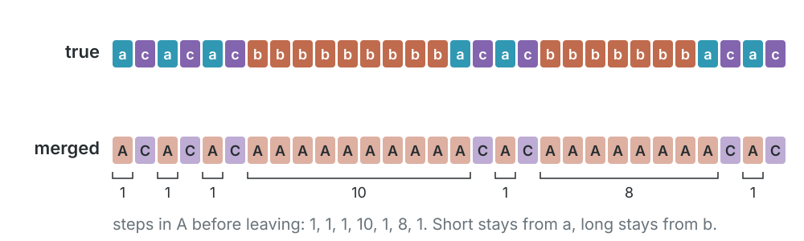

Note:
- Point at the brackets: inside ab, a stay lasts 1 step if it started in a, about 10 if it started in b
- A Markov state has one typical stay length, so the grouped state is not exactly Markov
- So a free fit might beat every grouping. Ask aloud: when is the best small HMM a grouping, and which one?

---

## The score has no formula because each prediction needs the filter

$$p_\theta(y_t \mid \text{past}) = \sum_s P(s_t = s \mid \text{past})\; f_s(y_t)$$

- $P(s_t = s \mid \text{past})$: the filter, what the past says about the current state
- $f_s(y_t)$: emission of state $s$

Note:
- To predict the next frame, the HMM guesses the current state from the whole past (the filter), then emits
- The filter is updated by Bayes at every step; its long-run statistics have no closed form (Blackwell, 1957)
- So ℓ has no formula, and we cannot simply compare the two merges

---

## With memory, nobody says which states a too-small HMM merges

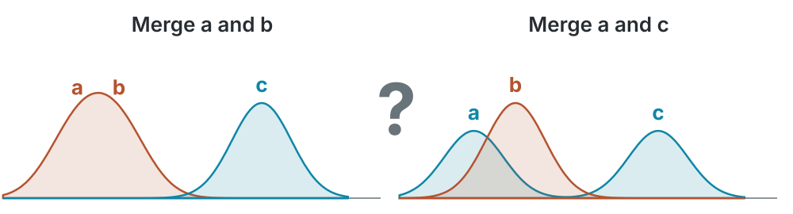

Note:
- The gap: we know what the fit maximises, but cannot compute it; grouping methods assume the answer is a grouping
- So on the toy, nobody can say a+b or a+c. Next: limits where ℓ becomes computable

---

# 3 · Four limits where the score can be computed

Note:
- Derived 23/10 to 13/11, checked numerically, not yet re-derived by hand

---

## We look for limits where the score becomes computable

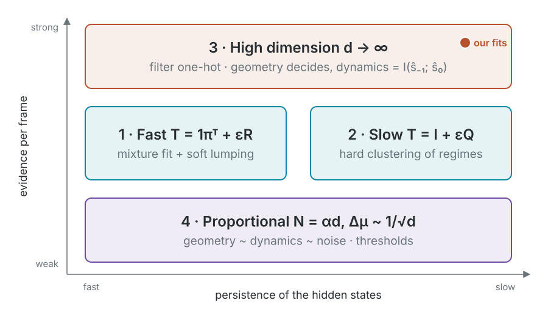

Note:
- Top row, limits on the dynamics. Fast: the chain forgets in one step. Slow: it rarely switches
- Bottom row, limits on one frame of d coordinates. Left: one frame names its state. Right: each coordinate carries little evidence
- Separate limits, not a phase diagram. Two are worked out: fast mixing and high dimension. Our zebrafish fits sit in d → ∞

---

## First limit: fast mixing

$$\begin{gathered}\mathcal{T} = \mathbf{1}\pi^\top + \varepsilon R, \qquad \sum_{s'} R_{ss'} = 0 \\[0.3em] \mathcal{T}^\star = \mathbf{1}\pi^{\star\top} + \varepsilon^\star R^\star\end{gathered}$$

Note:
- Fast mixing: every row of 𝒯 is close to π, so the next state barely depends on the current one. At ε = 0 the HMM is a mixture
- The truth mixes fast too, ε⋆ small. The fit's ε is free; it comes out small because the data have little memory

---

## With fast mixing, the prediction is the mixture plus a small correction

$$\begin{aligned}
P(y_t \mid \text{past}) &= \sum_{r,s} \pi_{t-1}(r)\; \mathcal{T}_{rs}\; f_s(y_t) \\
&= \sum_s \pi_s\, f_s(y_t) \;+\; \varepsilon \sum_{r,s} \pi_{t-1}(r)\, R_{rs}\, f_s(y_t) \\
&= m(y_t) + O(\varepsilon) \\[0.3em]
\ell &= \mathbb{E}_\star\big[\log m(y_t)\big] + O(\varepsilon)
\end{aligned}$$

- $\pi_{t-1}(r) = P(s_{t-1} = r \mid \text{past})$: the filter, belief about the previous state
- $m(y) = \sum_s \pi_s f_s(y)$: the mixture density

Note:
- Line 1: guess the previous state from the past (the filter), step with 𝒯, emit
- Line 2: put in 𝒯 = 1πᵀ + εR. The π part ignores the past: that is the mixture
- Lines 3–4: the mixture density plus a term of order ε. Take the log and average

---

## So at leading order, the fit is the mixture fit of section 1

Note:
- At leading order, maximising ℓ is maximising the mixture score: same π, same emissions as in section 1
- So the toy merges a+b, as without memory. Memory only adds a small term on top

---

## With fast mixing, timing cannot change the merge

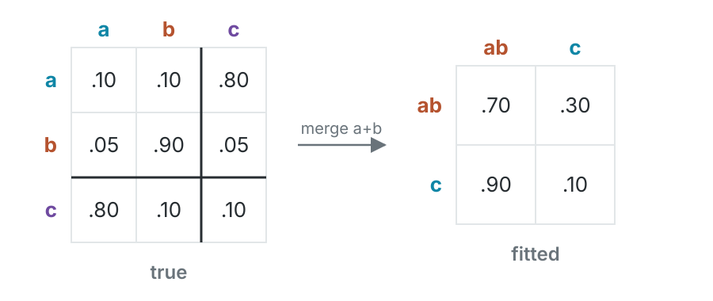

Note:
- The merge is fixed by the emissions. The fit still learns transitions: how the true chain moves between the merged groups
- Toy, merge a+b: ab stays with probability 0.70, c returns to ab with 0.90. Baum–Welch on the toy gives the same
- If asked: the toy as drawn is not fast mixing; the numbers still match because the emissions barely overlap

--

$$\begin{aligned}
\frac{P(y_t \mid \text{past})}{m(y_t)} &= 1 + \varepsilon \sum_{r,s} \pi_{t-1}(r)\, R_{rs}\, \frac{f_s(y_t)}{m(y_t)} \\
&= 1 + \varepsilon\, u_t + o(\varepsilon), \qquad u_t = \sum_{r,s} \phi_r(y_{t-1})\, R_{rs}\, \frac{\phi_s(y_t)}{\pi_s} \\[0.6em]
u_t &= \eta \Big(\sum_s \frac{\phi_s(y_{t-1})\,\phi_s(y_t)}{\pi_s} - 1\Big) \qquad \text{two states: } R = \eta\,\big(I - \mathbf{1}\pi^\top\big) \\
&= \eta\, \frac{\big(\phi_1(y_{t-1}) - \pi_1\big)\big(\phi_1(y_t) - \pi_1\big)}{\pi_1 \pi_2}
\end{aligned}$$

where $\phi_s(y) = \pi_s f_s(y) / m(y)$: probability of state $s$ judged from frame $y$ alone

Note:
- Only if asked. Line 1: the prediction of the last derivation, divided by the mixture m. Exact
- Line 2: f_s/m = φ_s/π_s, and at this order the filter only knows the last frame, π_{t−1} = φ(y_{t−1}). Call the sum u_t
- Lines 3–4: with two states R = η(I − 1πᵀ); εη is the lag-1 autocorrelation of the fitted state. u_t is a product of consecutive fluctuations of φ₁
- Toy, a+b fit: frames from a and from b both give φ_ab ≈ 1, so only ab ↔ c is visible

--

$$\begin{aligned}
\ell - \ell_{\text{mix}} &= \mathbb{E}_\star\big[\log(1 + \varepsilon u_t)\big] = \varepsilon\, \mathbb{E}_\star[u_t] - \tfrac{\varepsilon^2}{2}\, \mathbb{E}_\star[u_t^2] + O(\varepsilon^{\star 3}) \\
&= \kappa\varepsilon\eta\,\rho - \tfrac12 (\kappa\varepsilon\eta)^2 + O(\varepsilon^{\star 3}) \\[0.4em]
\varepsilon \hat\eta &= \frac{\rho}{\kappa}, \qquad \max_\eta\, \ell - \ell_{\text{mix}} = \frac{\rho^2}{2}
\end{aligned}$$

<ul>
<li>$u_t$: as on the last slide</li>
<li>$\ell_{\text{mix}} = \mathbb{E}_\star\big[\log m(y_t)\big]$</li>
<li>$\rho = \mathrm{Corr}_\star\big(\phi_1(y_{t-1}), \phi_1(y_t)\big)$</li>
<li>$\kappa = \mathrm{Var}_\star\big(\phi_1(y_t)\big) / (\pi_1\pi_2) \in [0, 1]$</li>
</ul>

Note:
- Only if asked. ρ: how much consecutive frames agree on the state. κ: how sharply one frame names it (1 without overlap)
- Expand the log to second order: the linear term sets the direction of εη, the quadratic term how far
- Optimum εη̂ = ρ/κ, gain ρ²/2. Toy, a+b fit: after c, ab comes more often than chance, so ρ < 0

--

## In matrix form, memory trades a covariance reward against a curvature penalty

$$\ell - \ell_{\text{mix}} = \underbrace{\varepsilon \,\mathrm{tr}\big(R^\top \Gamma_1 D_\pi^{-1}\big)}_{\text{reward}} \;-\; \underbrace{\tfrac{\varepsilon^2}{2}\, \mathrm{tr}\big(R^\top \Phi R\, D_\pi^{-1} \Phi D_\pi^{-1}\big)}_{\text{penalty}} \;+\; O(\varepsilon^{\star 3})$$
$$\Longrightarrow\quad \varepsilon \hat R = \Phi^{-1}\, \Gamma_1\, \Phi^{-1} D_\pi$$

<ul>
<li>$\Gamma_1 = \mathrm{Cov}_\star\big(\phi(y_{t-1}), \phi(y_t)\big)$: covariance of consecutive state probabilities</li>
<li>$\Phi = \mathbb{E}_\star\big[\phi(y)\phi(y)^\top\big]$, $D_\pi = \mathrm{diag}(\pi)$</li>
<li>$\Gamma_1 = O(\varepsilon^\star)$: consecutive frames are weakly dependent</li>
</ul>

Note:
- Only if asked. Reward: only the covariance Γ₁ of consecutive state probabilities survives, linear in R
- Penalty: frames almost independent, so the square factorises into Φ, quadratic in R. Lag 2 enters only at O(ε⋆³)
- The balance sets the memory: εR̂ = Φ⁻¹Γ₁Φ⁻¹D_π

--

## With K states, the fit learns how the true chain moves between merged groups

$$\begin{gathered}\hat{\mathcal{T}}_{ss'} = P_\star\big(s^\star_t \in C_{s'} \mid s^\star_{t-1} \in C_s\big) = \frac{\sum_{s^\star \in C_s} \sum_{s'^\star \in C_{s'}} \pi^\star_{s^\star}\, \mathcal{T}^\star_{s^\star s'^\star}}{\sum_{s^\star \in C_s} \pi^\star_{s^\star}} \\[0.4em]
\max\, \ell - \ell_{\text{mix}} = \tfrac12 \sum_{i} \rho_i^2 + O(\varepsilon^{\star 3})\end{gathered}$$

<ul>
<li>$C_s$: the true states merged into fitted state $s$; $s^\star_t$: true state at time $t$</li>
<li>$\rho_1 \geq \dots \geq \rho_{K-1}$: correlations between $\phi(y_{t-1})$ and $\phi(y_t)$, one per independent direction of $\phi$; with two states, the single $\rho$</li>
</ul>

Note:
- Only if asked. Without overlap Φ = D_π, so εR̂ is the grouped transition minus π: watch the true chain, write only the group, count
- Toy: P(ab → ab) = (0.25 × 0.20 + 0.50 × 0.95) / 0.75 = 0.70, the number on the main slide
- ρᵢ: canonical correlations, the largest correlation between weighted sums of φ at t−1 and at t, then the next one uncorrelated with it
- With overlap, a soft lumping: 𝒯̂ − 1πᵀ = W(𝒯⋆ − 1π⋆ᵀ)V. Checked against the exact filter: within 2–3% at ε⋆ = 0.05–0.1

---

## In high dimension, one state clearly explains each frame

$$\log \frac{f_s(y)}{f_{s'}(y)} = \sum_{i=1}^{d} \log \frac{f_{s,i}(y_i)}{f_{s',i}(y_i)} \qquad \text{mean} \sim d, \quad \text{spread} \sim \sqrt{d}$$

$y = (y_1, \dots, y_d)$: one frame, with coordinates independent given the state

Note:
- Second limit: many coordinates per frame, d → ∞. Our zebrafish fits sit here
- Start with one frame. Each coordinate votes; the votes add up like d, the noise like √d, so the best state wins by a margin of order d
- Assumes coordinates independent given the state (correlated noise: for later). Ask aloud: can the past overrule such a frame?

---

## The past adds a bounded term, so one frame names its state

$$\log \frac{\pi_t(s)}{\pi_t(s')} = \underbrace{\log \frac{\pi_{t|t-1}(s)}{\pi_{t|t-1}(s')}}_{\text{past: } |\cdot| \,\le\, \log(1/t_{\min})} + \underbrace{\log \frac{f_s(y_t)}{f_{s'}(y_t)}}_{\text{frame: } \sim d}$$

<ul>
<li>$\pi_t(s) = P(s_t = s \mid y_{1:t})$: the filter</li>
<li>$\pi_{t|t-1}(s) = \sum_r \pi_{t-1}(r)\, \mathcal{T}_{rs} \in [t_{\min}, 1]$: prediction from the past, $t_{\min} = \min \mathcal{T}$</li>
</ul>

$$\Longrightarrow \quad \pi_t(s) \to \mathbf{1}\big[s = \hat s_t\big], \qquad \hat s_t = \arg\max_s f_s(y_t)$$

Note:
- Bayes in log form: the filter = what the past predicted + what the frame says
- The prediction averages column s of 𝒯, so it stays between t_min and 1 whatever came before. The frame term grows like d and wins
- So the filter is one-hot on the frame's best state ŝ_t; the rest of the past drops out. Ask aloud: how large must d be?

--

$$\begin{aligned}
\pi_{t|t-1}(s) &= \sum_r \pi_{t-1}(r)\, \mathcal{T}_{rs} \;\in\; [t_{\min}, 1] \\[0.3em]
\frac{\pi_t(s)}{\pi_t(\hat s)} &= \frac{\pi_{t|t-1}(s)}{\pi_{t|t-1}(\hat s)}\, \frac{f_s(y_t)}{f_{\hat s}(y_t)} \;\le\; \frac{1}{t_{\min}}\, e^{-|L_{\hat s s}(y_t)|} \\[0.3em]
\big|\pi_t(s) - \mathbf{1}[s = \hat s]\big| &\le \frac{K - 1}{t_{\min}}\, \max_{s' \neq \hat s} e^{-|L_{\hat s s'}(y_t)|} \;\longrightarrow\; 0
\end{aligned}$$

$\pi_{t|t-1}$: belief before seeing $y_t$; $\ \pi_t$: after; $\ L_{s s'} = \log f_s / f_{s'}$; $\ \hat s = \hat s_t$

Note:
- Only if asked. Line 1: the prior on s averages column s of 𝒯, so it lies in [t_min, 1] whatever the past
- Line 2: Bayes; the normalisation cancels in the ratio, which is below 1/t_min times e^{−margin}
- Line 3: sum over the wrong states. The bound vanishes when the margin grows (hypothesis A)

---

## The frame wins once its evidence beats the rarest transition

$$\underbrace{\log \frac{f_{\hat s_t}(y_t)}{f_s(y_t)}}_{\sim\, d} \;\gg\; \underbrace{\log \frac{1}{t_{\min}}}_{\text{fixed by } \mathcal{T}} \qquad \text{for every } s \neq \hat s_t$$

<ul>
<li>Exception: a transition with probability $e^{-\gamma d}$. A fitted HMM gives such probabilities only to transitions it never saw in training</li>
</ul>

Note:
- Answer: compare one frame's evidence with the most the past can say. The left side grows with d, the right side is fixed by 𝒯
- The only exception: transitions so rare their cost grows with d too. Then the HMM waits several frames before switching. The best fit never does this for transitions it sees
- Our fits, S = 128: where it fails, it is almost always a transition Baum–Welch set below 10⁻⁶. Skip if short on time

---

## The score splits into classifying frames and counting transitions

$$\begin{aligned}
P(y_t \mid \text{past}) &= \sum_{r,s} \pi_{t-1}(r)\, \mathcal{T}_{rs}\, f_s(y_t) \\
&\approx \mathcal{T}_{\hat s_{t-1} \hat s_t}\, f_{\hat s_t}(y_t) \\[0.3em]
\ell &= \mathbb{E}_\star\Big[\max_s \log f_s(y_t)\Big] + \sum_{s,s'} N_{ss'} \log \mathcal{T}_{ss'} + o(1)
\end{aligned}$$

- $N_{ss'} = P_\star\big(\hat s_{t-1} = s,\ \hat s_t = s'\big)$: frequency of decoded transitions from $s$ to $s'$

Note:
- Now use the one-hot filter. Line 1: to predict y_t, the model uses its belief about the previous state, one-hot on ŝ_{t−1}
- Line 2: in the sum over s, ŝ_t wins for the same reason
- Line 3: log and average. First term: each frame scored by its best state, of order d. Second: the decoded sequence scored as a Markov chain

---

## So the emissions cluster single frames, and transitions are counted on decoded frames

$$\begin{aligned}
\ell_{\text{HMM}} - \ell_{\text{mix}} &= \underbrace{\sum_{s,s'} N_{ss'} \log \mathcal{T}_{ss'}}_{-H(\hat s_t \mid \hat s_{t-1})} \; \underbrace{- \sum_s N_s \log \pi_s}_{H(\hat s_t)} + o(1) \\[0.3em]
&= I\big(\hat s_{t-1}; \hat s_t\big) + o(1) \\[0.3em]
&\leq \log K + o(1)
\end{aligned}$$

<ul>
<li>$N_s = P_\star(\hat s_t = s)$: how often state $s$ is decoded; $\pi_s$: weights of the mixture with the same emissions</li>
<li>$I$: mutual information between consecutive decoded states; $K$: number of fitted states</li>
</ul>

Note:
- Emissions: the first term is of order d, the second at most log K, so the emissions cluster single frames. Toy: the look-alikes a+b merge
- Transitions: decode each frame alone and count. Mixture weights: count the states
- Subtract the mixture: what is left is I, the information between consecutive decoded states. Dynamics only break exact ties between clusterings

---

## Our zebrafish fits follow the high-dimension prediction

Note:
- First the premise: on our fits the filter is one-hot on 97–99.8% of frames
- x: I from the decoded counts. y: the exact gain of the HMM over the mixture. One dot per S, from 2 to 128, mean over 6 fish
- On the line for S = 4 to 16, within 0.01 nats. At 128: 2.08 vs 2.21, mostly because Baum–Welch stopped before the best 𝒯

---

## With fast mixing or in high dimension, the merge depends only on the emissions

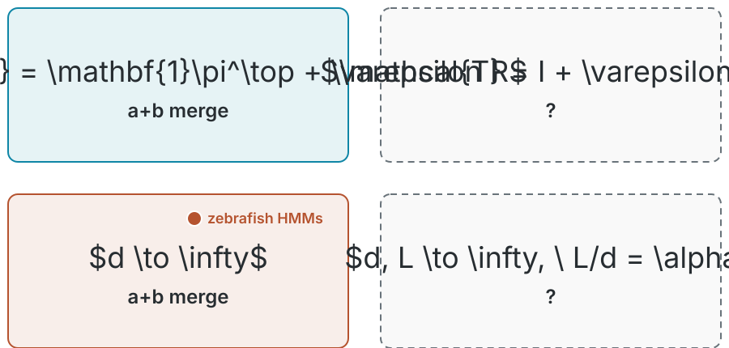

Note:
- Back to the question. Fast mixing: the fit is the mixture fit, plus the true transitions between the merged groups
- High dimension: the emissions cluster single frames; dynamics only break ties
- In both, the states that look alike merge: a+b on the toy. Timing can only win in the two open limits

---

## Next steps: slow mixing and weak frames

**Slow mixing**

$\mathcal{T} = I + \varepsilon Q$

The belief stays on one state for long stretches. The hard part is the cost of each switch

**Weak frames**

$L/d = \alpha$ fixed  
$d \to \infty$

One frame carries little evidence, so emissions and dynamics enter at the same order

Note:
- Slow mixing: after a switch the belief needs about log(1/ε) frames to follow, sometimes much longer; those delays set the cost
- Weak frames: no closed form for the filter, and with as many frames as dimensions the fit can miss the states entirely (tools: AMP, replicas)
- On the toy, simulations with strong timing merge the fast-switching pair a+c, or give no grouping at all. These limits are where that should appear

---

# 4 · An attempt at the general case

Note:
- Idea from Rémi, 13/11: avoid limits altogether. Skip the section if short on time

---

## Average the likelihood instead of its logarithm

$$\ell = \lim_{L \to \infty} \frac{1}{L} \lim_{n \to 0} \frac{1}{n} \log \mathbb{E}_\star\big[P(Y)^n\big]$$

- $Y$: a whole sequence of length $L$; $P(Y)$: its likelihood under the fitted HMM
- For integer $n$, the average $\mathbb{E}_\star\big[P(Y)^n\big]$ is an exact sum over paths

Note:
- ℓ averages log P(Y), which has no formula. Averaging a power of P(Y) is easier: for integer n it is an exact sum over paths
- The log comes back as n → 0. Exact at every L: the slope at n = 0 of log E[Pⁿ] is the mean of log P
- At n = 1 the averaged likelihood is set by the largest eigenvalue of a matrix τ on (fitted, true) pairs. That made n = 1 attractive (backup below)

--

$$\begin{aligned}
\mathbb{E}_\star[P(Y)] &= \int P_\star(Y)\, P(Y)\, dY \\
&= \sum_{s_{1:L}} \sum_{s^\star_{1:L}} \pi_{s_1} \pi^\star_{s^\star_1} \prod_{t=2}^{L} \mathcal{T}_{s_{t-1}s_t}\, \mathcal{T}^\star_{s^\star_{t-1}s^\star_t} \prod_{t=1}^{L} \int f_{s_t}(y)\, f^\star_{s^\star_t}(y)\, dy \\
&= \sum_{(s,s^\star)_{1:L}} \rho_0(s_1, s^\star_1) \prod_{t=2}^{L} \tau_{(s_{t-1},s^\star_{t-1}) \to (s_t,s^\star_t)} = \langle \rho_0 | \tau^{L-1} | 1 \rangle
\end{aligned}$$

$Y = y_{1:L}$; $\ P$, $P_\star$: fitted and true likelihoods; $\ s_{1:L}$, $s^\star_{1:L}$: fitted and true hidden paths; $\ \rho_0(s, s^\star) = \pi_s\, \pi^\star_{s^\star} \int f_s(y)\, f^\star_{s^\star}(y)\, dy$: weight of the first pair

Note:
- Only if asked. Line 1: average over the true data
- Line 2: write both likelihoods as sums over hidden paths. Given both paths, frames are independent, so the integral splits into one overlap per step
- Line 3: group the two paths into one path of pairs (s, s⋆): the weights multiply along it, a matrix power. Exact for any L

--

## The averaged likelihood is a power of one matrix on pairs of states

$$\mathbb{E}_\star[P(Y)] = \langle \rho_0 | \tau^{L-1} | 1 \rangle, \qquad \tau_{(s,s^\star) \to (s',s'^\star)} = \mathcal{T}_{ss'}\ \mathcal{T}^\star_{s^\star s'^\star}\ M_{s's'^\star}$$

<ul>
<li>$M_{ss^\star} = \int f_s(y)\, f^\star_{s^\star}(y)\, dy$: overlap of the emissions of fitted state $s$ and true state $s^\star$</li>
<li>$\rho_0(s,s^\star) = \pi_s \pi^\star_{s^\star} M_{ss^\star}$</li>
</ul>

Note:
- Only if asked. Run the fitted and true chains side by side; at each step, gain the overlap of what they emit
- Long sequences: only the largest eigenvalue of τ counts, so maximising the averaged likelihood = maximising that eigenvalue
- Toy: a 6 × 6 matrix (2 fitted × 3 true)

---

## Averaging the likelihood adds the log-likelihood variance to the usual score

$$\begin{aligned}
\Lambda(n) &= \lim_{L \to \infty} \frac{1}{L} \log \mathbb{E}_\star\big[e^{\,n \log P(Y)}\big] \\[0.3em]
&= \lim_{L \to \infty} \frac{1}{L} \Big( n\, \mathbb{E}_\star\big[\log P(Y)\big] + \frac{n^2}{2}\, \mathrm{Var}_\star\big[\log P(Y)\big] + O(n^3) \Big) \\[0.3em]
&= n\, \ell + \frac{n^2}{2}\, v + O(n^3) \\[0.3em]
\frac{\Lambda(n)}{n} &= \ell + \frac{n}{2}\, v + O(n^2) \\[1.2em]
v &= \lim_{L \to \infty} \frac{1}{L} \mathrm{Var}_\star\big[\log P(Y)\big]
\end{aligned}$$

Note:
- Line 1: Λ is the growth rate of the averaged likelihood, L → ∞ first; write Pⁿ as an exponential
- Lines 2–3: expand in n: the mean of log P gives ℓ, its variance gives v
- Line 4: we guess Λ is smooth at n = 0 and swap the limits, so n → 0 gives back ℓ (true in our numerics)
- Any n > 0 rewards fits whose log-likelihood fluctuates, and slower chains fluctuate more. Next: what that does, computed exactly

---

## The variance term slows the best chain until it never switches

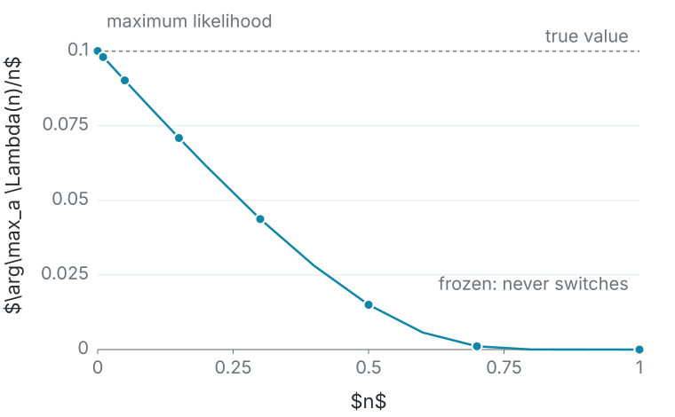

<em>Data:</em> 2-state HMM, switching probability 0.1, emissions $\mathcal{N}(\pm 1.5, 1)$

<em>Fit:</em> same emissions, $a$ chosen to maximise $\Lambda(n)$

$$\mathcal{T} = \begin{pmatrix} 1-a & a \\ a & 1-a \end{pmatrix}$$

Note:
- Simplest case: the model is right, only the switching probability a is fitted. Computed exactly for every n. Skip if short on time
- Left end, n → 0: the usual fit finds the true 0.1
- Moving right, the variance term wins: the best a falls, and from about n = 0.8 the chain never switches. Same with 3 true states
- So n = 1 cannot replace the likelihood: the method has to go all the way to n → 0

---

## Conclusions

- Without memory, the closest clusters merge
- With fast mixing or in high dimension, memory does not change the merge
- In high dimension, transitions are counted on decoded frames, as in our fits
- Averaging the likelihood itself freezes the fitted chain

Note:
- Answer to "which states merge, and why?": in every case we can compute, the states that look alike. Timing only sets the transitions between the merged groups
- Open: slow mixing and weak frames, where timing could win
- Next: Λ(n) near n = 0 beyond 2 states; read Peres & Quas, Deng et al., Kotsalis & Shamma
- Leave this slide up during questions

---

<!-- .slide: data-background-color="#000000" -->

---

<!-- .slide: data-visibility="hidden" -->

# Supplementary

---

<!-- .slide: data-visibility="hidden" -->

## Fitting two Gaussians to three, EM quickly lands on the merged pair

The model is symmetric: which pair merges is fixed in advance.

Paper: Theoretical guarantees for EM under misspecified Gaussian mixture models | Dwivedi, Ho, Khamaru, Wainwright & Jordan, *NeurIPS*, 2018

Note:
- Their case is our toy: a, b close (weight ¼ each), c far (½). Fit: ½N(−θ, σ²) + ½N(θ, σ²), σ known
- EM converges fast; the mean is almost exact (3.005 vs 3), the cost is the width
- They bound the cost of a merge; they cannot say which merge happens

---

<!-- .slide: data-visibility="hidden" -->

## In high dimension, too little data can hide the clusters completely

- Below a critical number of samples per dimension, the fitted centres carry **no information** about the true ones
- Exact thresholds are known, but for the correct number of clusters
- A wrong number of clusters was treated only in 2025

Paper: Statistical mechanics of the maximum-likelihood density estimation | Barkai & Sompolinsky, *PRE*, 1994

Paper: Phase transitions and optimal algorithms in high-dimensional Gaussian mixture clustering | Lesieur, De Bacco, Banks, Krzakala, Moore & Zdeborová, 2016

Paper: The role of rank in mismatched low-rank symmetric matrix estimation | Niu et al., arXiv, 2025

Note:
- Too few samples per dimension: the centres learn nothing
- Wrong number of clusters only treated in 2025; no dynamics anywhere

---

<!-- .slide: data-visibility="hidden" -->

## Each limit has tools in the literature

| Limit | Tools |
|---|---|
| Fast mixing | Pouzo, Psaradakis & Sola (2025); Yin & Zhang (2007) |
| Slow mixing | Peres & Quas; Zhang, Yin & Moore (2007); Noé et al. (2013) |
| High dimension | Zuk, Domany, Kanter & Aizenman; Han & Marcus |
| Weak frames | Ghasemian et al. (2016); Karagulyan & Ndaoud; Kadry & Zhang (2025); Truong |

Note:
- Pouzo et al.: an independent mixture fitted to HMM data still recovers the emissions
- Peres & Quas: entropy rate with rare transitions, our slow limit

