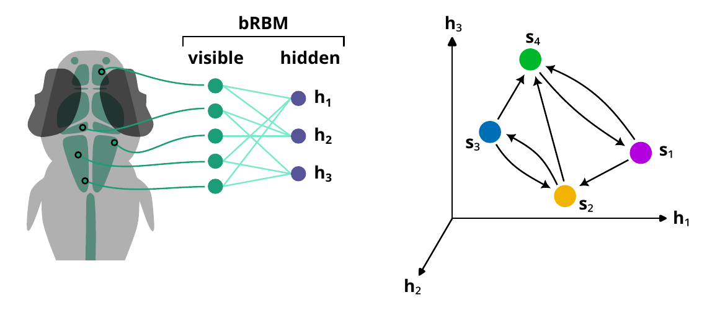
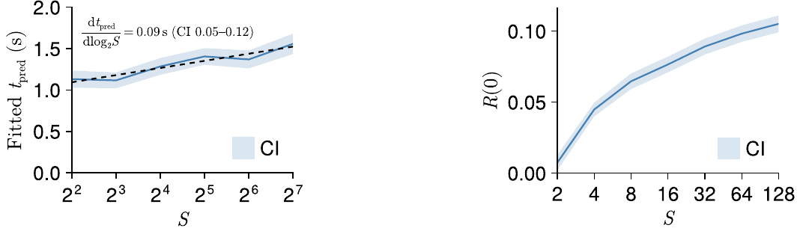
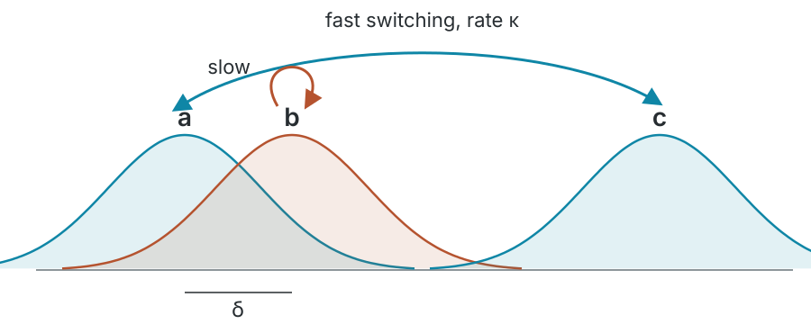
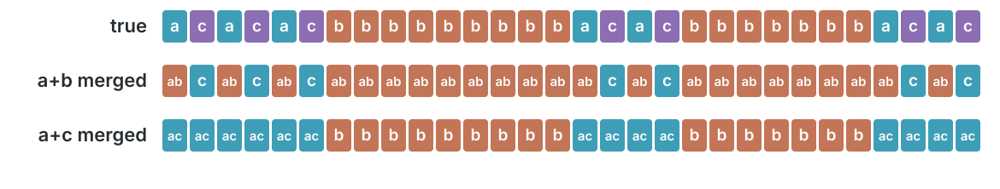
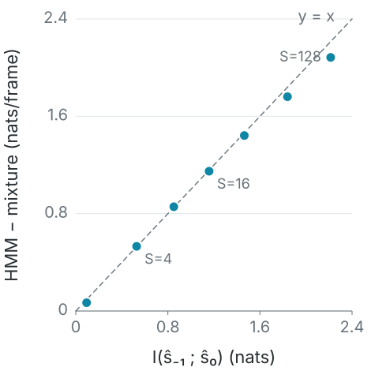
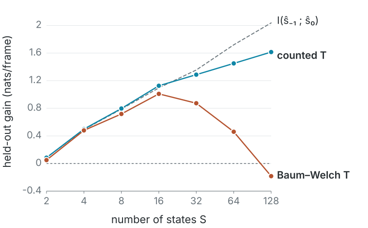
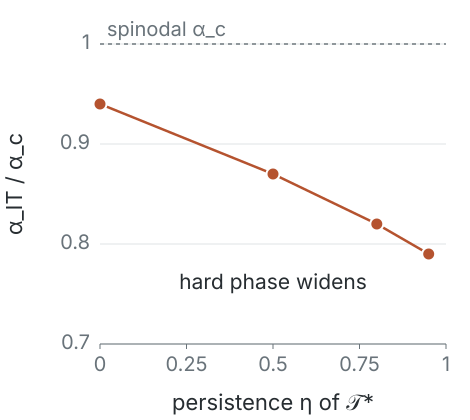

# What does a too-small HMM learn?

Guillaume Faye-Bédrin  
24/11/2026

---

## An HMM is a Markov chain seen through noise

$$T_{ss'} = P(s_{t+1} = s' \mid s_t = s) \qquad\qquad x_t \sim P(x \mid s_t)$$

Note:
- Two ingredients: how the state moves (T, left), what each state emits (emission, right)
- We only see the observations
- The number of states is fixed before fitting: that is the topic

---

## We fit HMMs to whole-brain zebrafish activity

Note:
- Six larvae, about 45,000 neurons, one frame every 0.4 s
- An RBM compresses each frame into 100 hidden units; each HMM state is a point there
- Bottom: one state at a time, stays of a few seconds; from t, forecast with T

---

## Activity hops from one state region to the next

<video data-autoplay loop muted data-src="figures/hmm_states_movie.mp4" style="max-height:560px; width:auto; display:block; margin:6px auto;"></video>

Note:
- Fish F4, 16 states, 4× speed
- Watch the orange dot: it stays in a region, then jumps to a neighbour
- S=16 is arbitrary, what happens with other S?

---

## Our HMM fits keep improving as we add states

Note:
- Left: forecast horizon, grows like log S
- Right: how much of the frame the state explains, no plateau up to 128
- So every model we fit is too small
- R(\tau)

--

## Forecasts stay useful longer with more states

Note:
- Gain over the stationary forecast against horizon, one panel per S, log scale
- Dashed: the fit that gives t_pred, from 0.29 s at S = 2 to 1.56 s at S = 128
- Only if asked how t_pred is measured

---

## Going from 8 to 16 states redraws the state map

→

Note:
- Each cell: the frames one state explains best
- From 8 to 16, cells split, and borders also move
- Ask aloud: data from K* states, fit with K < K*: which states merge, and why?

---

## A toy case with three hidden states

Note:
- Each bump: what one state emits
- a and b look alike; a and c switch fast; b stays long
- Bottom: one sample of the hidden sequence

---

## Which merge does a two-state fit choose, a+b or a+c?

Note:
- First row: the true sequence, as on the previous slide
- Middle row: a+b. Emissions almost right, but short and long stays mixed
- Bottom row: a+c. Emissions bad, but the fast switching disappears into one long stay
- A mixture picks a+b; an HMM must trade looks against timing

---

# 1 · Clustering with too few clusters, without dynamics

---

## A mixture model is an HMM without memory

$$P(x) = \sum_s \pi_s \, P(x \mid s)$$

Note:
- Start without memory: a mixture. Each step picks hidden cluster s with probability π_s, then draws x from its bump
- Same as the HMM, minus the arrows. Bumps need not be Gaussian; here they are, all with the same width (the case Rose treats)
- Toy case: generate data from these three bumps, fit only two clusters. Which do we find?

---

## Clusters split one at a time as temperature drops

$$P(s = j \mid x) \propto e^{-\|x - y_j\|^2 / T}$$

Paper: Statistical mechanics and phase transitions in clustering | Rose, Gurewitz & Fox, *PRL*, 1990

Note:
- Rose: all clusters get the same assumed width; T = twice that variance. Not a training setting, a resolution knob
- High T: one cluster at the mean. Lower T: clusters split one at a time (next slide)
- Dotted line: the true width T* = 2σ*², where centres sit on the true means
- Read bottom-up: a and b merge first, c later. Without memory, distance decides

--

## The centres balance distance against randomness

$$P(s = j \mid x) = \frac{e^{-d(x, y_j)/T}}{Z_x}, \qquad Z_x = \sum_k e^{-d(x, y_k)/T}, \qquad d(x,y) = \|x - y\|^2$$
$$F = D - T H = -T \sum_x p(x) \log Z_x \qquad\Rightarrow\qquad y_j = \frac{\sum_x p(x)\, x \, P(s = j \mid x)}{\sum_x p(x)\, P(s = j \mid x)}$$
$$\text{cluster } j \text{ splits when } T < T_c = 2 \lambda_{\max}\big(\mathrm{Cov}[x \mid s = j]\big)$$

- $p(x)$: weight of point $x$ ($1/N$ for $N$ points); $D$, $H$: mean distance and entropy of the assignments
- Same as fitting a Gaussian mixture (equal weights, variance fixed at $\sigma^2 = T/2$): $F = -T \times$ log-likelihood + const
- $T \to 0$: k-means

Footnote: Rose, Gurewitz & Fox, *PRL* (1990); Rose, *Proc. IEEE* (1998)

Note:
- Only if asked
- Averaged over the points with p(x), as in Rose 1998; a plain sum over points gives the same minimiser
- Why this posterior: Bayes for equal weights and width T/2; also the maximum-entropy assignment at fixed mean distance D (Rose), T the Lagrange multiplier
- Centres = weighted means; iterate at fixed T, then lower T slowly (annealing), perturbing centres to detect splits
- T_c from the second derivative of F: the single-centre solution becomes a saddle along the top principal axis
- Splits are continuous, not jumps: centres move apart fast (typically ∝ √(T_c − T)) and reach the true means at the true width T* = 2σ*². Below T* (towards k-means), overlapping clusters drift slightly apart. Jumps in special cases: equal isotropic clusters ("explosion"), high dimension (Lesieur et al.)
- Necessary condition only; annealing avoids bad local minima in practice, no global guarantee
- Mixture link: E-step = Gibbs assignment, M-step = centroid condition, log-likelihood = sum p(x) log Z_x + const. Annealing = shrink the assumed variance step by step. A normal mixture fit learns the variance, so no T and no collapse

---

## A cluster splits when the temperature falls below twice its largest variance

$$T_c = 2\lambda_{\max}\big(\mathrm{Cov}[x \mid s = j]\big)$$

- $T_c$: temperature at which cluster $j$ splits in two
- $\lambda_{\max}$: largest eigenvalue of the cluster's covariance, i.e. its variance along the principal axis

Paper: Deterministic annealing for clustering, compression, classification, regression, and related optimization problems | Rose, *Proc. IEEE*, 1998

Note:
- A spread-out cluster splits first, along its widest direction (the split is along that eigenvector)
- Cov is weighted by the posterior P(s = j | x): the points the cluster holds at that T
- Local condition only, no proof of the global optimum
- For HMMs: what replaces the variance?

---

## Without memory, a too-small model merges the closest clusters

A too-small model sees the data coarser, as at a higher T

Note:
- Toy fitted with two components (EM, learned widths): one bump on the a+b centre, wider, weight 2/3
- From the full model, raise T: the closest merge first, in the reverse order of the splits
- If asked (supplementary): EM reaches this merged fit fast (Dwivedi 2018); in high dimension, too little data hides the clusters
- Next: with memory, does timing change which clusters merge?

---

# 2 · HMMs fitted with the wrong model

---

## With infinite data, the fit goes to the best next-step predictor

$$\ell(\theta) = \mathbb{E}_{\star}\big[\log p_\theta(y_t \mid y_{t-1}, y_{t-2}, \dots)\big]$$

- $\ell(\theta)$: average log-probability of the next observation
- $p_\theta$: prediction of the fitted HMM with parameters $\theta$
- $\mathbb{E}_\star$: average over data from the true process

Paper: Asymptotic properties of the maximum likelihood estimation in misspecified hidden Markov models | Douc & Moulines, *Ann. Stat.*, 2012

Note:
- Best fit = best predictor of the next observation
- Maximum likelihood converges there, even with the wrong model
- Defines the target, not what it looks like

--

## The likelihood is a sum of next-step predictions

$$\frac{1}{T}\log p_\theta(y_1,\dots,y_T) = \frac{1}{T}\sum_{t=1}^{T} \log p_\theta(y_t \mid y_{1:t-1}) \;\xrightarrow[T\to\infty]{}\; \ell(\theta)$$

$$\ell(\theta) = -h_\star - \mathbb{E}_\star\Big[\mathrm{KL}\big(p_\star(y_t \mid \text{past}) \,\big\|\, p_\theta(y_t \mid \text{past})\big)\Big]$$

Note:
- Chain rule: the likelihood is a product of one-step predictions
- Time average over one long sequence → average over the data (ergodic theorem)
- The filter forgets its start, so the finite past acts like the infinite past: that is the hard part of the proof
- h⋆ = entropy rate of the data, same for every θ → maximise ℓ = minimise the average KL

---

## Other HMM results answer "how many states?", not "what do they mean?"

- Underestimating the number of states becomes exponentially unlikely with more data
- A computable stand-in for the distance between a process and an HMM
- In practice, a wrong emission model makes criteria pick too many states

Footnote: Gassiat & Boucheron (2003); Finesso, Grassi & Spreij (2006–08); Pohle, Langrock, van Beest & Schmidt (2017)

Note:
- They detect that K is too small, and stop there
- In practice, extra states absorb a wrong emission model

---

## We know the fit converges, but not what it converges to

With infinite data the fit converges to the best-predicting HMMs. Nobody has computed what they look like. In the toy case: <b>no answer</b> to a+b versus a+c.

Note:
- The closest answer comes from control theory

---

# 3 · Model reduction of HMMs

---

## Control theory shrinks an HMM by grouping its states

- Choose a grouping, average transitions and emissions inside each group
- Search for the grouping that loses the least

Paper: A recursive learning algorithm for model reduction of hidden Markov models | Deng, Mehta, Meyn & Vidyasagar, *CDC-ECC*, 2011

Note:
- Exactly our toy question: {a,b}{c} or {a,c}{b}
- Loss: the same prediction score as Douc & Moulines
- Closest work to ours; not read in full yet

---

## But the best small HMM need not be a grouping at all

Merging a and b: stays in the merged state are either very short or very long.

Note:
- A Markov state has one typical stay length
- Merged a+b has short and long stays: no longer Markov
- So the best small HMM may not be a grouping

---

## And the quantity to maximise has no formula

The score $\ell$ involves the entropy rate of a hidden Markov process, which has no closed form. So we cannot just write down the best fit.

Note:
- Predicting the next observation means filtering the hidden state: no closed form
- That is why we go to limits where it simplifies

---

## Nobody says which states a too-small HMM merges

For data from a $K^\star$-state HMM, the best $K$-state HMM has not been described: whether it merges true states, which ones, how timing enters, and whether the answer changes abruptly.

Note:
- Searched clustering, misspecified HMMs, model reduction, recent arXiv; Elicit agrees
- Not exhaustive for 2025–26 preprints

---

# 4 · A plan, and first results

Derivations from the last three weeks, checked numerically, not yet re-derived by hand

Note:
- Done 23/10 to 13/11, checked numerically: treat as conjectures

---

## In four limits the score simplifies enough to compute

Note:
- Across: how long states last. Up: how much one frame tells
- Solve the corners, connect them numerically
- Our zebrafish fits sit in the top corner

---

## When states switch fast, the fit is a mixture with a little memory

- Fast switching: the past says almost nothing about the next state
- First the fit is a mixture model, as in section 1
- Then a small memory correction: the true chain **seen through the fitted clusters**

Note:
- The fit is a mixture first, then a small memory correction
- Toy case: a+b merge, as for a mixture

---

## When states last long, the fit sorts whole stays by how they look

- Long stays: the filter locks onto one fitted state per true state
- Each true state goes **entirely** to the fitted state that resembles it most
- The fitted dynamics are the true ones, grouped: the control-theory recipe, now derived

Note:
- Each true state goes whole to the closest fitted state: k-means on true states
- Fitted dynamics = grouped true dynamics, the control-theory recipe
- Toy case: a+b merge

--

## On a four-state test, the fit matches the grouped dynamics within 2.4%

Footnote: Truth: 4 states, 6 symbols. Fit: 2 states, Baum–Welch, 6 starts, switching rate 0.01

Note:
- Skip if short on time
- Curve: prediction, no free parameter. Dots: Baum–Welch
- Best at c = 1: the grouped dynamics win

---

## In high dimension, each frame is classified alone and transitions are counted

- One whole-brain frame names its state with near certainty
- So the emissions are a plain clustering of single frames
- The best transitions: decode each frame, **count** the jumps

Note:
- One frame outweighs the previous state
- So: classify each frame, then count the jumps
- Dynamics only break ties

--

## Our HMM-RBM fits are in this regime

Prediction: what the dynamics add equals the information between consecutive decoded states.

Note:
- On the diagonal = prediction holds; 6 fish, S = 2 to 128
- Good up to S = 16, off at 128 where T has near-zero entries

--

## Counting decoded jumps beats Baum–Welch on held-out data

Footnote: Counted jumps on training frames, pseudocount 0.01. Held-out frames, mean over 6 fish

Note:
- At S = 128: Baum–Welch −0.18, counting 1.62 nats per frame
- Cause: tiny pseudocount, so an unseen jump costs about 20 nats
- A practical fix for the paper

---

## With weak frames, timing can change which states merge

Persistent states make a split detectable with less data.

Footnote: Same form as Ghasemian et al. (2016, *PRX*) for dynamic networks

Note:
- Here emissions, timing and noise compete on equal terms
- Persistent states make a split detectable with less data
- Only corner where the toy case could pick a+c; numerical only

---

## So far, emissions decide what merges

In three of the four limits the fit groups the true states that look alike, as in clustering. Timing changes the grouping only when single frames are weak. In the toy case: <b>a and b merge</b>, unless frames are weak.

Note:
- Mostly, looking alike wins
- All to re-derive and write up

---

# 5 · Rémi's idea for the general case

13/11

---

## Average the likelihood instead of its logarithm

- The score averages $\log P(Y)$: no formula
- Averaging $P(Y)$ itself is a sum over paths we can do exactly
- Later, recover the log with the replica trick

Note:
- Averaging P(Y) is an exact sum over paths
- Replica trick: average P(Y)^n, then n → 0
- Start with 2 fitted states

---

## The averaged likelihood is a power of one matrix on pairs of states

$$\mathbb{E}_\star[P(Y)] = \langle 1 | \tau^{L-1} | \rho_0 \rangle, \qquad \tau_{(x,x^\star) \to (y,y^\star)} = T^\star_{x^\star y^\star}\ T_{xy}\ M_{x x^\star}$$

- $x, y$: fitted states; $x^\star, y^\star$: true states
- $T, T^\star$: fitted and true transition matrices
- $M_{x x^\star}$: overlap of the emissions of fitted state $x$ and true state $x^\star$
- $L$: sequence length

Note:
- Run the fitted and true chains side by side; each step, gain the overlap of what they emit
- Long sequences: only the top eigenvalue counts
- Toy case: a 6-state matrix

---

## Averaging the likelihood rewards rare true sequences; replicas remove them

- With $n = 1$, the fit can bend the true path towards states it emits well
- The price of such a rare path falls like $1/n$, so it vanishes as $n \to 0$
- $n = 1$ is computable but answers another question

Note:
- Skip if short on time
- n = 1 rewards fits where log P(Y) fluctuates
- Next: replica-symmetric ansatz, small n, 2 states

---

## Conclusions

- No dynamics: a too-small model merges the clusters that look alike
- HMMs: the fit converges, but nobody has said to what
- Four limits: emissions decide the merge, timing only for weak frames
- HMM-RBM paper: count decoded jumps for the transitions

Note:
- Next: read Peres & Quas, Deng et al., Kotsalis & Shamma
- Re-derive the fast and slow limits by hand
- Toy model: map which merge wins between the corners
- Rémi's route: 2 states, then n → 0

---

<!-- .slide: data-background-color="#000000" -->

---

# Supplementary

---

## Fitting two Gaussians to three, EM quickly lands on the merged pair

The model is symmetric: which pair merges is fixed in advance.

Paper: Theoretical guarantees for EM under misspecified Gaussian mixture models | Dwivedi, Ho, Khamaru, Wainwright & Jordan, *NeurIPS*, 2018

Note:
- Their case is our toy: a, b close (weight ¼ each), c far (½). Fit: ½N(−θ, σ²) + ½N(θ, σ²), σ known
- EM converges fast; the mean is almost exact (3.005 vs 3), the cost is the width
- They bound the cost of a merge; they cannot say which merge happens

---

## In high dimension, too little data can hide the clusters completely

- Below a critical number of samples per dimension, the fitted centres carry **no information** about the true ones
- Exact thresholds are known, but for the correct number of clusters
- A wrong number of clusters was treated only in 2025

Paper: Statistical mechanics of the maximum-likelihood density estimation | Barkai & Sompolinsky, *PRE*, 1994

Paper: Phase transitions and optimal algorithms in high-dimensional Gaussian mixture clustering | Lesieur, De Bacco, Banks, Krzakala, Moore & Zdeborová, 2016

Paper: The role of rank in mismatched low-rank symmetric matrix estimation | Niu et al., arXiv, 2025

Note:
- Too few samples per dimension: the centres learn nothing
- Wrong number of clusters only treated in 2025; no dynamics anywhere

---

## Each limit has tools in the literature

| Limit | Tools |
|---|---|
| Fast switching | Pouzo, Psaradakis & Sola (2025); Yin & Zhang (2007) |
| Slow switching | Peres & Quas; Zhang, Yin & Moore (2007); Noé et al. (2013) |
| High dimension | Zuk, Domany, Kanter & Aizenman; Han & Marcus |
| Weak frames | Ghasemian et al. (2016); Karagulyan & Ndaoud; Kadry & Zhang (2025); Truong |

Note:
- Pouzo et al.: an independent mixture fitted to HMM data still recovers the emissions
- Peres & Quas: entropy rate with rare transitions, our slow limit

---

## With fast switching, correlations of consecutive posteriors set the memory gain

$$\max_R \ell - \ell_{\text{mix}} = \tfrac12 \sum_i \rho_i^2$$

- $\ell_{\text{mix}}$: score of the best mixture model
- $R$: the small correction to the transition matrix, $T = \mathbf{1}\pi^\top + \varepsilon R$
- $\rho_i$: canonical correlations between cluster posteriors at consecutive times

Note:
- epsilon R* = Phi^-1 Gamma_1 Phi^-1 D_pi: covariance over curvature of the posteriors

---

## With slow switching, the leading score clusters the true states in KL

$$\ell_0 = -\sum_k \pi^\star_k H(f^\star_k) - \sum_k \pi^\star_k \min_s D_{\mathrm{KL}}\big(f^\star_k \| f_s\big)$$

- $\pi^\star_k$: fraction of time in true state $k$
- $f^\star_k$, $f_s$: emission of true state $k$, of fitted state $s$
- $H$: entropy; $D_{\mathrm{KL}}$: KL divergence

Note:
- First term fixed; second: each true state pays the KL to its closest fitted state

---

## In high dimension, the score is classification plus a counted Markov chain

$$\ell \approx \mathbb{E}\Big[\max_s \log f_s(Y)\Big] + \sum_{s,s'} N_{ss'} \log T_{ss'}$$

- $f_s$: emission of fitted state $s$
- $N_{ss'}$: frequency of decoded jumps from $s$ to $s'$
- $T_{ss'}$: fitted transition probability

Note:
- Gain over the mixture = information between consecutive decoded states, at most log K

---

## With weak frames, persistence widens the hard phase

Note:
- K* = 10; ratio of the two thresholds against persistence; replica-symmetric
