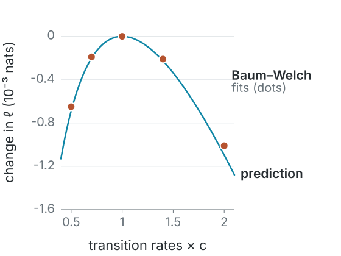

# What does a too-small HMM learn?

Literature review and first results

20/11/2026

Note:
- Side project that grew out of the HMM-RBM paper, started with Rémi on 23/10
- Main part of the talk: what the literature says, and where the gap is
- Then the plan (four limits), preliminary results, and Rémi's idea from last week

---

## Where the question comes from

- HMM-RBM fits of whole-brain zebrafish activity, $S = 2 \dots 128$ states
- Likelihood keeps improving with $S$: the true number of states is unknown, maybe infinite
- Small HMMs fitted to data from a big HMM still reproduce its spectrum of time scales

Every fit we report is <b>underfitted</b>. What does it represent?

Note:
- From the paper: no elbow in held-out likelihood; prediction time grows like log S
- Synthetic check from the paper: generate with the 1024-state model, refit with S ≤ 128, spectra look right
- So we need to know what an S-state model extracts from a richer process

---

## Looks alike, or behaves alike?

Fit $K = 2$ states to three true states: merge $\{a, b\}$ (cheap in emissions) or $\{a, c\}$ (cheap in dynamics)?

Note:
- Data from an HMM with K* states, fitted with K < K* states. Which true states get lumped, and what decides?
- a and b: emission means δ apart. c far away
- a and c swap quickly at rate κ; b is slow
- Merging a,b costs ~ π_b δ² in emissions, but the merged state mixes fast and slow behaviour: dwell times not geometric
- Merging a,c costs a lot in emissions but the merged state is clean in time
- A mixture model only sees emissions. An HMM has to trade the two

---

## Outline

1. **Literature**: clustering with too few clusters · misspecified HMMs · HMM model reduction
2. **The gap**, and a plan: four solvable limits
3. **Preliminary results** in each limit
4. **Rémi's idea**: annealed transfer matrices
5. Next steps

---

# 1 · Literature

What is known when the model is too small?

---

## Clustering: deterministic annealing

<ul style="font-size:0.66em;">
<li>Clustering as a physical system at temperature <i>T</i>: minimise the free energy <i>F</i> = <i>D</i> − <i>TH</i> (distortion − entropy of soft assignments)</li>
<li>High <i>T</i>: all centres coincide at the mean of the data — one effective cluster, however many centres are allowed</li>
<li>Cooling: clusters <b>split one at a time</b> at critical temperatures</li>
<li>A cluster splits when <i>T</i> = 2 λmax of its covariance, along the principal axis</li>
</ul>

Paper: Statistical mechanics and phase transitions in clustering | Rose, Gurewitz & Fox, *PRL*, 1990
Paper: Deterministic annealing for clustering, compression, classification, regression, and related optimization problems | Rose, *Proc. IEEE*, 1998

A fit with $K < K^\star$ clusters is a <b>hierarchy of splits stopped partway</b>.

Note:
- Optimal assignments are Gibbs: p(y|x) ∝ exp(−d(x,y)/T)
- First split of the whole dataset at T = 2 λ_max(Cov X)
- Mass-constrained version removes the dependence on how many centres start coincident
- Caveat: local stability argument, so a necessary condition; no proof that the low-T answer is the global optimum
- This is the picture we would like to have for HMMs: what replaces the covariance?

---

## Clustering: EM with too few components

<ul style="font-size:0.66em;">
<li>Fit a symmetric 2-component Gaussian mixture to data from <b>3 components</b> (1D)</li>
<li>Bounds on the <b>bias</b>: how far the fitted means sit from the true ones</li>
<li>Population EM contracts quickly to this biased fit; sample EM gets within ~ √(log(1/δ)/<i>n</i>)</li>
<li>Their simulations suggest the bounds are loose</li>
</ul>

Paper: Theoretical guarantees for EM under misspecified Gaussian mixture models | Dwivedi, Ho, Khamaru, Wainwright & Jordan, *NeurIPS*, 2018

They measure the <b>cost</b> of a merge. Which components merge is fixed in advance by the symmetric fit.

Note:
- Fitted model: ½N(−θ,σ²) + ½N(θ,σ²), σ known
- Case 1: two close components (separation ρ): bias ≤ ρ|θ*| + c(ρ|θ*|/σ)^(1/4)
- Case 2: small middle component of weight ω: bias ≤ c ω^(1/8) |θ*|^(1/4) / σ^(1/4)
- Simulations: true bias scales like ρ² and ω
- So this paper does not explain why a given merge happens

---

## Clustering: statistical physics in high dimension

<ul style="font-size:0.66em;">
<li>Below a critical number of samples per dimension, the estimated centres carry <b>no information</b> about the true ones (retarded learning)</li>
<li>Full phase diagrams for high-dimensional Gaussian mixtures: detectability thresholds, hard phases — with the <b>correct</b> number of clusters</li>
<li>Wrong assumed rank (≈ number of clusters): treated only recently</li>
</ul>

Paper: Statistical mechanics of the maximum-likelihood density estimation | Barkai & Sompolinsky, *PRE*, 1994
Paper: Phase transitions and optimal algorithms in high-dimensional Gaussian mixture clustering | Lesieur, De Bacco, Banks, Krzakala, Moore & Zdeborová, 2016
Paper: The role of rank in mismatched low-rank symmetric matrix estimation | Niu et al., arXiv, 2025

<b>Takeaway from clustering:</b> a too-small model converges to the closest model it can represent, i.e. it merges true clusters. Geometry decides which, and the change can be abrupt.

Note:
- Lesieur et al.: threshold ρ_c = K*/√α, first-order for K* > 4 + 2√α
- All of this is for i.i.d. labels: no dynamics
- Also: Pollard 1981 (consistency of k-means), Jin et al. 2016 (local maxima of the GMM likelihood) — from memory, not re-read

---

## What "best fit" means for a wrong HMM

$$\ell(\theta) = \mathbb{E}_{P^\star}\big[\log p_\theta(Y_0 \mid Y_{-1}, Y_{-2}, \dots)\big]$$

- With infinite data, ML picks the model closest to the truth in KL rate: the **KL projection**
- A property of the truth and the model family, not of a dataset
- The maximum-likelihood estimate converges to the maximisers of $\ell$, **even when the model is wrong**
- All the time structure lives in the conditioning on the past

Paper: Asymptotic properties of the maximum likelihood estimation in misspecified hidden Markov models | Douc & Moulines, *Ann. Stat.*, 2012

Note:
- ℓ is the average contribution of one step to the full log-likelihood, given the whole past
- Douc & Moulines: observations can be any stationary ergodic process; MLE → the *set* of maximisers; no CLT
- Caveats on "infinite data":
  - order of limits: infinite data first, then e.g. rare switches (n ε ≫ 1)
  - if the best fit wants a transition probability of exactly zero (plausible after a merge), it falls outside the theory, which needs transitions bounded away from zero
- Also Mevel & Finesso 2004

---

## Misspecified HMMs: what is known

<table style="font-size:0.5em;">
<thead><tr><th>Work</th><th>What it tells you</th><th>What it leaves open</th></tr></thead>
<tbody>
<tr><td>Douc & Moulines (2012); Mevel & Finesso (2004)</td><td>ML for a wrong HMM converges to the set of best fits</td><td>What the best fit looks like, uniqueness, which states merge</td></tr>
<tr><td>Gassiat & Boucheron (2003)</td><td>The chance of underestimating the number of states shrinks exponentially with data</td><td>What the underfitted model represents</td></tr>
<tr><td>Finesso, Grassi & Spreij (2006–08)</td><td>A computable stand-in for the KL rate between a process and an HMM</td><td>The exact best fit</td></tr>
<tr><td>"Phase transition for parameter learning of HMMs" (<i>PRE</i> 2021)</td><td>Learning breaks down sharply as noise increases</td><td>Uses the correct number of states</td></tr>
<tr><td>Pohle, Langrock, van Beest & Schmidt (2017)</td><td>In applications, information criteria pick too many states when the model is wrong</td><td>Theory</td></tr>
</tbody>
</table>

We know the fit <b>converges</b>. We do not know <b>to what</b>.

Note:
- Order estimation literature answers "how many states?", not "what does the small model mean?"
- Pohle et al.: practical counterpart of our situation — misspecified emissions get absorbed by extra states
- Lehéricy 2018: non-asymptotic control of the MLE for misspecified nonparametric HMMs

---

## HMM model reduction

<ul style="font-size:0.64em;">
<li><b>Aggregation</b>: given a partition of the states, the reduced model is the stationary-weighted average within each group; only the <b>partition</b> is optimised (KL rate)</li>
<li>Aggregating the joint state-and-observation process does not automatically give a valid HMM</li>
<li><b>Balanced truncation</b> for HMMs, and a lower bound on the error of <i>any</i> smaller model</li>
</ul>

Paper: A recursive learning algorithm for model reduction of hidden Markov models | Deng, Mehta, Meyn & Vidyasagar, *CDC-ECC*, 2011
Paper: Reduced-order modeling of Markov and hidden Markov processes via aggregation | Vidyasagar, *CDC*, 2010
Paper: Limits of performance for the model reduction problem of hidden Markov models | Kotsalis & Shamma, *CDC*, 2015

Optimisation <b>within a hand-built family</b> of aggregations — not the true best $K$-state HMM. Is the best fit an aggregation at all?

Note:
- Deng et al.: finite states and observations; ML over partitions is consistent; stochastic-approximation algorithm converges to a stationary point
- Closest work to ours, from the control community. Elicit search added these three
- Not yet read in full: Deng, Mehta & Meyn 2010; Vidyasagar 2010; Kotsalis & Shamma 2015 (check which error measure the bound uses)

---

## Why HMMs are harder than mixtures

- **Merging breaks the Markov property**: merge two clusters of a mixture → a mixture; merge two states of a Markov chain → usually not Markov (chains are rarely lumpable)
- **Emissions and dynamics compete**: states can look alike but behave differently, or the reverse
- **The objective has no formula**: the KL rate involves the entropy rate of a hidden Markov process

So the best $K$-state HMM may not be a merge at all: it could dedicate a state to "periods of switching", or split a state by dwell time.

Note:
- Heuristic: two states are hard to tell apart when they are predictively equivalent — similar observations now and similar distributions of future observations. A guide, not a theorem
- The absence of a closed form is probably why so few analytical results exist, and why limits where it simplifies are the way in

---

## The gap

Nobody characterises the best $K$-state HMM for data from a $K^\star$-state HMM: whether it merges true states, which ones, how the dynamics come into it, whether there are phase transitions.

- Searched: clustering with too few clusters, misspecified HMMs, order estimation, HMM model reduction, entropy-rate asymptotics, two-time-scale Markov chains, Markov-label mixtures, recent arXiv
- Independent check with Elicit: same conclusion
- To re-check once there is a first result

Note:
- The search was not exhaustive, especially for 2025–2026 preprints
- Also checked public AI-lab maths releases: nothing on HMMs, mixtures, misspecification or KL projections

---

# 2 · A plan

Four limits where the problem becomes solvable

---

## Four limits

Note:
- Strategy: find corners where ℓ(θ) simplifies enough to compute, solve there, connect the corners numerically
- x: how persistent the hidden states are; y: how much one frame tells you about its state
- From the 23/10 discussion with Rémi: n → ∞, T = I + εQ, T = 1π + εR, d → ∞, one-hot posteriors
- Our HMM-RBM fits sit in the high-dimension corner

---

## Tools the literature provides

<table style="font-size:0.5em;">
<thead><tr><th>Limit</th><th>Set-up</th><th>Expected behaviour</th><th>Tools</th></tr></thead>
<tbody>
<tr><td>1 · Fast switching</td><td>T = 1π + εR</td><td>Underfitted mixture; dynamics as a correction</td><td>Pouzo, Psaradakis & Sola (2025); Yin & Zhang (2007)</td></tr>
<tr><td>2 · Slow switching</td><td>T = I + εQ</td><td>Hard clustering of the emissions; dynamics at ε log(1/ε)</td><td>Peres & Quas (entropy rate, rare transitions); Zhang, Yin & Moore (2007); Noé et al. (2013)</td></tr>
<tr><td>3 · High SNR</td><td>separation grows with d</td><td>Geometry decides; dynamics break ties</td><td>Zuk, Domany, Kanter & Aizenman; Han & Marcus</td></tr>
<tr><td>4 · Proportional</td><td>separation ~ 1/√d, n ~ d</td><td>Geometry and dynamics both matter; phase transitions</td><td>Replica / AMP with a Markov prior: Ghasemian et al. (2016); Karagulyan & Ndaoud; Kadry & Zhang (2025); Truong</td></tr>
</tbody>
</table>

Note:
- Pouzo et al.: fitting an i.i.d. mixture to HMM data still recovers the emissions — the same-K version of limit 1
- Peres & Quas: entropy rate of HMMs with rare transitions, exactly the I + εQ form
- Noé et al.: hidden Markov state models in molecular dynamics — fast within groups, slow between
- Ghasemian et al.: detectability in dynamic networks, the graph analogue of limit 4
- Still to read in full: Peres & Quas; Pouzo et al.

---

# 3 · Preliminary results

Three weeks of derivations, with numerical checks. Not yet independently re-derived.

Note:
- Derivations done with Claude between 23/10 and 13/11; every statement was checked numerically (repo underfitted-hmm), but nothing has been re-derived by hand yet
- Treat formulas as conjectures with numerical support

---

## Preliminary · Fast switching: $T = \mathbf{1}\pi^\top + \varepsilon R$

- Leading order: a **mixture fit**; the memory is a second-order correction
- The fitted memory copies the lag-1 correlation of the posteriors; gain over the mixture:

$$\max_R \ell - \ell_{\text{mix}} = \tfrac12 \sum_i \rho_i^2 \qquad (\rho_i\text{: canonical correlations of consecutive posteriors})$$

If the truth is near-fast too:

$$T - \mathbf{1}\pi^\top = W\,\big(T^\star - \mathbf{1}\pi^{\star\top}\big)\,V$$

The fitted chain looks like the true chain seen through the fitted components: a <b>soft lumping</b>.

Footnote: Checked against the exact filter on small examples

Note:
- εR* = Φ⁻¹ Γ₁ Φ⁻¹ D_π: covariance / curvature of the posteriors
- W, V: membership matrices; hard lumping when components are separated
- With overlap, soft lumping differs from hard lumping by 5–25% in the example
- Open: near-tied mixture fits, multivariate emissions, finite data

---

## Preliminary · Slow switching: $T = I + \varepsilon Q$

Long runs: the filter locks onto one fitted state per true regime.

$$\ell_0 = -\sum_k \pi^\star_k H(f^\star_k) - \sum_k \pi^\star_k \min_s D_{\mathrm{KL}}\big(f^\star_k \,\|\, f_s\big)$$

- **Hard clustering of the regimes** in KL (Lloyd's algorithm with KL as distance)
- Fitted emission = mixture of its regimes
- Next order $\varepsilon\log(1/\varepsilon)$: detection cost of each switch; fitted $Q$ = **lumped generator**

Emissions decide the grouping. The lumped chain that Deng et al. <i>assumed</i> comes out of the expansion.

Note:
- Fast limit was a soft mixture; slow is hard assignment, like K-means
- Q_ss' = N_ss' / π*(C_s)
- Validity condition on the tail of the wrong-state belief (κ > ½); the case κ ≤ ½ is open
- The order-ε constant relates to Peres & Quas

--

## Slow limit: test on a 4-regime truth

<ul style="width:42%; font-size:0.6em;">
<li>Truth: 4 regimes, 6 symbols; fits with <i>K</i> = 2, 3 (Baum–Welch, 6 starts)</li>
<li>Predicted clustering always wins; emissions = cluster mixtures (±0.01)</li>
<li>Fitted <i>Q</i> = lumped generator within 2.4%</li>
<li>ℓ − ℓ₀ matches the expansion within 5%</li>
<li>BW local optima = fixed points of Lloyd on the regimes</li>
</ul>

Footnote: $\varepsilon = 0.01$, $K = 2$. Curve: $\varepsilon \Sigma N [\log c - (c-1)]$, no free parameter

Note:
- Scaling Q by c: maximum at c = 1 with the predicted curvature
- K = 3: two BW optima 0.027 apart = ℓ₀ gap between the two best clusterings

---

## Preliminary · High dimension: one frame decides

Prior moves log-odds by $O(1)$, one frame by $O(d)$ ⇒ filter one-hot on the decoded state $\hat s$:

$$\ell \approx \mathbb{E}\Big[\max_s \log f_s(Y)\Big] + \sum_{s,s'} N_{ss'} \log T_{ss'}, \qquad N_{ss'} = P^\star(\hat s_{-1} = s,\ \hat s_0 = s')$$

- Emissions: a static clustering of single frames
- Best $T$: decode each frame alone and **count transitions**
- What the dynamics buy: $\ell_{\text{HMM}} - \ell_{\text{mixture}} = I(\hat s_{-1}; \hat s_0) \le \log K$

Geometry decides; dynamics only break exact ties.

Note:
- First term: classification likelihood, order d. Second: decoded sequence scored as an observed Markov chain, order 1
- If the truth has regimes: ŝ = σ(regime), T = lumped T*
- Contrast with slow limit: there whole regimes were assigned; here single frames

--

## Test on the HMM-RBM fits

<ul style="width:48%; font-size:0.6em;">
<li>6 fish, <i>S</i> = 2…128</li>
<li>Filter one-hot (max > 0.99) on 97–99.8% of training frames</li>
<li>Gain over the mixture = <i>I</i>(ŝ₋₁; ŝ₀) within 0.01 for <i>S</i> = 4–16</li>
<li>Synthetic data (1024-state truth): each fitted state = a cluster of true states</li>
</ul>

Note:
- Our fits are deep in the high-dimension regime
- Formula error ≤ 0.03 nats up to S = 16, grows to 0.38 at S = 128: T has near-zero entries there
- Synthetic: ŝ is a function of the true state on 97–99.5% of frames

--

## A practical consequence for the paper

<ul style="width:36%; font-size:0.58em;">
<li>Counting decoded transitions gives a better held-out <i>T</i> than Baum–Welch at large <i>S</i></li>
<li>The held-out loss is in the <b>transitions</b>, not the emissions</li>
<li>Likely cause: BW pseudocount 10⁻⁹ — an unseen transition costs ≈ 20 nats</li>
</ul>

Footnote: Counted $T$: decoded transitions on training frames, pseudocount 0.01. Held-out frames, mean over 6 fish

Note:
- S = 128: BW −0.18 vs counted 1.62 nats/frame
- Per-neuron predictive power of the paper barely changes with the counted T: it is the likelihood that moves
- Pseudocount can be chosen by leave-one-out on the training counts

---

## Preliminary · Proportional regime

$N = \alpha d$ frames, separation $1/\sqrt d$ per coordinate

<ul style="font-size:0.62em;">
<li>One frame carries <i>O</i>(1) evidence: geometry, dynamics and estimation noise compete on equal terms</li>
<li>Detectability threshold lowered by the persistence λ of the labels (BBP at λ = 0)</li>
<li><i>K</i> = 2 < <i>K</i>* = 3: the best grouping seems to <b>switch abruptly</b> with α</li>
</ul>

The only corner where dynamics can change which states merge. Replica-symmetric and numerical so far.

Footnote: $\alpha_c \theta^2 = (1-\lambda^2)/(1+\lambda^2)$, same form as Ghasemian et al. (2016, *PRX*) for dynamic networks

Note:
- Exact reduction (Gaussian): ℓ = const + ℓ_K(M, G, T), a K-dimensional HMM objective in the overlaps
- AMP with a forward–backward denoiser; state evolution with a Markov prior
- Hard phase for K* = 10, widened by persistence (replica-symmetric free entropy)
- Grouping switch near α ≈ 0.75 in the AMP-EM example
- Heuristic: replica symmetry, Bayes-optimality of AMP with a Markov prior

---

## Preliminary picture

<table>
<thead><tr><th>Limit</th><th>What gets merged</th><th>Role of the dynamics</th></tr></thead>
<tbody>
<tr><td>Fast</td><td>mixture fit</td><td>soft lumping of the true chain</td></tr>
<tr><td>Slow</td><td>regimes, by KL</td><td>lumped generator, at ε log(1/ε)</td></tr>
<tr><td>High dimension</td><td>single frames</td><td>break exact ties</td></tr>
<tr><td>Proportional</td><td>depends on α</td><td>lower the threshold, can switch the grouping</td></tr>
</tbody>
</table>

So far the fit looks like a <b>lumping</b> of the truth, with emissions deciding the grouping — as in clustering. Dynamics compete only when one frame carries little evidence.

Note:
- Tentative answer to "looks alike vs behaves alike": mostly looks alike
- Matches the takeaway from the clustering literature, and gives Deng et al.'s aggregation a justification in the slow limit
- All of this is to be re-derived and written up properly

---

# 4 · Rémi's idea

A route to the general case (13/11)

---

## Annealed average and transfer matrix

Start with $S = 2$ as an easier first step, but look at the general case. Write

$$P(Y) = \sum_{s} \prod_t T_{s_t \to s_{t+1}}\, f_{s_t}(y_t)$$

and use $\mathbb{E}_\star[P(Y)]$ as a proxy for $\mathbb{E}_\star[\log P(Y)]$:

$$\mathbb{E}_\star[P(Y)] = \sum_Y P_\star(Y)\,P(Y) = \langle 1 |\, \tau^{L-1} | \rho_0 \rangle, \qquad \tau_{(x,x^\star) \to (y,y^\star)} = T^\star_{x^\star \to y^\star}\; T_{x \to y}\; M_{x,x^\star}$$
$$M_{s,s^\star} = \sum_y f_s(y)\, f^\star_{s^\star}(y) \quad \text{(overlap of fitted and true emissions)}$$

Maximising the likelihood ≈ maximising the <b>largest eigenvalue of $\tau$</b>, a matrix on pairs (fitted state, true state).

Note:
- τ acts on the joint chain of fitted and true hidden states; the observations are summed out into M
- For S = 2 at fixed M: eigenvalue equation, Rayleigh–Ritz, Perron–Frobenius
- Later: E*[P(Y)^n] with n → 0 (replicas) to get back the log

--

## First look at it

- The identity is exact, also for $n$ replicas: $\tau_n = (T^{\otimes n} \otimes T^\star) D_{M_n}$ (checked against brute force)
- Rate $\Lambda(n) = \log \rho(\tau_n)$ is convex, and $\ell = \Lambda'(0^+) \le \Lambda(n)/n$
- At $n = 1$ the true path can be **bent** towards high overlap at a finite price per step
  - separated emissions: the optimal $T$ is deterministic
- The price of an atypical true path scales as $1/n$

$n = 1$ is tractable but answers a different question. The $n \to 0$ limit is what pins the true path to typical sequences.

Note:
- Λ(1) ≈ ℓ + ½ Var: the annealed objective rewards parameters for which log P(Y) fluctuates
- Variational (Donsker–Varadhan) form gives an "annealed Baum–Welch" that increases ρ monotonically
- Separated emissions, S = S*: optimal T runs around the best cycle of T* (T = I if T* is diagonally dominant)
- ℓ = Λ'(0) needs regularity not checked here; the n → 0 continuation is the replica assumption
- Next: replica-symmetric ansatz at small n, S = 2

---

## Next steps

- Read in full: Peres & Quas; Deng, Mehta & Meyn (2010); Kotsalis & Shamma (2015); Pouzo, Psaradakis & Sola (2025)
- Re-derive the fast and slow expansions by hand
- The toy model $(\delta, \kappa, \varepsilon)$: map numerically which merge wins between the corners
- Rémi's route: $S = 2$, then $n \to 0$
- Side result: spectral learning with rank $K < K^\star$ (closed form, compare with ML)

For the HMM-RBM paper: counted $T$ with a leave-one-out pseudocount

Note:
- Spectral methods (Hsu, Kakade & Zhang): truncated SVD of the Hankel matrix; at rank K < K* the infinite-data answer is linear algebra. May explain why small HMMs reproduce the spectrum
- Later: Rose-style stability analysis of the one-state solution — conjecture that the first split involves the autocovariance, not only the variance
